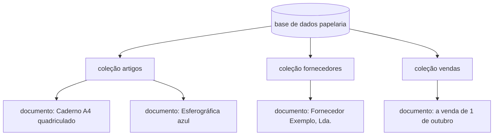
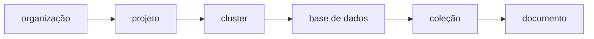
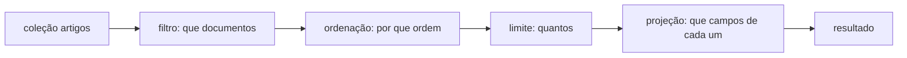
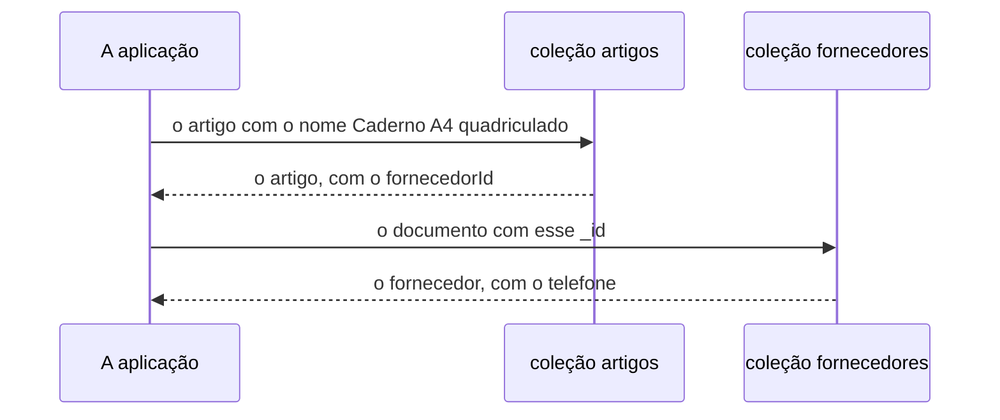
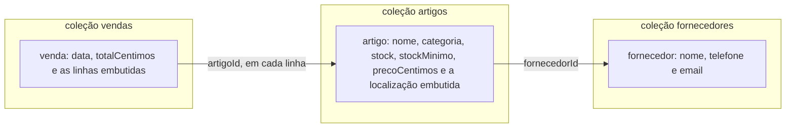

# Modelo documental e primeiras consultas no Atlas

Neste guia vês como o MongoDB guarda a informação de uma aplicação: em documentos parecidos com os objetos de JavaScript, arrumados em coleções. Aprendes a fazer-lhe perguntas no MongoDB Atlas, pelo browser, e a decidir o que fica dentro de cada documento e o que fica noutro, ligado por uma referência.

Usa os objetos, os métodos dos arrays e o JSON do 11.º ano, e as tabelas do SQL que aprendeste com o MariaDB. Rever: [Objetos e `this`: o que é um objeto](https://github.com/NunoMACastro/edu-docs-2ig-js-guias-2526/blob/8cf6ade3cf3d4508ea0fb4fbc5b2bedb29869a8f/JavaScript/08-Objetos-e-this.md#0-o-que-é-um-objeto), [Funções de alto nível em arrays: o `filter`](https://github.com/NunoMACastro/edu-docs-2ig-js-guias-2526/blob/8cf6ade3cf3d4508ea0fb4fbc5b2bedb29869a8f/JavaScript/11-Arrays-HighOrder.md#2-filter---selecionar) e [Objetos e `this`: JSON rápido](https://github.com/NunoMACastro/edu-docs-2ig-js-guias-2526/blob/8cf6ade3cf3d4508ea0fb4fbc5b2bedb29869a8f/JavaScript/08-Objetos-e-this.md#6-json-rápido). Para praticar: [laboratório](laboratorios/02-modelo-documental-e-consultas-no-atlas-laboratorio.md) e [ficha de exercícios](exercicios/02-modelo-documental-e-consultas-no-atlas-exercicios.md).

## Neste guia

1. [Parte 1: A informação guarda-se em documentos](#parte-1-a-informação-guarda-se-em-documentos)
2. [Parte 2: As consultas no Atlas](#parte-2-as-consultas-no-atlas)
3. [Parte 3: Desenhar os documentos de uma aplicação](#parte-3-desenhar-os-documentos-de-uma-aplicação)
4. [Exemplo guiado: modelar o inventário da papelaria](#exemplo-guiado-modelar-o-inventário-da-papelaria)

## Parte 1: A informação guarda-se em documentos

### Uma aplicação guarda os dados numa base de dados

Um array de objetos vive na memória do computador enquanto o programa está a correr. Quando o programa termina, ou o computador se desliga, os dados desaparecem. Numa papelaria, o stock de ontem tem de estar lá amanhã.

Um ficheiro JSON guarda os dados, e chega para um programa pequeno, usado por uma pessoa. Mas imagina a papelaria da escola com três funcionários a vender ao mesmo tempo, em três computadores. Se dois programas escreverem no mesmo ficheiro ao mesmo tempo, um apaga o trabalho do outro. Com dez mil artigos, encontrar os que têm pouco stock obriga a ler o ficheiro inteiro de cada vez. E se o computador se desligar a meio de uma escrita, o ficheiro pode ficar estragado.

Por isso, a aplicação não guarda os dados ela própria. Pede a um programa especializado que os guarde e que lhe responda ao que precisa de saber, depressa e com muitos utilizadores ao mesmo tempo. É o que faz o MariaDB, com que aprendeste SQL. Um programa destes corre num servidor, um computador sempre ligado que presta um serviço a outros computadores pela rede.

O MariaDB guarda a informação em tabelas. O MongoDB guarda-a em documentos.

Este ano vais usar o MongoDB Atlas, que é o MongoDB a funcionar na **nuvem** (em inglês, *cloud*). Quer dizer que corre em servidores de um centro de dados da empresa que o faz, a que chegas pela internet. Crias a base de dados numa página web, e a empresa trata de a manter ligada e protegida.

### O MongoDB guarda a informação em documentos

No 11.º ano, um objeto de JavaScript juntava várias informações sobre a mesma coisa, cada uma com um nome. Este objeto descreve um artigo de uma papelaria:

```js
const artigo = {
  nome: 'Caderno A4 quadriculado',
  categoria: 'Papel',
  stock: 12,
  precoCentimos: 250,
};
```

O preço está em cêntimos, num número inteiro: `250` quer dizer 2,50 €. Os números com casas decimais nem sempre dão contas exatas no computador, e com dinheiro um cêntimo a mais ou a menos é um erro a sério.

Um **documento** tem a forma de um objeto de JavaScript. É um conjunto de pares nome e valor que descreve uma coisa, como um artigo, um fornecedor ou uma venda. Num documento, cada par chama-se um campo, e não uma propriedade. O artigo acima, guardado no MongoDB, é um documento com quatro campos. Por guardar a informação em documentos, diz-se que o MongoDB segue o **modelo documental**.

Em JSON, o mesmo artigo fica quase igual, com aspas duplas nos nomes e sem a vírgula do fim: `{ "nome": "Caderno A4 quadriculado", "categoria": "Papel", "stock": 12, "precoCentimos": 250 }`.

### Uma coleção junta os documentos do mesmo tipo

Uma **coleção** é um conjunto de documentos do mesmo tipo. Os artigos da papelaria ficam na coleção `artigos`, os fornecedores na coleção `fornecedores` e as vendas na coleção `vendas`. No MongoDB, uma base de dados é um conjunto de coleções da mesma aplicação, e a base de dados `papelaria` junta as três.



O diagrama mostra a base de dados `papelaria` com as suas três coleções, e alguns documentos em cada uma. Pensa num arquivo em papel. Cada documento é uma ficha preenchida, cada coleção é a gaveta das fichas do mesmo tipo, e a base de dados é o armário.

### O campo `_id` e o ObjectId

Cada documento de uma coleção tem obrigatoriamente um campo `_id`, com um valor diferente do de todos os outros documentos da coleção. É ele que distingue dois documentos, mesmo que tenham os mesmos campos, como dois artigos com o mesmo nome.

Se inserires um documento sem `_id`, o MongoDB cria um, do tipo **ObjectId**. Um ObjectId escreve-se com 24 carateres, só com algarismos de 0 a 9 e letras de `a` a `f`, como em `ObjectId('66fb1c2a9d3e4f5a6b7c8d01')`. Na prática, dois ObjectId nunca saem iguais, mesmo criados ao mesmo tempo em computadores diferentes. Por isso não inventas valores de `_id` à mão: deixas o MongoDB criá-los e usas os que ele criou.

Prevê: se inserires o mesmo artigo duas vezes, sem `_id`, a coleção fica com um documento ou com dois?

Fica com dois, cada um com o seu `_id`. Para o MongoDB não são repetidos. São dois documentos diferentes que, por acaso, têm os mesmos campos.

<details>
<summary>Para ires mais longe: os 12 bytes de um ObjectId</summary>

Por dentro, um ObjectId tem 12 bytes, e um byte é a unidade de memória que guarda um número de 0 a 255. Os primeiros 4 bytes guardam o momento em que o ObjectId foi criado, em segundos contados desde 1 de janeiro de 1970. Os 5 seguintes são um valor aleatório do programa que o criou. Os últimos 3 são um contador, que sobe de cada vez. É esta combinação que torna praticamente impossível que dois saiam iguais.

Cada byte escreve-se com dois carateres em hexadecimal, o sistema de base 16. Aos algarismos de 0 a 9 juntam-se as letras de `a` a `f`, que valem de 10 a 15. Dois símbolos dão 16 vezes 16 valores, ou seja 256, exatamente os de um byte. Doze bytes, a dois carateres cada um, dão os 24 carateres, e nunca aparece um `g` ou um `z`.

</details>

### Um documento guarda tipos que o JSON não tem

Em JSON, uma data é só texto, como `"2026-10-01"`. O computador não a trata como uma data. Não sabe contar os dias entre duas vendas, nem sabe que "1/10/2026" e "2026-10-01" são o mesmo dia.

O MongoDB não guarda os documentos como texto. Guarda-os em **BSON**, um formato binário, feito para o computador ler e escrever depressa, e não para uma pessoa ler. É o Atlas que te mostra cada documento com a forma de um objeto.

O BSON tem mais tipos de valores do que o JSON, e um deles é a data, que se compara e ordena como uma data. Na janela do Atlas onde se inserem documentos, uma data escreve-se assim: `ISODate('2026-10-01T10:15:00Z')`. O ObjectId é outro desses tipos. Quando vires `ISODate(...)` ou `ObjectId(...)`, é a forma de dizer ao MongoDB que o valor tem um tipo especial, e não é um simples texto.

O texto dentro do `ISODate(...)` lê-se do maior para o mais pequeno. Primeiro vêm o ano, o mês e o dia: `2026-10-01` é 1 de outubro de 2026. Depois vem a letra `T`, que só separa a data da hora, e por fim a hora, `10:15:00`. O `Z` do fim diz que a hora está em **UTC**, a hora de referência usada no mundo inteiro. Em Portugal continental, na hora de inverno, a hora é a do UTC. Na hora de verão, do fim de março ao fim de outubro, é mais uma: a 1 de outubro, `10:15` em UTC são 11:15 em Lisboa.

<details>
<summary>Para ires mais longe: porque se guardam as horas em UTC</summary>

Com as horas em UTC, não há confusões quando a hora muda entre o verão e o inverno, nem quando a aplicação é usada noutro país. É a aplicação que converte para a hora local quando a mostra. A forma de escrever a data e a hora, do ano aos segundos, segue uma norma internacional, a ISO 8601, que dá o nome ao `ISODate`.

</details>

### Os documentos de uma coleção não têm de ser iguais

Numa tabela do MariaDB, todas as linhas têm as mesmas colunas. No MongoDB, dois documentos da mesma coleção podem ter campos diferentes: um artigo pode ter um campo `cor`, e outro não. Diz-se que o MongoDB tem um **esquema flexível**.

Dá jeito quando os dados variam de verdade, mas também é um perigo. Se escreveres `categria` em vez de `categoria` num documento, o MongoDB aceita-o sem avisar, porque para ele é só outro campo. Depois, quando procurares os artigos de uma categoria, esse documento não aparece, e nenhuma mensagem de erro te avisa.

Manter os documentos coerentes fica a cargo de quem os escreve. Por agora és tu, à mão; numa aplicação, é o código dela. A regra é escrever os documentos de uma coleção sempre com os mesmos nomes de campos e os mesmos tipos.

### A coleção é a tabela, e o documento é a linha

O SQL que aprendeste com o MariaDB usa uma base de dados relacional, feita de tabelas. O MongoDB é uma base de dados não relacional, mas quase todas as ideias têm par:

| MariaDB (tabelas) | MongoDB (documentos) |
| --- | --- |
| Tabela | Coleção |
| Linha | Documento |
| Coluna | Campo |
| Chave primária | Campo `_id` |
| A informação relacionada fica noutra tabela e junta-se numa consulta | A informação relacionada pode ficar dentro do próprio documento |

A última linha é a maior diferença entre as duas. No MongoDB, quem desenha os documentos decide o que fica dentro de cada um.

### No Atlas, cada aluno tem o seu cluster

No Atlas, as bases de dados vivem num **cluster**: o conjunto de servidores onde o MongoDB está a correr. O cluster fica dentro de um projeto, e o projeto dentro de uma organização. O projeto e a organização são as pastas do Atlas, que arrumam clusters e dizem quem lhes pode aceder.



O diagrama mostra os seis níveis, do maior para o mais pequeno, cada um dentro do anterior.

Uma **ligação** é o canal que um programa abre para falar com a base de dados, como faz a tua aplicação quando está a correr. Este ano usas o plano gratuito, com um cluster gratuito por projeto. Os limites dele chegam folgadamente: 0,5 GB de dados, 500 ligações ao mesmo tempo e 100 operações por segundo. Uma operação é cada pedido de um programa à base de dados, como inserir um documento ou fazer uma consulta. Se o cluster passar 30 dias sem nenhuma ligação, o Atlas põe-no em pausa, o que pode acontecer nas férias.

Na turma, cada um cria a sua conta, o seu projeto e o seu cluster. Assim, os teus dados são só teus, ninguém os estraga por engano, e o mesmo cluster serve para o resto do ano. Para o professor acompanhar o teu trabalho, dás-lhe acesso de leitura ao teu projeto. Os passos estão no [laboratório](laboratorios/02-modelo-documental-e-consultas-no-atlas-laboratorio.md).

<details>
<summary>Para ires mais longe: um cluster tem três servidores</summary>

A palavra cluster quer dizer agrupamento. No plano gratuito, o Atlas guarda os mesmos dados em três servidores ao mesmo tempo, com cópias iguais. Se um deles avariar, os outros continuam a responder, e não se perde nada. Pela página do Atlas isto não se vê: o cluster funciona como se fosse um só servidor.

</details>

## Parte 2: As consultas no Atlas

No Atlas, as perguntas à base de dados escrevem-se na barra de consulta do Data Explorer, a página onde vês as coleções e os documentos. A barra fica por cima da lista dos documentos.

Os exemplos desta parte usam os oito artigos da papelaria que inseres no início do laboratório, antes de lhes juntares um nono. Cada artigo tem o nome, a categoria, o stock, o stock mínimo, o preço em cêntimos e a localização, que diz o corredor e a prateleira onde está arrumado. O stock mínimo é o número de unidades abaixo do qual é preciso encomendar mais.

| Artigo | Categoria | Stock | Stock mínimo | Preço (cêntimos) | Corredor e prateleira |
| --- | --- | ---: | ---: | ---: | --- |
| Caderno A4 quadriculado | Papel | 12 | 5 | 250 | A, 1 |
| Esferográfica azul | Escrita | 3 | 10 | 60 | B, 1 |
| Bloco de notas A5 | Papel | 0 | 4 | 180 | A, 2 |
| Lápis HB | Escrita | 25 | 10 | 35 | B, 1 |
| Resma de papel A4 | Papel | 4 | 3 | 520 | A, 3 |
| Marcador fluorescente | Escrita | 8 | 10 | 95 | B, 2 |
| Régua de 30 cm | Desenho | 6 | 3 | 120 | C, 1 |
| Compasso escolar | Desenho | 1 | 2 | 450 | C, 1 |

Cada linha da tabela é um documento da coleção `artigos`, com a localização guardada dentro dele. A primeira linha é este documento:

```js
{ nome: "Caderno A4 quadriculado", categoria: "Papel", stock: 12, stockMinimo: 5, precoCentimos: 250, localizacao: { corredor: "A", prateleira: 1 } }
```

### Um filtro escolhe os documentos

Até aqui, a papelaria vê todos os artigos. Mas quem lá trabalha quer só alguns, como os de papel. Pedir informação a uma base de dados é fazer uma **consulta**. No MongoDB, a consulta diz que documentos queres com um **filtro**: um documento com as condições que eles têm de cumprir, escrito com a forma de um objeto de JavaScript.

O filtro faz o mesmo que o `filter` de um array. A diferença é onde se faz o trabalho. Com o array, o programa tem primeiro de receber todos os artigos, e só depois os percorre. Com o filtro, só os documentos que interessam saem da base de dados. Com oito artigos não se nota, mas com cem mil já se sente.

O filtro mais simples pede os documentos em que um campo tem um valor exato. Prevê, com a tabela dos oito artigos: que artigos devolve este filtro?

```js
{ categoria: "Papel" }
```

Devolve três: o Caderno A4 quadriculado, o Bloco de notas A5 e a Resma de papel A4. O filtro lê-se "os documentos cujo campo `categoria` é igual a `Papel`".

O MongoDB compara o texto exatamente como está escrito. Por isso `{ categoria: "papel" }`, com minúscula, não encontra nenhum artigo, e não dá erro. Para a base de dados, `papel` e `Papel` são textos diferentes, e uma consulta que não encontra nada dá uma resposta vazia.

O filtro vazio, `{}`, não tem condições, e todos os documentos o cumprem. Usa-se quando queres todos os documentos, por exemplo para os ordenar. Na barra de consulta, deixar o filtro em branco é o mesmo que escrever `{}`.

### Um operador compara um campo com um valor

Para encontrar os artigos com pouco stock, a igualdade não chega, porque a pergunta é "menor do que". Para isso usa-se um **operador**, uma palavra começada por `$`, escrita como um documento dentro do filtro. Prevê quais dos oito artigos têm menos de 5 unidades, com este filtro:

```js
{ stock: { $lt: 5 } }
```

Devolve quatro: a Esferográfica azul (3), o Bloco de notas A5 (0), a Resma de papel A4 (4) e o Compasso escolar (1). O filtro lê-se "stock menor do que 5". O `$` é o que diz ao MongoDB que `lt` é um operador, e não o nome de um campo.

Os operadores de comparação mais usados são estes. Os nomes são abreviaturas do inglês, e saber de onde vêm ajuda a não os trocar:

| Operador | Significado | Vem de | Exemplo |
| --- | --- | --- | --- |
| `$eq` | igual a | *equal* | `{ stock: { $eq: 0 } }` |
| `$ne` | diferente de | *not equal* | `{ categoria: { $ne: "Papel" } }` |
| `$gt` | maior do que | *greater than* | `{ stock: { $gt: 10 } }` |
| `$gte` | maior ou igual a | *greater than or equal* | `{ stock: { $gte: 10 } }` |
| `$lt` | menor do que | *less than* | `{ stock: { $lt: 5 } }` |
| `$lte` | menor ou igual a | *less than or equal* | `{ stock: { $lte: 5 } }` |
| `$in` | igual a um dos valores da lista | *in*, em | `{ categoria: { $in: ["Papel", "Desenho"] } }` |

O `$eq` quase nunca se escreve, porque `{ stock: 0 }` quer dizer o mesmo que `{ stock: { $eq: 0 } }`.

Ter ou não ter o igual só se nota na fronteira, e é aí que nascem muitos erros. `{ stock: { $lt: 5 } }` deixa de fora um artigo com exatamente 5 unidades, e `{ stock: { $lte: 5 } }` inclui-o. Com os oito artigos, os dois filtros dão o mesmo resultado, porque nenhum tem 5 unidades. No dia em que um artigo tiver 5, já não dão. Antes de escolheres o operador, pergunta-te se o valor da fronteira deve aparecer no resultado.

O `$in` recebe uma lista, entre parênteses retos, como um array. O filtro `{ categoria: { $in: ["Papel", "Desenho"] } }` lê-se "categoria é Papel ou Desenho", e um documento aparece se o campo for igual a qualquer um dos valores. Devolve cinco artigos: os três de papel e os dois de desenho.

### Todas as condições de um filtro têm de se cumprir

Quando o filtro tem vários campos, um documento só aparece se cumprir todas as condições. Prevê quantos artigos aparecem com este filtro, e quais.

```js
{ categoria: "Escrita", stock: { $lt: 10 } }
```

Devolve dois: a Esferográfica azul (3) e o Marcador fluorescente (8). O filtro lê-se "categoria Escrita e stock menor do que 10". O Lápis HB é de escrita, mas as suas 25 unidades deixam-no de fora, porque cumpre a primeira condição e não a segunda. Quem esperava sete artigos leu o filtro como "ou", com todos os de escrita e mais todos os que têm menos de 10.

Dois operadores no mesmo campo também se cumprem os dois, e é assim que se pede um intervalo:

```js
{ precoCentimos: { $gte: 100, $lte: 300 } }
```

O filtro lê-se "preço maior ou igual a 100 cêntimos e menor ou igual a 300", ou seja, entre 1,00 € e 3,00 €, com as duas fronteiras incluídas. Devolve três artigos: o Caderno A4 quadriculado (250), o Bloco de notas A5 (180) e a Régua de 30 cm (120).

### Um campo embutido escreve-se com um ponto

A localização de cada artigo é um documento guardado dentro do artigo, com o corredor e a prateleira. A um documento dentro de outro chama-se **documento embutido**. É como um objeto dentro de outro, em JavaScript: se o documento do caderno estivesse numa variável `caderno`, `caderno.localizacao.corredor` dava `"A"`.

Num filtro, chega-se a um campo de um documento embutido da mesma forma, com o nome dos dois campos ligados por um ponto:

```js
{ "localizacao.corredor": "C" }
```

Devolve os dois artigos do corredor C: a Régua de 30 cm e o Compasso escolar. O nome fica entre aspas porque tem um ponto no meio. Sem as aspas, não é um nome válido num objeto de JavaScript, e a barra de consulta recusa o filtro.

Prevê: e se escreveres só `{ corredor: "C" }`?

A consulta volta vazia, e sem erro. Nenhum artigo tem um campo `corredor` no nível de cima, porque o corredor está dentro de `localizacao`.

### A projeção escolhe os campos

Cada documento do resultado aparece com todos os campos, mas para uma lista de encomendas chegam o nome e o stock. A **projeção** diz que campos aparecem. É um documento em que cada campo recebe `1`, para aparecer, ou `0`, para ficar escondido. Faz o mesmo que um `map` que fica só com alguns campos de cada objeto. Prevê: com o filtro `{ stock: { $lt: 5 } }` e esta projeção, o que aparece?

```js
{ nome: 1, stock: 1, _id: 0 }
```

Aparecem os mesmos quatro artigos do filtro, cada um só com o nome e o stock, como `{ nome: "Esferográfica azul", stock: 3 }`. A projeção não muda que documentos aparecem, porque isso é trabalho do filtro. Muda só o que se vê de cada um. O `_id` aparece sempre, a não ser que o escondas com `_id: 0`.

Numa projeção não se misturam campos a mostrar com campos a esconder. A projeção `{ nome: 1, stock: 0 }` dá o erro `Cannot do exclusion on field stock in inclusion projection`, que quer dizer "não se pode esconder o campo stock numa projeção de campos a mostrar". Os dois modos dizem coisas opostas sobre os campos que não escreveste: com `1`, ficam escondidos, e com `0`, aparecem. Misturados, o MongoDB não saberia o que fazer a um campo como `categoria`, e por isso recusa a projeção. A exceção é o `_id: 0`, porque o `_id` aparece sempre, e escondê-lo é tão frequente que o MongoDB o deixa fazer.

### Ordenar e depois limitar

Para saber os três artigos mais caros, é preciso pôr os artigos por ordem de preço e ficar só com os primeiros. A **ordenação** é um documento em que cada campo recebe `1`, para ordem crescente, ou `-1`, para ordem decrescente, como o `sort` de um array. O **limite** é o número máximo de documentos do resultado, como o `slice(0, n)`, que fica só com os primeiros `n` elementos. Prevê: com o filtro vazio, esta ordenação e o limite 3, que artigos aparecem, e por que ordem?

```js
{ precoCentimos: -1 }
```

Aparecem a Resma de papel A4 (520), o Compasso escolar (450) e o Caderno A4 quadriculado (250), do mais caro para o mais barato. O limite aplica-se depois de ordenar: a ordenação põe os oito do preço maior para o menor, e o limite fica com os três primeiros dessa ordem. Sem a ordenação, o limite ficava com três artigos quaisquer.



O diagrama mostra o caminho de uma consulta com as quatro partes. O filtro escolhe os documentos, a ordenação põe-nos por ordem e o limite fica com os primeiros. Só no fim a projeção escolhe os campos que se veem.

### A pergunta que a barra de consulta não faz

"Que artigos estão abaixo do stock mínimo?" parece uma pergunta como as outras, mas os operadores desta parte não chegam para ela. Os operadores comparam um campo com um valor escrito no filtro, e esta pergunta compara dois campos do mesmo documento, o `stock` e o `stockMinimo`. No MongoDB, isso faz-se com o operador `$expr`, que a barra de consulta do Atlas não aceita. No laboratório, respondes-lhe à mão, com a tabela dos artigos; numa aplicação, responde-lhe o código.

## Parte 3: Desenhar os documentos de uma aplicação

Já sabes como é um documento e como se pergunta por ele. Falta decidir a forma dos documentos de uma aplicação: o que fica dentro de cada um e o que fica noutro.

### A informação relacionada embute-se ou referencia-se

Um artigo tem uma localização e um fornecedor. Quando uma informação está relacionada com outra, o MongoDB deixa escolher entre duas formas de a guardar.

**Embutir** é guardar a informação dentro do próprio documento, como um [documento embutido](#um-campo-embutido-escreve-se-com-um-ponto). É o que a papelaria faz com a localização do artigo:

```js
{
  nome: "Caderno A4 quadriculado",
  categoria: "Papel",
  localizacao: { corredor: "A", prateleira: 1 }
}
```

Também se pode embutir um array de documentos. Uma venda tem as suas linhas, que são o que aparece em cada linha do talão: que artigo se vendeu, quantas unidades e a que preço. Uma venda de três artigos diferentes tem três linhas, e cada linha é um pequeno documento dentro do array.

**Referenciar** é guardar a informação num documento à parte, noutra coleção, e guardar no primeiro documento só o `_id` do segundo. O fornecedor de um artigo fica na coleção `fornecedores`, e o artigo guarda só o identificador dele:

```js
{
  nome: "Caderno A4 quadriculado",
  categoria: "Papel",
  fornecedorId: ObjectId('66fb1c2a9d3e4f5a6b7c8d01')
}
```

### Seguir uma referência pede uma segunda consulta

O campo `fornecedorId` é uma **referência**: guarda o `_id` de outro documento. O nome segue uma convenção, o nome da coisa referida seguido de `Id`. O MongoDB aceitaria outro nome, mas este diz logo a quem lê que o valor é o `_id` de um fornecedor, a procurar na coleção `fornecedores`.

Ler uma referência obriga a um passo a mais. Com os filtros que já conheces, mostrar o artigo com o telefone do fornecedor pede duas consultas, e a isto chama-se **seguir a referência**. Primeiro lê o artigo, e encontra nele o `fornecedorId`. Depois procura, na coleção `fornecedores`, o documento cujo `_id` é igual a esse valor.



O diagrama mostra as duas consultas, uma em cada coleção. A segunda só se pode fazer com o valor que a primeira devolveu, e é esse o preço de referenciar.

A pergunta também se faz ao contrário. Para saber que artigos tem um fornecedor, procuram-se na coleção `artigos` os documentos cujo `fornecedorId` é igual ao `_id` desse fornecedor. É esta a consulta que fazes no laboratório.

<details>
<summary>Para ires mais longe: seguir a referência numa só operação</summary>

O MongoDB também consegue juntar o artigo e o fornecedor numa só operação, como o `JOIN` do SQL. Faz-se com uma agregação e o operador `$lookup`, que a barra de consulta não aceita. Por isso, na barra de consulta, seguir uma referência pede sempre as duas consultas.

</details>

### Duas perguntas decidem entre embutir e referenciar

Para decidir, faz duas perguntas sobre a informação: "que ecrã vai ler estes dados?" e "que dados mudam ao mesmo tempo?".

Da primeira pergunta vem a regra de embutir. Se a informação aparece sempre no ecrã que mostra o documento, e não cresce sem limite, embute-se. A localização aparece sempre que se mostra o artigo, e cada artigo tem uma só. Com ela embutida, basta ler o artigo para o ecrã ter tudo o que mostra.

Da segunda pergunta vem a regra de referenciar. Se a informação muda sem que o documento mude, ou se é a mesma em muitos documentos e teria de mudar em todos ao mesmo tempo, referencia-se. O mesmo fornecedor fornece dezenas de artigos. Se o contacto dele estivesse embutido em cada artigo e mudasse, tinhas de o alterar em dezenas de sítios, e bastava esquecer um para a informação ficar contraditória. Referenciado, o contacto fica num só documento e muda-se uma vez.

A condição de não crescer sem limite tem uma razão concreta: um documento não pode passar de 16 MiB, um pouco mais de 16 MB. Nenhum artigo chega perto disso, mas uma lista que cresce sempre, como todas as vendas de um artigo desde que a papelaria abriu, acabava por chegar. Uma lista assim nunca se embute, e cada venda é um documento da coleção `vendas`.

Nenhuma das duas formas é sempre a melhor. Decide-se informação a informação, com as duas perguntas.

### Uma venda guarda uma cópia do preço, de propósito

Numa venda, cada linha diz que artigo se vendeu, e podia guardar só a referência ao artigo. Mas imagina que, em janeiro, o preço do caderno sobe de 2,50 € para 2,80 €. As vendas de outubro passavam a mostrar o preço novo, e a faturação de outubro deixava de bater certo.

Por isso, cada linha da venda guarda a referência ao artigo e também uma cópia do nome e do preço no momento da venda. A cópia é o registo do que aconteceu nesse dia, e esse registo não deve mudar quando o artigo muda.

### O MongoDB não verifica as referências

Quando um artigo guarda um `fornecedorId`, o MongoDB não confirma que existe mesmo um fornecedor com esse `_id`, e aceita qualquer ObjectId. Se um fornecedor for apagado, os artigos que o referiam continuam a apontar para um documento que já não existe.

No MariaDB, uma chave estrangeira impede uma referência destas. No MongoDB, é a aplicação que tem de confirmar que o documento referido existe, antes de guardar a referência. É também ela que decide o que acontece às referências quando um documento é apagado. No laboratório, vês o MongoDB aceitar uma referência que não leva a lado nenhum.

### Um modelo desenha-se a partir das perguntas

Um bom modelo não se desenha a pensar nas coisas que existem, mas nas perguntas a que a aplicação vai ter de responder. O método tem cinco passos:

1. Escrever as perguntas que a aplicação tem de responder, tal como quem a usa as faria.
2. Para cada pergunta, identificar a informação necessária.
3. Agrupar essa informação em coleções, uma por tipo de coisa.
4. Para cada informação relacionada, decidir se se embute ou se se referencia, com [as duas perguntas](#duas-perguntas-decidem-entre-embutir-e-referenciar).
5. Escrever um documento de exemplo de cada coleção e confirmar, pergunta a pergunta, que a resposta está lá.

O quinto passo é o mais esquecido e o que apanha os modelos errados. Um modelo que não responde a uma das perguntas está errado, por mais arrumado que pareça.

## Exemplo guiado: modelar o inventário da papelaria

A papelaria da escola quer uma aplicação para gerir o stock e as vendas. Vamos seguir os cinco passos.

### Passo 1: as perguntas

Depois de falar com quem trabalha na papelaria, chegámos a estas perguntas:

1. Que artigos há de uma dada categoria (papel, escrita, desenho)?
2. Que artigos têm pouco stock?
3. Que artigos estão abaixo do stock mínimo e precisam de ser encomendados?
4. Onde está arrumado um artigo?
5. Quem fornece um artigo, e qual é o contacto desse fornecedor?
6. O que se vendeu num dia, e quanto se faturou?

### Passo 2: a informação de que cada pergunta precisa

As perguntas 1 e 2 precisam da categoria e do stock de cada artigo. A pergunta 3 precisa de mais uma informação: o stock mínimo de cada artigo, abaixo do qual é preciso encomendar.

"Pouco stock" e "abaixo do mínimo" são perguntas diferentes. Cinco esferográficas são poucas, porque o mínimo delas é 10, e cinco compassos são muitos, porque o mínimo é 2. O mínimo depende do artigo, e por isso tem de ficar guardado em cada artigo. É também por isso que esta pergunta compara dois campos de cada artigo, como viste em [A pergunta que a barra de consulta não faz](#a-pergunta-que-a-barra-de-consulta-não-faz).

A pergunta 4 precisa do corredor e da prateleira. A pergunta 5 precisa do nome e do contacto do fornecedor. A pergunta 6 precisa da data de cada venda, dos artigos vendidos, das quantidades e dos preços.

### Passo 3: as coleções

Há três tipos de coisas: artigos, fornecedores e vendas. Ficam três coleções: `artigos`, `fornecedores` e `vendas`.

### Passo 4: embutir ou referenciar

A localização do artigo embute-se no artigo. É sempre lida com o artigo, cada artigo tem uma só, e não cresce.

O fornecedor referencia-se a partir do artigo. Um fornecedor fornece muitos artigos, e o seu contacto muda sem que os artigos mudem.

As linhas de uma venda embutem-se na venda. São sempre lidas com a venda, pertencem só àquela venda, e uma venda tem um número limitado de linhas. Cada linha referencia o artigo vendido e guarda uma cópia do nome e do preço no momento da venda. A razão está em [Uma venda guarda uma cópia do preço, de propósito](#uma-venda-guarda-uma-cópia-do-preço-de-propósito).

As vendas não se embutem nos artigos. Um artigo vende-se todos os dias, e a lista cresceria sem limite.



O diagrama mostra as três coleções. A localização está dentro do artigo, e as linhas estão dentro da venda. As setas são as referências: o `fornecedorId` de cada artigo e o `artigoId` de cada linha da venda.

### Passo 5: os documentos de exemplo

Um documento da coleção `artigos`:

```js
{
  _id: ObjectId('66fb1c2a9d3e4f5a6b7c8d10'),
  nome: "Caderno A4 quadriculado",
  categoria: "Papel",
  stock: 12,
  stockMinimo: 5,
  precoCentimos: 250,
  localizacao: { corredor: "A", prateleira: 1 },
  fornecedorId: ObjectId('66fb1c2a9d3e4f5a6b7c8d01')
}
```

Um documento da coleção `fornecedores`:

```js
{
  _id: ObjectId('66fb1c2a9d3e4f5a6b7c8d01'),
  nome: "Fornecedor Exemplo, Lda.",
  telefone: "210000000",
  email: "encomendas@fornecedor.example"
}
```

Um documento da coleção `vendas`:

```js
{
  _id: ObjectId('66fb1c2a9d3e4f5a6b7c8d90'),
  data: ISODate('2026-10-01T10:15:00Z'),
  linhas: [
    {
      artigoId: ObjectId('66fb1c2a9d3e4f5a6b7c8d10'),
      nome: "Caderno A4 quadriculado",
      quantidade: 2,
      precoCentimos: 250
    },
    {
      artigoId: ObjectId('66fb1c2a9d3e4f5a6b7c8d11'),
      nome: "Esferográfica azul",
      quantidade: 3,
      precoCentimos: 60
    }
  ],
  totalCentimos: 680
}
```

Os valores de `_id` são exemplos para leres o modelo, porque na base de dados verdadeira é o MongoDB que os cria. O `fornecedorId` do artigo é igual ao `_id` do fornecedor. O `artigoId` da primeira linha da venda é igual ao `_id` do artigo. É assim que se lê uma referência.

O total da venda confere: duas vezes 250 cêntimos dá 500, três vezes 60 dá 180, e 500 mais 180 dá 680 cêntimos, ou seja, 6,80 €.

O total podia ser calculado a partir das linhas sempre que fosse preciso, e mesmo assim ficou guardado. Guardar um valor que se pode calcular traz uma vantagem e uma obrigação. A vantagem é que quem lê a venda tem logo o valor que o cliente pagou. A obrigação é que o valor guardado tem de bater sempre certo com as linhas, senão o documento contradiz-se. Uma venda registada não volta a ser alterada, e a obrigação cumpre-se uma só vez, quando a venda é guardada. É por isso que vale a pena conferir o total, como acabámos de fazer.

Agora, a confirmação pergunta a pergunta:

| Pergunta | Onde está a resposta |
| --- | --- |
| 1. Artigos de uma categoria | Campo `categoria` de cada artigo |
| 2. Artigos com pouco stock | Campo `stock` de cada artigo |
| 3. Artigos abaixo do mínimo | Campos `stock` e `stockMinimo` de cada artigo |
| 4. Onde está um artigo | Documento embutido `localizacao` do artigo |
| 5. Quem fornece um artigo | `fornecedorId` do artigo, que leva ao documento do fornecedor |
| 6. O que se vendeu num dia e quanto se faturou | Campos `data`, `linhas` e `totalCentimos` das vendas desse dia |

Todas as perguntas têm resposta, e por isso o modelo serve.

## Erros frequentes

### Uma consulta volta vazia, e não dá erro

É o erro mais comum. A causa é quase sempre uma destas, e as três primeiras estão explicadas nas secções:

- o nome do campo mal escrito, como `categria` ([Os documentos de uma coleção não têm de ser iguais](#os-documentos-de-uma-coleção-não-têm-de-ser-iguais));
- uma maiúscula diferente no valor, como `"papel"` ([Um filtro escolhe os documentos](#um-filtro-escolhe-os-documentos));
- o campo embutido sem o caminho, como `{ corredor: "C" }` ([Um campo embutido escreve-se com um ponto](#um-campo-embutido-escreve-se-com-um-ponto));
- o tipo do valor. Se um documento tiver `stock: "12"`, com aspas, o valor é texto, e `{ stock: { $lt: 20 } }` não o encontra, porque o MongoDB não compara números com texto;
- o operador sem o `$`. O filtro `{ stock: { lt: 5 } }` procura um stock que seja o próprio documento `{ lt: 5 }`, e não há nenhum.

Para encontrar a causa, abre um documento que devia aparecer e compara-o com o filtro: o nome de cada campo, a escrita de cada valor e o seu tipo.

## Palavras novas deste guia

- Modelo documental: a forma de organizar a informação do MongoDB, em documentos.
- Nuvem (*cloud*): servidores num centro de dados de uma empresa, a que chegas pela internet.
- Documento: um conjunto de pares nome e valor, os campos, que descreve uma coisa; tem a forma de um objeto de JavaScript.
- Coleção: um conjunto de documentos do mesmo tipo; a papelaria tem as coleções `artigos`, `fornecedores` e `vendas`.
- `_id` e ObjectId: cada documento tem um `_id` diferente do de todos os outros da coleção. Quando não o escreves, o MongoDB cria-o, do tipo ObjectId, com 24 carateres, de 0 a 9 e de `a` a `f`.
- BSON: o formato binário em que o MongoDB guarda os documentos, com mais tipos de valores do que o JSON, como as datas.
- UTC: a hora de referência usada no mundo inteiro; o `Z` no fim de uma data diz que a hora está em UTC.
- Esquema flexível: os documentos da mesma coleção podem ter campos diferentes.
- Cluster: os servidores onde o MongoDB corre e onde vivem as tuas bases de dados.
- Ligação: o canal que um programa abre para falar com a base de dados.
- Consulta: um pedido de informação a uma base de dados.
- Filtro: o documento que diz que documentos queres; o filtro vazio, `{}`, aceita todos.
- Operador: uma palavra começada por `$`, como o `$lt`, que faz uma comparação dentro de um filtro.
- Documento embutido: um documento guardado dentro de outro, como a `localizacao` de um artigo.
- Projeção: o documento que diz que campos de cada documento aparecem, com `1` para mostrar e `0` para esconder.
- Ordenação: o documento que diz por que ordem aparecem os documentos, com `1` para crescente e `-1` para decrescente.
- Limite: o número máximo de documentos do resultado.
- Embutir: guardar uma informação dentro do próprio documento.
- Referenciar: guardar uma informação num documento à parte, noutra coleção, e guardar no primeiro só o `_id` do segundo.
- Referência: o campo que guarda o `_id` de outro documento, como o `fornecedorId`.
- Seguir uma referência: procurar o documento cujo `_id` é igual ao valor guardado na referência.

## O que vem a seguir

O tema seguinte é Arquitetura e setup Node, em que preparas o projeto do servidor que vai falar com esta base de dados.

## Para saber mais

Documentação oficial da MongoDB, em inglês:

- [Documentos](https://www.mongodb.com/docs/manual/core/document/): o que é um documento, as regras dos nomes dos campos e o tamanho máximo de um documento.
- [Tipos BSON, incluindo o ObjectId](https://www.mongodb.com/docs/manual/reference/bson-types/): todos os tipos de valores que um documento pode guardar, com as partes de um ObjectId e o tipo das datas.
- [Consultar dados no Data Explorer do Atlas](https://www.mongodb.com/docs/atlas/atlas-ui/query/filter/): como se escrevem as consultas na barra de consulta do Atlas.
- [Limites do cluster gratuito](https://www.mongodb.com/docs/atlas/reference/free-shared-limitations/): os limites do plano gratuito, como o espaço e as operações por segundo.


