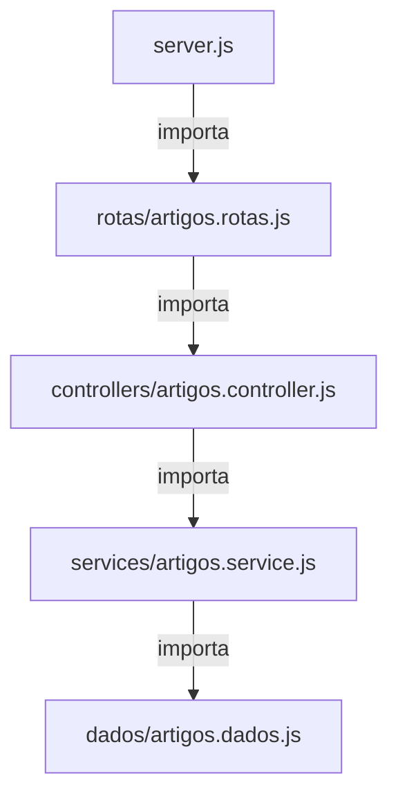
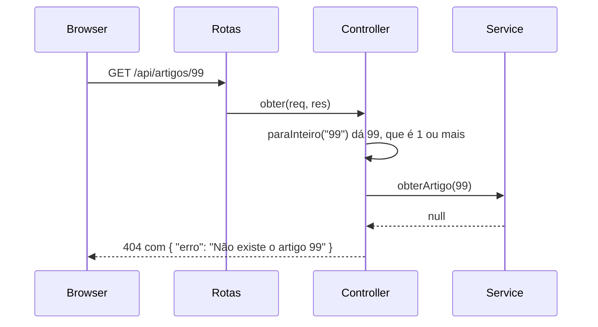
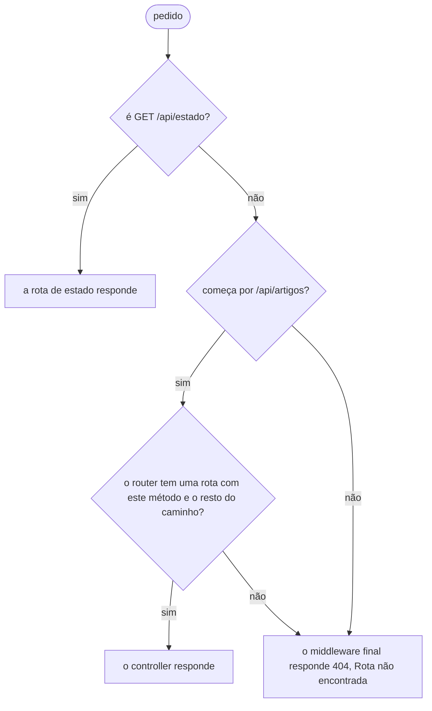

# API Express e contratos

Neste guia, escreves o contrato da API da papelaria, que diz o que ela aceita e o que responde, e a API que o cumpre. São três pedidos: a lista dos artigos, com filtros, um artigo de cada vez e os artigos a encomendar, ainda guardados num array. A API faz-se primeiro num só ficheiro, e depois em camadas, sem mudar nenhuma resposta.

Usa o HTTP de Sistemas de Informação, as camadas do tema anterior e os módulos do 11.º ano. Rever: [Os três códigos deste tema](https://github.com/NunoMACastro/epms-2627-3ig-si/blob/main/01-aplicacoes-em-browser/03-http-rotas-e-middleware.md#os-três-códigos-deste-tema), [Uma fila, pela ordem do ficheiro](https://github.com/NunoMACastro/epms-2627-3ig-si/blob/main/01-aplicacoes-em-browser/03-http-rotas-e-middleware.md#uma-fila-pela-ordem-do-ficheiro), [O servidor divide-se em quatro camadas](03-arquitetura-e-setup-node.md#o-servidor-divide-se-em-quatro-camadas) e [Exportar e importar](https://github.com/NunoMACastro/edu-docs-2ig-js-guias-2526/blob/8cf6ade3cf3d4508ea0fb4fbc5b2bedb29869a8f/JavaScript/13-Modulos-ES.md#2-exportar-e-importar). Para praticar: [laboratório](laboratorios/04-api-express-e-contratos-laboratorio.md) e [ficha de exercícios](exercicios/04-api-express-e-contratos-exercicios.md).

## Neste guia

1. [Parte 1: O contrato vem antes do código](#parte-1-o-contrato-vem-antes-do-código)
2. [Parte 2: A primeira versão, num só ficheiro](#parte-2-a-primeira-versão-num-só-ficheiro)
3. [Parte 3: As camadas em código](#parte-3-as-camadas-em-código)
4. [Parte 4: Um formato único para os erros](#parte-4-um-formato-único-para-os-erros)
5. [Exemplo guiado: do contrato às respostas verificadas](#exemplo-guiado-do-contrato-às-respostas-verificadas)

## Parte 1: O contrato vem antes do código

Uma API é usada por outros programas, como a interface em React. Antes de a escrever, escreve-se o que ela promete a esses programas.

### O contrato diz o que a API aceita e o que responde

Imagina que estás a escrever o componente React que mostra os artigos, e que um colega está a escrever a API. Para o teu `fetch`, precisas de saber que endereço pedes, com que parâmetros, e o que vem na resposta: uma lista ou um objeto, e com que campos. Precisas também de saber como é que o componente percebe que um artigo não existe. O teu colega precisa de saber o mesmo, do outro lado. Se cada um decidir por si, as duas partes não encaixam quando se juntarem.

O **contrato** de uma API é o documento que responde a estas perguntas, pedido a pedido. Para cada pedido, diz quatro coisas:

1. o método e o caminho;
2. os parâmetros: onde vêm (no caminho, na pesquisa ou no corpo), de que tipo são, se são obrigatórios e que valores servem;
3. a resposta quando corre bem: o código e a forma do JSON, com os nomes e os tipos dos campos;
4. todas as respostas de erro: o código e quando acontece.

Chama-se contrato porque obriga as duas partes. A API compromete-se a responder assim, e o cliente a pedir assim. Enquanto os dois o cumprirem, cada um pode mudar o seu código por dentro sem estragar o outro.

Na tua aplicação, o colega és tu, daqui a umas semanas, quando escreveres o React. O contrato que escreves agora diz-te como usar a tua própria API. E permite verificá-la antes de haver React: se a API responde ao que o contrato diz, cumpre-o.

Em Sistemas de Informação, a tabela de contratos HTTP do catálogo tem uma linha por pedido. O contrato de uma API leva a mesma ideia mais longe, em três pontos. Escreve-se antes do código, diz a forma exata do JSON de cada resposta e fica no Git, ao lado do código que o cumpre. Rever: [A tabela de contratos HTTP](https://github.com/NunoMACastro/epms-2627-3ig-si/blob/main/01-aplicacoes-em-browser/03-http-rotas-e-middleware.md#a-tabela-de-contratos-http).

### No contrato, cada pedido tem os parâmetros e as respostas

A interface da papelaria vai precisar, por agora, de três pedidos. A venda, que o tema anterior também previa, muda o stock e fica para o tema seguinte. Cada pedido tem uma tabela com os parâmetros, quando os há, e outra com todas as respostas possíveis. O contrato está também no [exemplo publicado](../exemplos/acesso-a-dados/papelaria-api-com-camadas/contrato-da-api.md), com a rota de estado e os campos de um artigo explicados um a um.

`GET /api/artigos` lista os artigos.

| Parâmetro | Onde | Tipo | Obrigatório | Valores válidos |
| --- | --- | --- | --- | --- |
| `categoria` | pesquisa | texto | não | qualquer; só aparecem os artigos dessa categoria |
| `stockMaximo` | pesquisa | inteiro | não | 0 ou mais; só aparecem os artigos com stock até esse valor, incluído |

| Código | Quando | Corpo |
| --- | --- | --- |
| 200 | os parâmetros são válidos | lista de artigos, possivelmente vazia |
| 400 | `stockMaximo` vem vazio (`?stockMaximo=`), não é um inteiro, ou é negativo | erro |

Cada artigo da lista tem esta forma:

```json
{ "id": 1, "nome": "Caderno A4 quadriculado", "categoria": "Papel", "stock": 12, "stockMinimo": 5, "precoCentimos": 250 }
```

O preço está em cêntimos, como no modelo do tema do Atlas. Há duas diferenças em relação ao Atlas. O `_id` dá lugar a um `id` inteiro, de 1 a 8, que se escreve num endereço como `/api/artigos/2`. E a `localizacao` fica de fora, porque nenhum pedido a usa. No tema seguinte, com os artigos no MongoDB, o `id` passa a ser o `_id`, e o contrato muda nessa linha.

`GET /api/artigos/:id` mostra um artigo.

| Parâmetro | Onde | Tipo | Obrigatório | Valores válidos |
| --- | --- | --- | --- | --- |
| `id` | caminho | inteiro | sim | 1 ou mais |

| Código | Quando | Corpo |
| --- | --- | --- |
| 200 | o artigo existe | o artigo |
| 400 | o `id` não é um inteiro positivo | erro |
| 404 | não existe nenhum artigo com esse `id` | erro |

`GET /api/artigos/abaixo-do-minimo` lista os artigos com stock abaixo do stock mínimo, que a papelaria tem de encomendar. Não tem parâmetros. É a pergunta que, no tema do Atlas, ficou para o código. Rever: [A pergunta que a barra de consulta não faz](02-modelo-documental-e-consultas-no-atlas.md#a-pergunta-que-a-barra-de-consulta-não-faz).

| Código | Quando | Corpo |
| --- | --- | --- |
| 200 | sempre | lista de artigos, possivelmente vazia |

Qualquer outro pedido tem também a sua linha:

| Código | Quando | Corpo |
| --- | --- | --- |
| 404 | não há nenhuma rota com esse método e esse caminho | `{ "erro": "Rota não encontrada" }` |

E todas as respostas de erro têm a mesma forma, com a mensagem em `erro`:

```json
{ "erro": "Não existe o artigo 99" }
```

O contrato não diz como a API está organizada por dentro, nem se os artigos estão num array ou numa base de dados. Isso decide-o quem escreve a API, e pode mudar sem o contrato mudar. Neste tema muda uma vez: a primeira versão cumpre o contrato num só ficheiro, e a segunda reparte o mesmo código por camadas, com as mesmas respostas.

### Cada linha do contrato verifica-se com um pedido

O contrato é também a lista do que se verifica. Cada linha de uma tabela de respostas diz o que a API responde a um pedido. Para a verificar, faz-se esse pedido no browser, com o separador Rede aberto, e compara-se o código e o corpo com o contrato.

Uma linha não fica verificada só com o pedido que corre bem. A linha do 400 do `stockMaximo` junta três casos, e cada um precisa do seu pedido. A eles juntam-se os do outro lado do limite, que dão 200: o pedido sem o parâmetro e o do menor valor aceite. São os **casos de fronteira**, os pedidos à volta do limite do que o contrato aceita:

| Pedido | O caso | O que o contrato diz |
| --- | --- | --- |
| `/api/artigos` | sem o parâmetro | 200, os oito artigos |
| `/api/artigos?stockMaximo=0` | o menor valor aceite | 200, só o bloco de notas A5, que tem stock 0 |
| `/api/artigos?stockMaximo=` | o parâmetro vazio | 400 |
| `/api/artigos?stockMaximo=abc` | um valor que não é um número | 400 |
| `/api/artigos?stockMaximo=-1` | um número abaixo do limite | 400 |

Os casos de fronteira apanham os erros que o pedido normal esconde. O parâmetro vazio, por exemplo, chega como texto vazio, e o `Number("")` dá 0, e não `NaN`, como mostra [O `Number` transforma um texto vazio em 0](#o-number-transforma-um-texto-vazio-em-0).

Quando todas as linhas dão o que o contrato diz, sabes que a API o cumpre nos pedidos que fizeste, e não em todos os valores possíveis. Um pedido que ficou de fora, como `/api/artigos?stockMaximo=2.5`, ainda pode esconder um erro. Por isso, cada linha do contrato leva pelo menos um pedido, e cada parâmetro os seus casos de fronteira. A verificação completa da papelaria está no [passo 7 do exemplo guiado](#passo-7-verificar-o-contrato).

## Parte 2: A primeira versão, num só ficheiro

Antes de dividir a API em camadas, escreve-se uma versão que cumpre o contrato com tudo no `src/server.js` do esqueleto, como os servidores de Sistemas de Informação. Quase tudo já conheces de lá, incluindo a verificação do `id` da rota de detalhe, com o 400 antes do 404. O que é novo é verificar assim cada parâmetro do contrato, e um caso que engana o `Number`: o parâmetro que vem vazio.

### O que chega no pedido verifica-se à entrada

Os parâmetros de um pedido chegam como texto, ou como uma lista de textos quando um nome se repete. E podem chegar errados: `?stockMaximo=abc`, `/api/artigos/-3`, ou com um parâmetro que a API não conhece, como `?ordem=preco`. A rota não pode usar esses valores tal como vêm.

É a validação que fizeste em Sistemas de Informação com o `id`, agora para cada parâmetro do contrato: antes de usar um valor do pedido, confirma-se que serve. Chama-se verificar à entrada, e tem duas partes:

1. Só se leem os parâmetros que o contrato prevê, um a um. Um parâmetro que o contrato não prevê é ignorado: `?ordem=preco` dá os oito artigos, como um pedido sem parâmetros.
2. Os números convertem-se e comparam-se com os limites do contrato. O `stockMaximo` tem de ser um inteiro, 0 ou mais, e o `id`, um inteiro, 1 ou mais. Se o valor não servir, a resposta é 400, e o `return` acaba ali o pedido.

Depois da verificação, o resto da função trabalha com valores do tipo certo: o filtro compara o stock com o número 5, e não com o texto `"5"`.

Na primeira versão, a verificação está dentro de cada rota, antes de o valor ser usado. O ficheiro completo é este, e está pronto a correr em [papelaria-api-sem-camadas](../exemplos/acesso-a-dados/papelaria-api-sem-camadas/README.md):

```js check
// src/server.js: a API da papelaria, primeira versão, com tudo neste ficheiro.
// Os dados, a verificação dos pedidos, as regras da papelaria e as respostas
// estão juntos, como nos servidores de Sistemas de Informação. A versão
// seguinte separa-os em camadas, sem mudar nenhuma das respostas.
import express from "express";

// A porta vem do ambiente: em desenvolvimento, do ficheiro .env.
// Se não estiver definida, a API usa a 3000.
const PORTA = process.env.PORT || 3000;

const app = express();

// Os artigos da papelaria, em memória. São dados temporários: no tema da
// ligação segura, passam a vir do MongoDB Atlas. São os mesmos que inseriste
// no Atlas, com um id numérico em vez do _id.
const artigos = [
  { id: 1, nome: "Caderno A4 quadriculado", categoria: "Papel", stock: 12, stockMinimo: 5, precoCentimos: 250 },
  { id: 2, nome: "Esferográfica azul", categoria: "Escrita", stock: 3, stockMinimo: 10, precoCentimos: 60 },
  { id: 3, nome: "Bloco de notas A5", categoria: "Papel", stock: 0, stockMinimo: 4, precoCentimos: 180 },
  { id: 4, nome: "Lápis HB", categoria: "Escrita", stock: 25, stockMinimo: 10, precoCentimos: 35 },
  { id: 5, nome: "Resma de papel A4", categoria: "Papel", stock: 4, stockMinimo: 3, precoCentimos: 520 },
  { id: 6, nome: "Marcador fluorescente", categoria: "Escrita", stock: 8, stockMinimo: 10, precoCentimos: 95 },
  { id: 7, nome: "Régua de 30 cm", categoria: "Desenho", stock: 6, stockMinimo: 3, precoCentimos: 120 },
  { id: 8, nome: "Compasso escolar", categoria: "Desenho", stock: 1, stockMinimo: 2, precoCentimos: 450 },
];

/**
 * Converte um texto num inteiro, ou devolve null se o texto não for um inteiro.
 * @param {string} texto o valor tal como chegou no pedido
 * @returns {number | null}
 */
function paraInteiro(texto) {
  // Number("") e Number("  ") dão 0, e não NaN. Sem esta verificação,
  // ?stockMaximo= (o parâmetro sem valor) seria tratado como ?stockMaximo=0.
  // Um parâmetro repetido, como ?stockMaximo=1&stockMaximo=2, chega como
  // um array, que não é texto: também não é um inteiro.
  if (typeof texto !== "string" || texto.trim() === "") {
    return null;
  }
  const numero = Number(texto);
  return Number.isInteger(numero) ? numero : null;
}

// Rota de estado: serve para confirmar que a API está ligada e a responder.
app.get("/api/estado", (req, res) => {
  res.json({ estado: "ok", aplicacao: "API da papelaria" });
});

// GET /api/artigos, com os filtros opcionais ?categoria= e ?stockMaximo=.
// Só se leem os dois parâmetros que o contrato prevê; os outros são ignorados.
app.get("/api/artigos", (req, res) => {
  let resultado = artigos;

  if (req.query.categoria !== undefined) {
    resultado = resultado.filter((artigo) => artigo.categoria === req.query.categoria);
  }

  if (req.query.stockMaximo !== undefined) {
    const stockMaximo = paraInteiro(req.query.stockMaximo);
    if (stockMaximo === null || stockMaximo < 0) {
      res.status(400).json({ erro: "O parâmetro stockMaximo tem de ser um número inteiro, zero ou maior" });
      return;
    }
    resultado = resultado.filter((artigo) => artigo.stock <= stockMaximo);
  }

  res.json(resultado);
});

// GET /api/artigos/abaixo-do-minimo. O caminho fixo vem antes do caminho com
// parâmetro. Ao contrário, /abaixo-do-minimo seria tratado como um :id, e daria 400.
app.get("/api/artigos/abaixo-do-minimo", (req, res) => {
  // Regra da papelaria: um artigo está abaixo do mínimo quando o stock é
  // menor do que o stock mínimo definido para ele, e é preciso encomendá-lo.
  const aEncomendar = artigos.filter((artigo) => artigo.stock < artigo.stockMinimo);
  res.json(aEncomendar);
});

// GET /api/artigos/:id
app.get("/api/artigos/:id", (req, res) => {
  const id = paraInteiro(req.params.id);
  if (id === null || id < 1) {
    res.status(400).json({ erro: "O identificador do artigo tem de ser um número inteiro positivo" });
    return;
  }
  const artigo = artigos.find((artigo) => artigo.id === id);
  if (!artigo) {
    res.status(404).json({ erro: `Não existe o artigo ${id}` });
    return;
  }
  res.json(artigo);
});

app.listen(PORTA, (erro) => {
  if (erro) {
    console.error(`Não foi possível ligar a API: ${erro.message}`);
    return;
  }
  console.log(`API a correr em http://localhost:${PORTA}`);
});
```

O ficheiro lê-se de cima para baixo, pela ordem em que o Node o executa ao arrancar. O `import`, a porta e a rota de estado são os do esqueleto. Os artigos são os oito do Atlas, sem a localização. A `paraInteiro` é a conversão que as duas rotas com números usam, e a secção seguinte explica porque é que não é só um `Number`. Na rota de `/api/artigos`, cada filtro que vier aplica-se ao resultado do anterior, e sem filtros vêm todos. Na rota de um artigo, primeiro verifica-se se o `id` faz sentido (400), e só depois se o artigo existe (404), como na rota de detalhe de Sistemas de Informação. Todas as respostas que o ficheiro escreve, de sucesso e de erro, são JSON.

A rota `/api/artigos/abaixo-do-minimo` vem antes de `/api/artigos/:id` pela regra das rotas de Sistemas de Informação: o `:id` aceita qualquer texto, e o Express fica com a primeira rota que encaixa. Ao contrário, o pedido dos artigos a encomendar ia parar à rota de um artigo, que respondia 400 com a mensagem do identificador. O terminal não mostrava erro nenhum.

### O `Number` transforma um texto vazio em 0

A `paraInteiro` verifica o texto antes de chamar o `Number`, por causa de uma regra do JavaScript que engana muita gente. O `Number` tira os espaços das pontas do texto e converte o que sobra. Mas se não sobrar nada, o resultado não é `NaN`: é 0. A tabela compara as duas conversões:

| O que chega | `Number(texto)` | `paraInteiro(texto)` |
| --- | --- | --- |
| `"5"` | 5 | 5 |
| `" 5 "` | 5 | 5 |
| `"abc"` | `NaN` | `null` |
| `"1.5"` | 1.5 | `null` |
| `""` | 0 | `null` |
| `"   "` | 0 | `null` |

No pedido `/api/artigos?stockMaximo=`, o parâmetro veio, mas sem valor. O `req.query.stockMaximo` não é `undefined`: é o texto vazio, `""`. Convertido só com o `Number`, como o `id` da rota de detalhe de Sistemas de Informação, passava a 0. O 0 é um inteiro e não é negativo, e a API respondia 200 com os artigos sem stock, que são só o bloco de notas A5. Quem fez o pedido esqueceu-se do número, e a API inventava-lhe um. O contrato diz que o parâmetro vazio dá 400.

Por isso, a `paraInteiro` devolve `null` para um texto vazio ou só com espaços, antes de chamar o `Number`. O `trim()` tira os espaços das pontas, e se fica `""`, não há número nenhum. A última linha usa o operador `? :` do 11.º ano: devolve o número se for inteiro, e `null` se não for.

Para o `id`, a conversão de Sistemas de Informação chegava. Um `id` só com espaços dava 0, que fica abaixo do limite de 1 e dá 400 na mesma. Para o `stockMaximo`, o 0 é um valor válido, e não chega. A API usa a `paraInteiro` nos dois, para as duas rotas converterem da mesma maneira.

<details>
<summary>Para ires mais longe: o parâmetro repetido</summary>

A primeira metade da condição da `paraInteiro`, `typeof texto !== "string"`, trata de um caso mais raro. Em `?stockMaximo=1&stockMaximo=2`, o Express entrega um array, `["1", "2"]`, e não um texto. O `typeof` dá o tipo de um valor, em texto: `"string"` para um texto, e `"object"` para um array. Um array não tem o método `trim`, e chamá-lo fazia a rota falhar, com um erro 500 numa página HTML do Express. Como a condição usa `||`, quando o valor não é um texto, a segunda metade nem chega a correr, e a `paraInteiro` devolve `null`, como para `"abc"`.

</details>

### A primeira versão verificada fica de referência

Começar por um só ficheiro tem duas vantagens. A primeira é que há poucas novidades, a verificação de cada parâmetro e o texto vazio; o resto é Sistemas de Informação. A segunda é que, quando esta versão responde ao que o contrato diz, fica de referência. Depois, o código muda de ficheiro, camada a camada, e as respostas têm de continuar exatamente as mesmas. Se uma resposta mudar, foi a separação que a estragou.

A verificação desta versão é a tabela do [passo 2 do exemplo guiado](#passo-2-tudo-no-serverjs-e-verificar). Dá o que o contrato diz em todas as linhas menos numa. Um caminho que não existe, como `/api/artigo`, responde com o código certo, 404, mas numa página HTML do Express, e não em JSON. Essa linha fica para [Um formato único para os erros](#parte-4-um-formato-único-para-os-erros).

## Parte 3: As camadas em código

A primeira versão funciona, e para quatro rotas podia ficar assim. Mas a API vai crescer, e o ficheiro já mostra onde é que vai doer.

### O ficheiro único mistura HTTP, regras e dados

Lê o `server.js` da primeira versão com a pergunta do tema anterior, linha a linha: isto é HTTP, regra da papelaria ou dados? Cada tipo tem uma camada à espera:

| No `server.js` | O que é | Para onde vai |
| --- | --- | --- |
| o array `artigos` | dados | um ficheiro de dados, `src/dados/artigos.dados.js` |
| os `filter` e o `find`: a categoria, o stock até ao máximo, o stock abaixo do mínimo, o `id` igual | regras da papelaria | o service |
| a `paraInteiro`, as leituras de `req.query` e `req.params`, os `res.status(...).json(...)` e os `res.json` | HTTP: ler o pedido, verificá-lo e responder | o controller |
| os `app.get`, com o método e o caminho | rotas: que pedido vai para que função | o router |
| a porta, a rota de estado e o `app.listen` | o arranque | fica no `server.js` |

Com os quatro tipos misturados, há problemas que já se veem neste ficheiro pequeno, e cada um tem a camada que o resolve:

| O problema no ficheiro único | Como fica com as camadas |
| --- | --- |
| A regra dos artigos a encomendar está numa função que recebe o `req` e o `res`. Para a experimentar, é preciso ligar a API e fazer o pedido | A regra fica no service, que não recebe `req` nem `res` e se chama sem servidor |
| Na rota da lista, as linhas de HTTP e as de regra alternam. Para mudar um filtro, lês o HTTP à volta dele | O controller fica só com o HTTP, e o service só com as regras |
| Quando os artigos passarem para uma base de dados, cada rota ganha a sua consulta, e os pedidos de criar e apagar entram no mesmo ficheiro | Muda só a camada dos dados, e cada pedido novo reparte-se pelos ficheiros das camadas |
| Para saber que pedidos a API aceita, tens de ler o ficheiro todo | As rotas ficam num ficheiro curto, que é a lista dos pedidos |

A separação começa por baixo, pelos dados: primeiro os dados e o service, depois o controller, depois as rotas e, por fim, o `server.js`. Como cada camada importa a de baixo, cada ficheiro novo já tem o que importa. O código quase não se reescreve: cada parte muda de ficheiro, ganha um `export` e passa a ser usada com um `import`. As funções das rotas ganham um nome, e onde uma rota usava o que passou para outra camada, passa a chamar uma função dela. As respostas não mudam, e é por isso que a tabela da primeira versão volta a servir no fim.

### As camadas ligam-se com `export` e `import`

Cada camada vive no seu ficheiro, numa pasta própria dentro de `src`. O nome do ficheiro diz o recurso e a camada, para se distinguirem nos separadores do editor:

```text
papelaria-api/
├── contrato-da-api.md
└── src/
    ├── server.js
    ├── dados/
    │   └── artigos.dados.js           os artigos, por agora num array
    ├── services/
    │   └── artigos.service.js         as regras sobre os artigos
    ├── controllers/
    │   └── artigos.controller.js      o HTTP dos artigos
    └── rotas/
        └── artigos.rotas.js           que pedido vai para que função
```

Na papelaria, os artigos ainda não vêm de uma base de dados. São **dados temporários**: um array num ficheiro, que ocupa por agora o lugar do repository. Quando os dados estão numa base, a camada de baixo é o repository, com as consultas do Mongoose, e liga-se às outras da mesma maneira. É o caso das cenas do jogo Fechado na escola, no [laboratório deste tema](laboratorios/04-api-express-e-contratos-laboratorio.md).

Num projeto com `"type": "module"`, cada ficheiro `.js` é um módulo. O que lá se declara fica fechado lá dentro, e outro ficheiro só o usa se ele tiver `export` e se o outro o pedir com `import`. Já o fizeste no 11.º ano. A novidade é que os ficheiros estão em pastas diferentes, e cada camada importa só a de baixo:



Cada seta é um `import`. O `server.js` importa as rotas, as rotas importam o controller, o controller importa o service, e o service importa os dados. Nenhuma seta sobe: os dados não sabem que o service existe, e o service não sabe que o controller existe.

O primeiro `export` é o dos dados. O array é o mesmo da primeira versão, sem mudar um artigo, agora num ficheiro próprio e com `export` à frente do `const`:

```js check
// src/dados/artigos.dados.js: os artigos da papelaria, em memória.
// São dados temporários: no tema da ligação segura, passam a vir do MongoDB Atlas.
// Os artigos são os mesmos que inseriste no Atlas, com um id numérico em vez do _id.

export const artigos = [
  { id: 1, nome: "Caderno A4 quadriculado", categoria: "Papel", stock: 12, stockMinimo: 5, precoCentimos: 250 },
  { id: 2, nome: "Esferográfica azul", categoria: "Escrita", stock: 3, stockMinimo: 10, precoCentimos: 60 },
  { id: 3, nome: "Bloco de notas A5", categoria: "Papel", stock: 0, stockMinimo: 4, precoCentimos: 180 },
  { id: 4, nome: "Lápis HB", categoria: "Escrita", stock: 25, stockMinimo: 10, precoCentimos: 35 },
  { id: 5, nome: "Resma de papel A4", categoria: "Papel", stock: 4, stockMinimo: 3, precoCentimos: 520 },
  { id: 6, nome: "Marcador fluorescente", categoria: "Escrita", stock: 8, stockMinimo: 10, precoCentimos: 95 },
  { id: 7, nome: "Régua de 30 cm", categoria: "Desenho", stock: 6, stockMinimo: 3, precoCentimos: 120 },
  { id: 8, nome: "Compasso escolar", categoria: "Desenho", stock: 1, stockMinimo: 2, precoCentimos: 450 },
];
```

Do outro lado, o service pede-o com `import { artigos } from "../dados/artigos.dados.js"`. O nome entre chavetas é exatamente o do `export`. O caminho parte do ficheiro que faz o `import`: o service está em `src/services/`, os dois pontos (`..`) sobem uma pasta, para `src/`, e daí o caminho desce para `dados/artigos.dados.js`. Um caminho que começa por `./`, com um ponto só, procura na mesma pasta.

Nos teus ficheiros, o caminho do `import` começa sempre por `./` ou `../` e acaba sempre na extensão `.js`. Num módulo do Node, a extensão não é opcional: sem ela, o ficheiro não é encontrado. O `import express from "express"` não tem nada disto, porque não é um ficheiro teu. É um pacote, que o Node vai buscar à pasta `node_modules`.

### O service fica com as regras, sem `req` nem `res`

As regras da papelaria passam para o service: os dois filtros da lista, a procura de um artigo e a regra dos artigos a encomendar. Cada função recebe valores simples e devolve valores simples, e tem `export`, porque o controller vai precisar das três.

```js check
// src/services/artigos.service.js: as regras da papelaria sobre os artigos.
// Recebe valores simples e devolve valores simples. Não sabe nada de HTTP:
// não usa req nem res, e por isso pode ser usado e testado sem servidor.
import { artigos } from "../dados/artigos.dados.js";

/**
 * Devolve os artigos que cumprem os filtros recebidos.
 * Os filtros já chegam verificados pelo controller; os que faltam não se aplicam.
 * @param {object} filtros com categoria (texto) e stockMaximo (número), os dois opcionais
 * @returns {object[]} uma lista nova, possivelmente vazia
 */
export function listarArtigos(filtros) {
  let resultado = artigos;
  if (filtros.categoria !== undefined) {
    resultado = resultado.filter((artigo) => artigo.categoria === filtros.categoria);
  }
  if (filtros.stockMaximo !== undefined) {
    resultado = resultado.filter((artigo) => artigo.stock <= filtros.stockMaximo);
  }
  return resultado;
}

/**
 * Procura um artigo pelo id.
 * @param {number} id um inteiro positivo, já verificado pelo controller
 * @returns {object | null} o artigo, ou null se não existir
 */
export function obterArtigo(id) {
  const artigo = artigos.find((artigo) => artigo.id === id);
  if (!artigo) {
    return null;
  }
  return artigo;
}

/**
 * Regra da papelaria: um artigo está abaixo do mínimo quando o stock é
 * menor do que o stock mínimo definido para ele, e é preciso encomendá-lo.
 * @returns {object[]} os artigos a encomendar, possivelmente nenhum
 */
export function artigosAbaixoDoMinimo() {
  return artigos.filter((artigo) => artigo.stock < artigo.stockMinimo);
}
```

Cada função vem de uma rota da primeira versão, sem o HTTP à volta. A `listarArtigos` são os dois `filter` da rota da lista, agora a ler os valores de um objeto `filtros`, e não do `req.query`. A `obterArtigo` é o `find` da rota de um artigo. Não decide que um artigo que falta é um 404, porque não sabe o que é um 404: diz só que não há, e o controller traduz. A `artigosAbaixoDoMinimo` é a linha da regra, tal e qual.

Como nenhuma função usa `req` nem `res`, o service chama-se sem servidor. Na raiz do projeto, este comando corre um pequeno programa escrito ali mesmo, que importa duas funções do service e escreve o que elas devolvem:

```bash
node --input-type=module -e "import { listarArtigos, artigosAbaixoDoMinimo } from './src/services/artigos.service.js'; console.log(listarArtigos({}).length); console.log(listarArtigos({ categoria: 'Papel' }).length); console.log(artigosAbaixoDoMinimo().map((artigo) => artigo.nome));"
```

Antes de o correres, prevê as três linhas que ele escreve. Mostra `8`, `3` e os nomes dos quatro artigos a encomendar: a esferográfica azul, o bloco de notas A5, o marcador fluorescente e o compasso escolar. Tudo sem browser, sem servidor e sem HTTP. Na primeira versão, para experimentar a mesma regra, tinhas de ligar a API e fazer o pedido.

### O controller verifica o pedido e escolhe a resposta

Sem as regras, o que fica nas rotas da primeira versão é HTTP: ler o pedido, verificá-lo, chamar o service e escolher a resposta. Passa para o controller, a camada que conhece o HTTP. A verificação à entrada fica aqui, antes de chamar o service, e tem duas consequências:

1. O controller constrói os filtros parâmetro a parâmetro, só com os que o contrato prevê, e nunca passa o `req.query` inteiro ao service. Com uma base de dados, um parâmetro que ninguém previu, como `?nome=Lápis HB`, passava a ser um filtro que o contrato não tem.
2. O service recebe valores já verificados e do tipo certo, como o número 5, e não o texto `"5"`. Não tem de desconfiar do que recebe.

A divisão entre as duas camadas é esta. Saber se `"abc"` é um número é um problema do pedido, e é do controller. Saber se um artigo tem de ser encomendado é uma regra da papelaria, e é do service.

```js check
// src/controllers/artigos.controller.js: a ponte entre o HTTP e o service.
// Lê e verifica o que vem no pedido, chama o service e escolhe o código
// e o corpo da resposta, sempre em JSON, como diz o contrato da API.
import { listarArtigos, obterArtigo, artigosAbaixoDoMinimo } from "../services/artigos.service.js";

/**
 * Converte um texto num inteiro, ou devolve null se o texto não for um inteiro.
 * @param {string} texto o valor tal como chegou no pedido
 * @returns {number | null}
 */
function paraInteiro(texto) {
  // Number("") e Number("  ") dão 0, e não NaN. Sem esta verificação,
  // ?stockMaximo= (o parâmetro sem valor) seria tratado como ?stockMaximo=0.
  // Um parâmetro repetido, como ?stockMaximo=1&stockMaximo=2, chega como
  // um array, que não é texto: também não é um inteiro.
  if (typeof texto !== "string" || texto.trim() === "") {
    return null;
  }
  const numero = Number(texto);
  return Number.isInteger(numero) ? numero : null;
}

/** GET /api/artigos, com os filtros opcionais ?categoria= e ?stockMaximo= */
export function listar(req, res) {
  const filtros = {};

  if (req.query.categoria !== undefined) {
    filtros.categoria = req.query.categoria;
  }

  if (req.query.stockMaximo !== undefined) {
    const stockMaximo = paraInteiro(req.query.stockMaximo);
    if (stockMaximo === null || stockMaximo < 0) {
      res.status(400).json({ erro: "O parâmetro stockMaximo tem de ser um número inteiro, zero ou maior" });
      return;
    }
    filtros.stockMaximo = stockMaximo;
  }

  res.json(listarArtigos(filtros));
}

/** GET /api/artigos/abaixo-do-minimo */
export function abaixoDoMinimo(req, res) {
  res.json(artigosAbaixoDoMinimo());
}

/** GET /api/artigos/:id */
export function obter(req, res) {
  const id = paraInteiro(req.params.id);
  if (id === null || id < 1) {
    res.status(400).json({ erro: "O identificador do artigo tem de ser um número inteiro positivo" });
    return;
  }
  const artigo = obterArtigo(id);
  if (artigo === null) {
    res.status(404).json({ erro: `Não existe o artigo ${id}` });
    return;
  }
  res.json(artigo);
}
```

As três funções exportadas são as três rotas da primeira versão, com duas diferenças. Têm nome, `listar`, `abaixoDoMinimo` e `obter`, porque vão ser usadas noutro ficheiro, o das rotas. E, onde a primeira versão filtrava ou procurava no array, chamam o service. A `paraInteiro` veio do `server.js` sem mudar uma linha e fica sem `export`. Nenhum outro ficheiro precisa dela, e um nome que não se exporta não se usa por engano noutro sítio.

O pedido de um artigo que não existe mostra quem decide o quê:



O controller verifica o `id`, o service procura e diz que não há, e é o controller que transforma esse `null` num 404. Com `/api/artigos/abc`, o pedido nem chega ao service: o controller responde 400 logo na verificação.

### As rotas ficam num router, que o `server.js` monta

Falta dizer que pedido vai para que função. As três rotas dos artigos começam todas por `/api/artigos`, e ficam juntas num **router**. Um router é um conjunto de rotas, criado com `express.Router()`, que se monta todo de uma vez num caminho do servidor.

```js check
// src/rotas/artigos.rotas.js: que pedido vai para que função do controller.
// Os caminhos são relativos ao sítio onde este router é montado, em server.js:
// "/" quer dizer /api/artigos, e "/:id" quer dizer /api/artigos/:id.
import express from "express";
import { listar, abaixoDoMinimo, obter } from "../controllers/artigos.controller.js";

const router = express.Router();

router.get("/", listar);
// O caminho fixo vem antes do caminho com parâmetro. Ao contrário,
// /abaixo-do-minimo seria tratado como um :id, e daria 400.
router.get("/abaixo-do-minimo", abaixoDoMinimo);
router.get("/:id", obter);

export default router;
```

Cada rota recebe o nome de uma função do controller, sem a chamar: `listar`, e não `listar()`. É como o `onClick={somar}` do React, que recebe a função, e não o resultado de a chamar. É o Express que a chama, quando o pedido chega, com o `req` e o `res`. E o ficheiro acaba com `export default router`, que exporta uma só coisa, sem nome. Quem a importa escreve-a sem chavetas, e escolhe o nome. É a forma habitual quando um ficheiro existe para entregar uma só peça.

O `server.js` fica só com o arranque:

```js check
// src/server.js: o ponto de arranque da API da papelaria.
// Lê a configuração do ambiente, cria a aplicação Express, monta as rotas
// e liga-a à porta.
import express from "express";
import artigosRotas from "./rotas/artigos.rotas.js";

// A porta vem do ambiente: em desenvolvimento, do ficheiro .env.
// Se não estiver definida, a API usa a 3000.
const PORTA = process.env.PORT || 3000;

const app = express();

// Rota de estado: serve para confirmar que a API está ligada e a responder.
app.get("/api/estado", (req, res) => {
  res.json({ estado: "ok", aplicacao: "API da papelaria" });
});

// Todos os pedidos começados por /api/artigos seguem para o router dos artigos.
app.use("/api/artigos", artigosRotas);

app.listen(PORTA, (erro) => {
  if (erro) {
    console.error(`Não foi possível ligar a API: ${erro.message}`);
    return;
  }
  console.log(`API a correr em http://localhost:${PORTA}`);
});
```

Em relação à primeira versão, perdeu o array, a `paraInteiro` e as três rotas dos artigos. Ganhou duas linhas: o `import artigosRotas from "./rotas/artigos.rotas.js"`, sem chavetas, porque o router é um `export default`, e o `app.use("/api/artigos", artigosRotas)`. É o `app.use` do middleware de Sistemas de Informação, agora com um caminho. O começo comum dos caminhos escreve-se uma só vez, aqui, e quem quiser saber que pedidos dos artigos a API aceita lê as três linhas do router.

Com o router montado, um pedido começado por `/api/artigos` procura-se no router pelo resto do caminho:

| Pedido | O resto do caminho | A rota do router | A função |
| --- | --- | --- | --- |
| `/api/artigos` | `/` | `"/"` | `listar` |
| `/api/artigos/abaixo-do-minimo` | `/abaixo-do-minimo` | `"/abaixo-do-minimo"` | `abaixoDoMinimo` |
| `/api/artigos/2` | `/2` | `"/:id"`, com o `id` `"2"` | `obter` |
| `/api/artigos/2/preco` | `/2/preco` | nenhuma | nenhuma: o router passa o pedido à frente |

## Parte 4: Um formato único para os erros

As respostas de erro que a API escreve, os 400 e o 404 de um artigo, já têm a forma do contrato. Falta perceber porque é que isso importa, e cumprir a última linha do contrato, a de qualquer outro pedido.

### Todos os erros da API têm a mesma forma

Imagina uma API em que um erro vem como `{ "erro": "..." }`, outro como `{ "mensagem": "..." }` e um terceiro como texto simples. O cliente tinha de tratar cada pedido de maneira diferente. Com um **formato único** para os erros, trata-os todos da mesma forma. No React, para qualquer pedido à tua API, fica assim:

```js
const resposta = await fetch(`/api/artigos/${id}`);
const dados = await resposta.json();
if (!resposta.ok) {
  // Qualquer erro da API traz a mensagem em dados.erro.
  setMensagemDeErro(dados.erro);
  return;
}
setArtigo(dados);
```

O `resposta.ok` é verdadeiro para os códigos 2xx e falso para os outros. O componente mostra a mensagem sem precisar de saber que erro foi.

As mensagens são para quem usa a aplicação, ou para quem programa o cliente. Dizem o que estava errado no pedido, de forma que se perceba o que corrigir. Por exemplo, "O identificador do artigo tem de ser um número inteiro positivo", e não "Erro" nem "NaN". E nunca mostram o que está dentro do servidor: nem nomes de ficheiros, nem mensagens do Node, nem pormenores da base de dados.

### O middleware final fica depois de todas as rotas

Há uma resposta que a API ainda não escreve: a de um caminho que não existe, como `/api/artigo`, sem o `s`. Nenhuma rota lhe corresponde, e o Express responde sozinho, com o código 404 e uma página HTML com o texto `Cannot GET /api/artigo` (não é possível obter). O código está certo, mas o corpo não é JSON e não tem `erro`. No componente React acima, um endereço mal escrito fazia falhar o `await resposta.json()`. O corpo começa por `<!DOCTYPE html>`, que não é JSON, e o JavaScript dá um erro, `SyntaxError`, antes de chegar ao `if`.

A solução é o middleware final de Sistemas de Informação, agora a responder em JSON. É uma função registada com `app.use`, sem caminho, no fim da fila, e por isso só lhe chegam os pedidos a que nenhuma rota respondeu. Rever: [O middleware final](https://github.com/NunoMACastro/epms-2627-3ig-si/blob/main/01-aplicacoes-em-browser/03-http-rotas-e-middleware.md#o-middleware-final). O `server.js` acaba assim, e é este o do exemplo publicado:

```js check
// src/server.js: o ponto de arranque da API da papelaria.
// Lê a configuração do ambiente, cria a aplicação Express, monta as rotas
// e liga-a à porta.
import express from "express";
import artigosRotas from "./rotas/artigos.rotas.js";

// A porta vem do ambiente: em desenvolvimento, do ficheiro .env.
// Se não estiver definida, a API usa a 3000.
const PORTA = process.env.PORT || 3000;

const app = express();

// Rota de estado: serve para confirmar que a API está ligada e a responder.
app.get("/api/estado", (req, res) => {
  res.json({ estado: "ok", aplicacao: "API da papelaria" });
});

// Todos os pedidos começados por /api/artigos seguem para o router dos artigos.
app.use("/api/artigos", artigosRotas);

// Middleware final: nenhuma rota respondeu. Responde em JSON, como o resto
// da API, para quem a usa encontrar sempre o erro no mesmo sítio.
app.use((req, res) => {
  res.status(404).json({ erro: "Rota não encontrada" });
});

app.listen(PORTA, (erro) => {
  if (erro) {
    console.error(`Não foi possível ligar a API: ${erro.message}`);
    return;
  }
  console.log(`API a correr em http://localhost:${PORTA}`);
});
```

A decisão deste ficheiro é a ordem. O Express experimenta as rotas e os middlewares pela ordem em que foram registados, e o middleware final responde a tudo o que lhe chega. Por isso fica depois da rota de estado e do `app.use` das rotas, logo antes do `app.listen`:



Um pedido percorre o `server.js` de cima para baixo. Só chega ao middleware final se nem a rota de estado nem o router lhe responderem. É o caso de `/api/artigo`, que não começa por `/api/artigos`, e de `/api/artigos/2/preco`, que entra no router e não encontra lá nenhuma rota.

Se o middleware final estivesse antes do `app.use` das rotas, respondia `Rota não encontrada` a todos os pedidos dos artigos, mesmo aos que existem. O `/api/estado` continuava a responder, porque está antes dele, e é essa a pista para o erro.

## Exemplo guiado: do contrato às respostas verificadas

O problema: a interface da papelaria vai precisar dos três pedidos do contrato. A API tem de os cumprir, primeiro num só ficheiro e depois em camadas, com as mesmas respostas. O exemplo parte do esqueleto da papelaria do tema anterior e segue a ordem em que se trabalha. A tabela mostra que ficheiros aparecem em cada passo e o que o `server.js` usa:

| Passo | Ficheiros novos | O que o `server.js` usa | Como se confirma |
| --- | --- | --- | --- |
| 1 | `contrato-da-api.md` | só a rota de estado, do esqueleto | pela leitura |
| 2 | nenhum: tudo no `server.js` | as suas rotas e o seu array | a tabela do passo 2 |
| 3 | os dados e o service | ainda as suas rotas e o seu array | o comando do service |
| 4 | o controller | ainda as suas rotas e o seu array | pela leitura |
| 5 | as rotas | o router, que usa o controller, o service e os dados | dois pedidos |
| 6 | nenhum: o middleware final, no `server.js` | o router e o middleware final | `/api/artigo` |
| 7 | nenhum | o mesmo | a tabela do passo 7 |

No fim do passo 2, o `server.js` é o do [papelaria-api-sem-camadas](../exemplos/acesso-a-dados/papelaria-api-sem-camadas/README.md). No fim do passo 6, a pasta `src` é igual à do [papelaria-api-com-camadas](../exemplos/acesso-a-dados/papelaria-api-com-camadas/README.md).

### Passo 1: escrever o contrato

Antes de qualquer código, cria-se o `contrato-da-api.md`, na raiz do projeto. Leva os três pedidos, a resposta a qualquer outro pedido e o formato dos erros de [No contrato, cada pedido tem os parâmetros e as respostas](#no-contrato-cada-pedido-tem-os-parâmetros-e-as-respostas). Leva também a rota de estado, como o contrato do exemplo publicado. É a especificação do que vem a seguir, e a lista do que se verifica nos passos 2 e 7.

A decisão deste passo é que campos leva um artigo, e o critério é o que os pedidos usam ou devolvem. O `id` entra porque o pedido de um artigo o procura pelo caminho. O nome, a categoria, o stock e o preço entram porque a interface mostra cada artigo com eles. E o stock mínimo entra porque a regra dos artigos a encomendar o usa, como os filtros usam a categoria e o stock.

### Passo 2: tudo no server.js, e verificar

O `src/server.js` do esqueleto ganha o que mostra [O que chega no pedido verifica-se à entrada](#o-que-chega-no-pedido-verifica-se-à-entrada). Os artigos e a `paraInteiro` ficam a seguir a `const app = express();`, e as três rotas do contrato entre a rota de estado e o `app.listen`.

Confirma que os nomes, as categorias, os stocks, os stocks mínimos e os preços são os do Atlas. Assim, os resultados não mudam quando os artigos vierem de lá. Depois, com a API ligada (`npm run dev`), faz no browser os pedidos que cobrem cada rota e cada código, com o separador Rede aberto. Antes de cada pedido, prevê o código e a resposta, com o contrato ao lado:

| Pedido | Código | Resposta |
| --- | --- | --- |
| `/api/estado` | 200 | `{"estado":"ok","aplicacao":"API da papelaria"}` |
| `/api/artigos` | 200 | os oito artigos |
| `/api/artigos?categoria=Papel&stockMaximo=4` | 200 | o bloco de notas (0) e a resma (4) |
| `/api/artigos?stockMaximo=` | 400 | `{"erro":"O parâmetro stockMaximo tem de ser um número inteiro, zero ou maior"}` |
| `/api/artigos/2` | 200 | a esferográfica azul |
| `/api/artigos/abc` | 400 | `{"erro":"O identificador do artigo tem de ser um número inteiro positivo"}` |
| `/api/artigos/99` | 404 | `{"erro":"Não existe o artigo 99"}` |
| `/api/artigos/abaixo-do-minimo` | 200 | a esferográfica, o bloco de notas, o marcador e o compasso |
| `/api/artigo` | 404 | a página de erro do Express, em HTML, com `Cannot GET /api/artigo` |

A última linha é a única que não cumpre o contrato: o código é o certo, mas o corpo é HTML. Com esta tabela verificada, a primeira versão fica de referência para os passos seguintes.

### Passo 3: os dados e o service, e um teste sem servidor

Escreve os ficheiros `src/dados/artigos.dados.js` e `src/services/artigos.service.js`, de [As camadas ligam-se com `export` e `import`](#as-camadas-ligam-se-com-export-e-import) e de [O service fica com as regras, sem `req` nem `res`](#o-service-fica-com-as-regras-sem-req-nem-res). A decisão é, linha a linha, o que é regra e vai para o service, e o que é HTTP e fica de fora. A tabela de [O ficheiro único mistura HTTP, regras e dados](#o-ficheiro-único-mistura-http-regras-e-dados) diz para onde vai cada parte.

O `server.js` ainda não usa estes ficheiros, e a API responde como no passo 2. Por isso, nesta altura, o array existe em dois sítios. É de propósito, e por pouco tempo. Se o tirasses já do `server.js`, as rotas dele deixavam de o encontrar, e quase todos os pedidos aos artigos davam erro 500.

Confirma que o ficheiro dos dados exporta o array com o nome `artigos`, o nome que o service importa. Depois experimenta o service sem servidor, com o comando de [O service fica com as regras, sem `req` nem `res`](#o-service-fica-com-as-regras-sem-req-nem-res). Tem de mostrar `8`, `3` e os quatro artigos a encomendar.

### Passo 4: o controller

Escreve o ficheiro `src/controllers/artigos.controller.js`, de [O controller verifica o pedido e escolhe a resposta](#o-controller-verifica-o-pedido-e-escolhe-a-resposta).

Nenhuma rota chama ainda o controller, porque o `server.js` continua com as rotas da primeira versão. Por isso, o controller não se experimenta no browser, e um erro de `import` deste ficheiro só aparece no passo 5. Confirma-o pela leitura:

- cada mensagem de erro é a que está na tabela do passo 2;
- cada `res.status(...).json(...)` de erro tem o `return` a seguir;
- nenhuma função passa o `req.query` inteiro ao service.

### Passo 5: as rotas e o router, e o server.js que os monta

Escreve primeiro o ficheiro `src/rotas/artigos.rotas.js`, de [As rotas ficam num router, que o `server.js` monta](#as-rotas-ficam-num-router-que-o-serverjs-monta). Enquanto o `server.js` não o importar, este ficheiro não muda nada, e a API continua a responder pelas rotas da primeira versão.

Depois, muda o `src/server.js` para o dessa secção. Saem o array, a `paraInteiro` e as três rotas dos artigos, que já estão nas camadas, e a rota de estado fica onde estava.

Ao guardar, o `--watch` reinicia a API, e o terminal volta a mostrar `API a correr em http://localhost:3000`. Se houver um erro de `import` num dos ficheiros novos, é agora que aparece. É a primeira vez que o `server.js` carrega as rotas, que carregam o controller, que carrega o service. A mensagem diz que ficheiro faltou e quem o pediu, como em [Erros frequentes](#erros-frequentes).

Dois pedidos confirmam a montagem, antes da verificação completa: `/api/estado` responde como no tema anterior, e `/api/artigos` mostra os oito artigos.

### Passo 6: o formato único e o middleware final

Acrescenta o middleware final no fim do `src/server.js`, logo antes do `app.listen`, como em [O middleware final fica depois de todas as rotas](#o-middleware-final-fica-depois-de-todas-as-rotas).

Confirma que `/api/artigo` responde agora `{"erro":"Rota não encontrada"}`, com o código 404, no separador Rede. Confirma também, no contrato, que todas as respostas de erro têm a mesma forma, com a mensagem em `erro`. São os dois 400, o 404 de um artigo e este.

### Passo 7: verificar o contrato

Com a API ligada, faz cada pedido no browser, com o separador Rede aberto, e confere a resposta com o contrato:

| Pedido | Código | Resposta |
| --- | --- | --- |
| `/api/artigos` | 200 | os oito artigos |
| `/api/artigos?categoria=Desenho` | 200 | a régua e o compasso |
| `/api/artigos?stockMaximo=3` | 200 | a esferográfica (3), o bloco de notas (0) e o compasso (1) |
| `/api/artigos?categoria=Papel&stockMaximo=4` | 200 | o bloco de notas (0) e a resma (4) |
| `/api/artigos?categoria=Cola` | 200 | `[]` |
| `/api/artigos?stockMaximo=abc` | 400 | `{"erro":"O parâmetro stockMaximo tem de ser um número inteiro, zero ou maior"}` |
| `/api/artigos?stockMaximo=` | 400 | o mesmo erro |
| `/api/artigos?stockMaximo=-1` | 400 | o mesmo erro |
| `/api/artigos?stockMaximo=0` | 200 | só o bloco de notas (0) |
| `/api/artigos/1` | 200 | o caderno A4 quadriculado |
| `/api/artigos/2` | 200 | a esferográfica azul |
| `/api/artigos/abc` | 400 | `{"erro":"O identificador do artigo tem de ser um número inteiro positivo"}` |
| `/api/artigos/0` | 400 | o mesmo erro |
| `/api/artigos/99` | 404 | `{"erro":"Não existe o artigo 99"}` |
| `/api/artigos/abaixo-do-minimo` | 200 | a esferográfica, o bloco de notas, o marcador e o compasso |
| `/api/artigo` | 404 | `{"erro":"Rota não encontrada"}` |

Repara em duas linhas. A resma, com stock 4, aparece com `stockMaximo=4`, porque o contrato diz "até esse valor, incluído". E o marcador fluorescente, com 8 unidades, tem de ser encomendado, e a régua, com 6, não: o mínimo do marcador é 10, e o da régua é 3. Ter pouco stock e ter de encomendar são coisas diferentes, e é o service que sabe a diferença.

Compara com a tabela do passo 2. Os pedidos que estão nas duas dão as mesmas respostas, com os mesmos códigos e as mesmas mensagens. A única diferença é o `/api/artigo`, que agora vem em JSON. A separação em camadas reorganizou o código sem tocar no que a API responde, como o contrato prometia.

### Passo 8: guardar no Git

No fim, o contrato e as camadas ficam guardados num commit:

```bash
git add .
git commit -m "API dos artigos: contrato, rotas, controller e service com dados temporários"
```

## Erros frequentes

### Cannot set headers after they are sent to the client

O terminal mostra este erro depois de um pedido que devia dar 400. Falta o `return` a seguir ao `res.status(400).json(...)`: a função continua e tenta responder outra vez ao mesmo pedido. Rever: [Responder uma vez, e sair](https://github.com/NunoMACastro/epms-2627-3ig-si/blob/main/01-aplicacoes-em-browser/03-http-rotas-e-middleware.md#responder-uma-vez-e-sair).

### A API não arranca: Cannot find module

```text
Error [ERR_MODULE_NOT_FOUND]: Cannot find module '.../src/controllers/artigos.controller' imported from .../src/rotas/artigos.rotas.js
```

Ou falta o `.js` no fim do caminho de um `import` de um ficheiro teu, ou o caminho parte da pasta errada. Dentro de `src/services/`, `./dados/artigos.dados.js` procura uma pasta `dados` dentro de `services`, e o caminho certo é `../dados/artigos.dados.js`. A mensagem diz que ficheiro não encontrou e quem o pediu.

### A API não arranca: does not provide an export named

```text
SyntaxError: The requested module '../controllers/artigos.controller.js' does not provide an export named 'listarTodos'
```

O nome entre chavetas no `import` tem de ser exatamente o de um `export` do outro ficheiro. Aqui, o controller exporta `listar`, e pediu-se `listarTodos`. A mesma mensagem aparece quando a função não tem `export` à frente, e com chavetas num `export default`: `import { artigosRotas } from "./rotas/artigos.rotas.js"` falha, porque o router não foi exportado com esse nome. Um `export default` importa-se sem chavetas.

### Os pedidos aos artigos não encontram a rota

Dentro do router, escreveste o caminho completo, `router.get("/api/artigos", listar)`, e montaste o router em `/api/artigos`. A rota ficou em `/api/artigos/api/artigos`, e é só aí que responde. Em `/api/artigos`, aparece a página `Cannot GET /api/artigos` do Express, antes do middleware final, ou `{"erro":"Rota não encontrada"}`, depois. O `/api/estado` continua a responder, porque não está no router. Dentro do router, os caminhos são relativos ao sítio onde ele é montado: `"/"`.

### A API não arranca: Cannot read properties of undefined

```text
TypeError: Cannot read properties of undefined (reading 'query')
```

Numa rota do router, a função do controller tem parênteses: `router.get("/", listar())`. Com eles, a função corre logo no arranque, sem pedido nenhum, e o `req` é `undefined`. Escreve só o nome, `listar`, para ser o Express a chamá-la quando chega um pedido.

## Palavras novas deste guia

- Contrato de uma API: o documento que diz, pedido a pedido, o que a API aceita e o que responde, também quando corre mal.
- Caso de fronteira: um pedido no limite do que o contrato aceita, como o parâmetro em falta, vazio, que não é um número ou fora dos limites.
- Dados temporários: os artigos num array, que ocupam o lugar do repository enquanto a API não usa uma base de dados.
- Router: um conjunto de rotas, criado com `express.Router()` e montado todo de uma vez num caminho do servidor.
- Formato único dos erros: a mesma forma, `{ "erro": "..." }`, em todas as respostas de erro da API.

## O que vem a seguir

O tema seguinte é Ligação segura, CRUD e regras de domínio, em que os artigos passam para o MongoDB e a API passa a criá-los, alterá-los e apagá-los.

## Para saber mais

- [Encaminhamento no Express](https://expressjs.com/en/guide/routing/), em inglês: as rotas, os parâmetros de caminho e o `express.Router`, na secção sobre ele.
- [Códigos de estado HTTP](https://developer.mozilla.org/en-US/docs/Web/HTTP/Reference/Status), na documentação da Mozilla, em inglês: a lista completa, com o significado de cada um.


