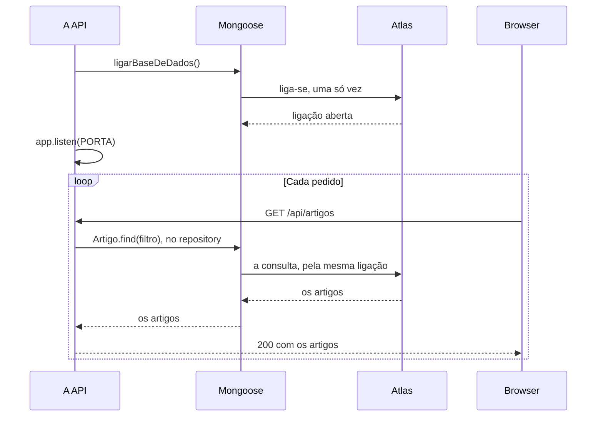
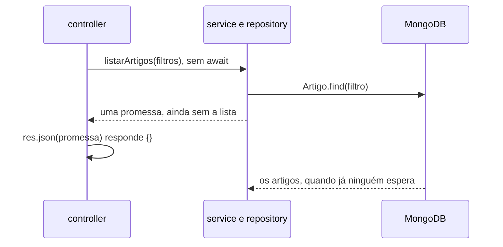
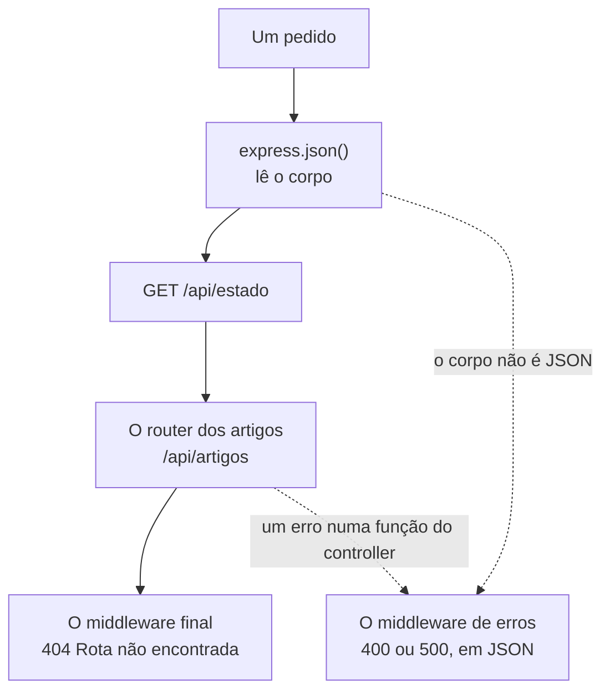

# Ligação segura, CRUD e regras de domínio

Neste guia, a API da papelaria deixa de ler os artigos de um array e passa a criá-los, lê-los, alterá-los e apagá-los no MongoDB, com o Mongoose. Vês o que um pedido pode trazer, em que camada fica cada regra da papelaria e como a API recusa o que não as cumpre, sem estragar os dados.

Usa a API da papelaria com camadas, a ligação ao Atlas com o modelo, o seed e o `_id` dos documentos. Rever: [As camadas em código](04-api-express-e-contratos.md#parte-3-as-camadas-em-código), [a API ligada ao Atlas](../exemplos/acesso-a-dados/papelaria-api-com-atlas/README.md), [o seed da ficha do cinema](https://github.com/NunoMACastro/epms-2627-3ig-si/blob/main/01-aplicacoes-em-browser/exercicios/04-ejs-e-reutilizacao-no-servidor-exercicios-cinema.md#exercício-2-a-ligação-o-modelo-e-o-seed) e [O campo _id e o ObjectId](02-modelo-documental-e-consultas-no-atlas.md#o-campo-_id-e-o-objectid). Para praticar: [ficha de exercícios](exercicios/05-ligacao-segura-crud-e-regras-de-dominio-exercicios.md).

## Neste guia

1. [Parte 1: O contrato e a leitura na base de dados](#parte-1-o-contrato-e-a-leitura-na-base-de-dados)
2. [Parte 2: Criar e alterar só o que cumpre as regras](#parte-2-criar-e-alterar-só-o-que-cumpre-as-regras)
3. [Parte 3: Apagar com cuidado e guardar só o necessário](#parte-3-apagar-com-cuidado-e-guardar-só-o-necessário)
4. [Exemplo guiado: registar uma venda](#exemplo-guiado-registar-uma-venda)

## Parte 1: O contrato e a leitura na base de dados

Antes de escrever na base, a API precisa de um contrato novo e de uma base onde possa errar à vontade. Precisa também de um repository que vá buscar os artigos ao MongoDB.

### O contrato ganha criar, alterar e apagar

No tema anterior, o contrato da papelaria só tinha pedidos para ler. Mas uma papelaria também recebe artigos novos, muda o stock depois de uma entrega e tira do catálogo o que deixou de vender. Estas quatro operações têm um nome: **CRUD**, as iniciais, em inglês, de criar (create), ler (read), alterar (update) e apagar (delete). Quase todas as aplicações que guardam dados fazem estas quatro coisas.

Como no tema anterior, o contrato vem antes do código. Muda em três sítios: o identificador, os métodos e os códigos de estado.

O identificador deixa de ser o `id` de 1 a 8 que estava no array. Passa a ser o `_id` que o MongoDB deu a cada artigo quando o inseriu, e é por ele que se pede um artigo:

```json
{ "_id": "6ae50cc456457b28519e9054", "nome": "Caderno A4 quadriculado", "categoria": "Papel", "stock": 12, "stockMinimo": 5, "precoCentimos": 250, "__v": 0 }
```

O `__v` é o número de versão que o Mongoose acrescenta a cada documento que insere, como viste na ficha do cinema. Não o escreves nem o lês.

Os pedidos novos usam três métodos HTTP. O `POST` cria um artigo, o `PATCH` altera alguns campos de um artigo e o `DELETE` apaga um artigo. Existe também o `PUT`, que substitui o documento inteiro e obriga a enviar todos os campos. A papelaria usa o `PATCH`, porque o que mais faz é mudar o stock sem reescrever o resto.

Os códigos de estado novos são três:

| Código | Nome | Quando |
| --- | --- | --- |
| 201 | Created (criado) | O pedido criou um recurso novo, e o corpo da resposta é esse recurso |
| 204 | No Content (sem conteúdo) | O pedido correu bem e não há nada a devolver, como depois de apagar |
| 409 | Conflict (conflito) | O pedido está bem escrito, mas choca com o estado dos dados, como apagar um artigo que ainda tem stock |

O 409 não é um 400. Um 400 diz que o pedido está mal escrito, como um stock em texto, e repetir o mesmo pedido dá sempre 400. Um 409 diz que o pedido está certo, mas que os dados, como estão agora, não o deixam passar. O mesmo `DELETE` passa mais tarde, quando o stock do artigo chegar a 0.

O contrato fica assim, com os pedidos de leitura do tema anterior e o `_id` no lugar do `id`:

| Pedido | O que faz | Respostas |
| --- | --- | --- |
| `GET /api/artigos` | Lista os artigos, com os filtros `?categoria=` e `?stockMaximo=` | 200; 400 se um filtro não for válido |
| `GET /api/artigos/abaixo-do-minimo` | Lista os artigos a encomendar | 200 |
| `GET /api/artigos/:id` | Mostra um artigo | 200; 400 se o `id` não tiver a forma de um ObjectId; 404 se não existir |
| `POST /api/artigos` | Cria um artigo, com os cinco campos no corpo | 201 com o artigo criado; 400 se o corpo não cumprir as regras |
| `PATCH /api/artigos/:id` | Altera os campos que vierem no corpo | 200 com o artigo alterado; 400; 404 |
| `DELETE /api/artigos/:id` | Apaga um artigo sem stock | 204 sem corpo; 400; 404; 409 se o artigo ainda tiver stock |
| Qualquer outro | Nenhuma rota responde a esse método e a esse caminho | 404 com `{ "erro": "Rota não encontrada" }` |

Qualquer pedido pode ainda responder 500, com `{ "erro": "Erro interno do servidor" }`, se alguma coisa falhar dentro do servidor. Todas as respostas de erro continuam a ter a forma `{ "erro": "..." }`.

O corpo de um `POST` e de um `PATCH` leva os campos de um artigo, com estes tipos e estas regras:

| Campo | Tipo | Regras |
| --- | --- | --- |
| `nome` | texto | obrigatório; até 60 carateres, sem contar os espaços do início e do fim |
| `categoria` | texto | obrigatório; `Papel`, `Escrita` ou `Desenho` |
| `stock` | inteiro | obrigatório; 0 ou mais |
| `stockMinimo` | inteiro | obrigatório; 0 ou mais |
| `precoCentimos` | inteiro | obrigatório; 1 ou mais |

Num `POST`, os cinco são obrigatórios. Num `PATCH`, vem pelo menos um, e os que vierem cumprem as mesmas regras. Qualquer outro campo, como o `_id`, é recusado com 400. O contrato completo, pedido a pedido, está no exemplo [a API com o CRUD](../exemplos/acesso-a-dados/papelaria-api-com-crud/contrato-da-api.md).

### A ligação abre-se uma vez, no arranque

Já escreveste a `ligarBaseDeDados`, e o `server.js` chama-a antes do `app.listen`. Falta dizer porquê.

Ligar ao Atlas demora. O computador encontra o cluster na internet, os dois combinam como vão cifrar a conversa e o Atlas confirma o utilizador e a palavra-passe. Leva algumas centenas de milissegundos, mais do que a própria consulta. E o cluster gratuito aceita um número limitado de ligações ao mesmo tempo. Por isso, a API liga-se uma vez, no arranque, e o Mongoose usa essa ligação em todos os pedidos.



O diagrama mostra a ordem do arranque: primeiro a ligação, depois o `app.listen`, e só então os pedidos, todos pela mesma ligação. A ligação vem antes do `app.listen` porque uma API que aceitasse pedidos antes de chegar aos dados deixava-os à espera. Se o Atlas não responder, é melhor a API não arrancar e dizer porquê no terminal.

### A cadeia de ligação fica só no servidor

A cadeia de ligação, a `MONGODB_URI`, leva o utilizador e a palavra-passe da base de dados, e quem a tiver lê, altera e apaga tudo. Por isso vive no `.env` do servidor, que o `.gitignore` deixa fora do Git. E nunca chega ao browser, porque tudo o que o browser recebe pode ser lido por quem o usa: o HTML, o JSON das respostas e o código da interface.

A interface feita com o React chega ao browser como um conjunto de ficheiros que ele descarrega, o **bundle**. Uma cadeia de ligação escrita num ficheiro do React, ou numa variável `VITE_` do `.env` do React, ia dentro do bundle, à vista de quem abrisse a aplicação. Rever: [O .env do React não guarda segredos](03-arquitetura-e-setup-node.md#o-env-do-react-não-guarda-segredos). É por isso que o React fala com a API, por HTTP, e só a API conhece a cadeia.

Pela mesma razão, o utilizador da base de dados que a API usa não deve poder mais do que ler e escrever dados. Não precisa de criar outros utilizadores nem de mudar o cluster, e se a cadeia escapar, faz menos estragos.

### A base de teste reconstrói-se com o seed

Neste tema vais criar, alterar e apagar artigos muitas vezes, e algumas experiências vão correr mal de propósito. Na base `papelaria`, a do laboratório do Atlas, perdias o que lá puseste à mão, como a Cola em bastão e o fornecedor dela.

Por isso, as experiências fazem-se numa **base de teste**: uma base de dados com dados conhecidos, que se pode estragar à vontade, porque um script a reconstrói. Fica no mesmo cluster, com o nome `papelaria-teste`, e a API passa a usá-la com esta linha do `.env`:

```text
DB_NAME=papelaria-teste
```

A API e o seed usam só a `papelaria-teste`, e a `papelaria` fica no cluster sem mudar. O MongoDB cria a base de teste sozinho, na primeira vez que alguém lá escreve. A `ligarBaseDeDados` também muda numa linha: sem o `DB_NAME`, usa a `papelaria-teste`, e nunca a `papelaria`.

```js
  await mongoose.connect(uri, { dbName: process.env.DB_NAME || "papelaria-teste" });
```

O script que reconstrói a base de teste é um seed, como o do cinema: apaga todos os artigos e insere os oito do início. Depois de qualquer experiência, corres o seed e a base volta ao princípio. Assim os resultados são previsíveis: quem correr o seed e fizer os mesmos pedidos obtém as mesmas respostas, menos nos `_id`, que o MongoDB dá de novo em cada seed.

O perigo está no `deleteMany({})`, que apaga todos os artigos da base onde o seed está ligado. No cinema não se notava, porque a base só tinha os filmes do próprio seed. Na papelaria, bastava um `DB_NAME` errado para apagar a base do laboratório do Atlas. Por isso, o seed da papelaria tem uma verificação a mais: só continua se o nome da base acabar em `-teste`. Corre-se com `npm run seed`, como no cinema, pelo script `"seed": "node --env-file=.env src/seed.js"` do `package.json`:

```js check
// src/seed.js: reconstrói a base de teste da papelaria com os oito artigos.
// Corre-se à parte, com npm run seed. Apaga primeiro os artigos que lá
// estiverem, por isso pode correr-se as vezes que for preciso: depois de cada
// experiência, a base volta a ficar como estava no início.
import mongoose from "mongoose";
import { ligarBaseDeDados } from "./db/mongoose.js";
import { Artigo } from "./models/artigo.model.js";

// Os artigos da papelaria, os mesmos do laboratório do Atlas, sem o _id:
// o MongoDB dá um a cada artigo quando o insere.
const artigos = [
  { nome: "Caderno A4 quadriculado", categoria: "Papel", stock: 12, stockMinimo: 5, precoCentimos: 250 },
  { nome: "Esferográfica azul", categoria: "Escrita", stock: 3, stockMinimo: 10, precoCentimos: 60 },
  { nome: "Bloco de notas A5", categoria: "Papel", stock: 0, stockMinimo: 4, precoCentimos: 180 },
  { nome: "Lápis HB", categoria: "Escrita", stock: 25, stockMinimo: 10, precoCentimos: 35 },
  { nome: "Resma de papel A4", categoria: "Papel", stock: 4, stockMinimo: 3, precoCentimos: 520 },
  { nome: "Marcador fluorescente", categoria: "Escrita", stock: 8, stockMinimo: 10, precoCentimos: 95 },
  { nome: "Régua de 30 cm", categoria: "Desenho", stock: 6, stockMinimo: 3, precoCentimos: 120 },
  { nome: "Compasso escolar", categoria: "Desenho", stock: 1, stockMinimo: 2, precoCentimos: 450 },
];

try {
  await ligarBaseDeDados();
  // O seed apaga todos os artigos da base onde está ligado. Na base papelaria,
  // a do laboratório do Atlas, perdias o que lá inseriste à mão. Por isso,
  // só continua se o nome da base acabar em -teste.
  const nomeDaBase = mongoose.connection.name;
  if (!nomeDaBase.endsWith("-teste")) {
    console.error(`O seed só corre numa base de teste, e esta é a ${nomeDaBase}. Muda o DB_NAME no .env.`);
  } else {
    const apagados = await Artigo.deleteMany({});
    console.log(`Apagados ${apagados.deletedCount} artigos`);
    // O insertMany verifica cada artigo com as regras do schema antes de inserir.
    const inseridos = await Artigo.insertMany(artigos);
    console.log(`Inseridos ${inseridos.length} artigos`);
  }
} catch (erro) {
  console.error(`O seed falhou: ${erro.message}`);
}

// A ligação fica aberta até alguém a fechar. Sem esta linha, o programa
// ficava à espera e não voltava ao terminal.
await mongoose.disconnect();
```

Com `DB_NAME=papelaria`, o terminal escreve isto, e os artigos da base `papelaria` ficam como estavam:

```text
Ligada à base de dados papelaria
O seed só corre numa base de teste, e esta é a papelaria. Muda o DB_NAME no .env.
```

O `mongoose.connection.name` é o nome da base a que a ligação chegou, o mesmo que a `ligarBaseDeDados` escreve na primeira linha. O `endsWith("-teste")` diz se esse nome acaba em `-teste`, e como não acaba, o seed não apaga nada. Com `DB_NAME=papelaria-teste`, escreve `Apagados 0 artigos` e `Inseridos 8 artigos` da primeira vez, e `Apagados 8 artigos` das seguintes.

### O repository troca o array pela base de dados

No tema anterior, a pasta `src/dados` ocupava o lugar do repository, com os oito artigos num array. Agora entra o repository, em `src/repositories/artigos.repository.js`, a única camada que usa o modelo `Artigo` e escreve consultas do MongoDB. É o mesmo papel do repository das cenas, no passo 2 do jogo ([a fase 4, onde crias o repository das cenas](laboratorios/04-api-express-e-contratos-laboratorio.md#fase-4-as-camadas-ligam-se-com-export-e-import)).

O modelo `Artigo` é o da aula em que ligaste a papelaria ao Atlas, com duas diferenças. Perdeu a localização e o fornecedor, que nenhum pedido do contrato usa. E ganhou as regras de cada campo, que estão em [As regras de cada campo ficam no schema](#as-regras-de-cada-campo-ficam-no-schema).

O repository começa pelo `import { Artigo } from "../models/artigo.model.js";`, e as primeiras funções são as dos pedidos de leitura:

```js
/**
 * Procura os artigos que cumprem as condições recebidas.
 * As condições que faltam não se aplicam; sem nenhuma, vêm todos os artigos.
 * @param {object} condicoes com categoria (texto) e stockAte (número), os dois opcionais
 * @returns {Promise<object[]>} os artigos encontrados, possivelmente nenhum
 */
export async function procurarArtigos(condicoes) {
  // O filtro é o mesmo que escreverias na barra do Atlas, construído aqui a
  // partir das condições. Nenhum valor do pedido entra nele sem ter sido verificado.
  const filtro = {};
  if (condicoes.categoria !== undefined) {
    filtro.categoria = condicoes.categoria;
  }
  if (condicoes.stockAte !== undefined) {
    filtro.stock = { $lte: condicoes.stockAte };
  }
  const artigos = await Artigo.find(filtro);
  return artigos;
}

/**
 * Procura um artigo pelo _id.
 * @param {string} id um identificador com a forma de um ObjectId, já verificado pelo controller
 * @returns {Promise<object | null>} o artigo, ou null se não existir
 */
export async function procurarPorId(id) {
  // O findById devolve o documento, ou null quando nenhum tem este _id.
  const artigo = await Artigo.findById(id);
  return artigo;
}
```

A `procurarArtigos` recebe condições com nomes da papelaria, como `stockAte`, e transforma-as no filtro do MongoDB. É o único sítio da API onde aparece o `$lte`. A `procurarPorId` devolve `null` quando nenhum artigo tem aquele `_id`. Tal como a `obterArtigo` do tema anterior, não sabe o que é um 404: diz só que não há.

As funções do Mongoose devolvem uma promessa, porque perguntar à base demora. Por isso, o repository é `async`, e o service e o controller também passam a ser, com um `await` antes de cada chamada à camada de baixo. O service muda pouco. A `listarArtigos` passa as condições ao repository, a `obterArtigo` pede-lhe o artigo, e a `artigosAbaixoDoMinimo` pede-lhe todos os artigos e aplica a regra da papelaria, como antes:

```js
/**
 * Devolve os artigos que cumprem os filtros recebidos.
 * Os filtros já chegam verificados pelo controller; os que faltam não se aplicam.
 * @param {object} filtros com categoria (texto) e stockMaximo (número), os dois opcionais
 * @returns {Promise<object[]>} os artigos, possivelmente nenhum
 */
export async function listarArtigos(filtros) {
  const condicoes = {};
  if (filtros.categoria !== undefined) {
    condicoes.categoria = filtros.categoria;
  }
  if (filtros.stockMaximo !== undefined) {
    // O stock máximo inclui o valor: com 4, entram os artigos com stock 4.
    condicoes.stockAte = filtros.stockMaximo;
  }
  const artigos = await procurarArtigos(condicoes);
  return artigos;
}

/**
 * Procura um artigo pelo _id.
 * @param {string} id um identificador já verificado pelo controller
 * @returns {Promise<object | null>} o artigo, ou null se não existir
 */
export async function obterArtigo(id) {
  const artigo = await procurarPorId(id);
  return artigo;
}

/**
 * Regra da papelaria: um artigo está abaixo do mínimo quando o stock é
 * menor do que o stock mínimo definido para ele, e é preciso encomendá-lo.
 * @returns {Promise<object[]>} os artigos a encomendar, possivelmente nenhum
 */
export async function artigosAbaixoDoMinimo() {
  const artigos = await procurarArtigos({});
  return artigos.filter((artigo) => artigo.stock < artigo.stockMinimo);
}
```

O `stockMaximo`, que é o nome do contrato, passa a `stockAte`, o nome que o repository entende, para o repository não depender dos nomes do contrato. A regra dos artigos a encomendar continua no service, porque é uma regra da papelaria, e não uma consulta. A base devolve os artigos, e quem decide quais estão abaixo do mínimo é o service.

O `await` esquecido é o erro mais traiçoeiro desta mudança. Prevê: se a `listar` do controller ficasse sem o `await`, o que respondia `/api/artigos`?

```js
/** GET /api/artigos, com os filtros opcionais ?categoria= e ?stockMaximo= */
export async function listar(req, res) {
  // ... as verificações dos filtros, como no tema anterior ...
  const artigos = listarArtigos(filtros); // sem o await: um erro de propósito
  res.json(artigos);
}
```

Responde 200 com `{}`, e o terminal não mostra erro nenhum. Sem o `await`, a variável `artigos` guarda a promessa, e não a lista, e uma promessa escrita em JSON é um objeto vazio. O diagrama mostra o que acontece, pela ordem:



A pista é a forma da resposta: um objeto vazio onde se esperava uma lista. No service, o mesmo esquecimento dá outro sintoma quando a função usa o resultado. Na `artigosAbaixoDoMinimo`, a API responde 500, e o terminal diz `artigos.filter is not a function`, porque uma promessa não tem `filter`.

### A forma do `_id` verifica-se antes de ir à base

O contrato diz que `GET /api/artigos/:id` responde 400 quando o `id` não tem a forma de um ObjectId, e 404 quando tem a forma certa mas nenhum artigo o tem.

Sem verificação, o `findById("abc")` não devolve `null`. O Mongoose tenta converter `"abc"` num ObjectId, não consegue e lança um erro de conversão, o `CastError`. A API responde 500, como se a culpa fosse do servidor, numa página HTML do Express, como no tema anterior. O terminal mostra o erro, que começa por esta linha:

```text
CastError: Cast to ObjectId failed for value "abc" (type string) at path "_id" for model "Artigo"
```

Um ObjectId escrito em texto tem 24 carateres, cada um de 0 a 9 ou de `a` a `f`. O controller verifica essa forma antes de chamar o service, com uma função pequena:

```js check
/**
 * Diz se um texto tem a forma de um identificador do MongoDB, um ObjectId
 * escrito em texto: 24 carateres, cada um de 0 a 9 ou de a a f.
 * Não diz se o artigo existe; isso só a base de dados sabe.
 * @param {string} texto o valor tal como chegou no caminho do pedido
 * @returns {boolean}
 */
function eIdentificador(texto) {
  if (typeof texto !== "string" || texto.length !== 24) {
    return false;
  }
  for (const carater of texto.toLowerCase()) {
    if (!"0123456789abcdef".includes(carater)) {
      return false;
    }
  }
  return true;
}
```

Prevê o que a `eIdentificador` devolve para `"abc"`, para `"6AE50CC456457B28519E9054"`, com letras maiúsculas, e para `"zzzzzzzzzzzzzzzzzzzzzzzz"`.

Devolve `false`, `true` e `false`. O `"abc"` não tem 24 carateres, e a função para logo na primeira verificação. O texto em maiúsculas passa, porque o `toLowerCase()` o põe em minúsculas antes de comparar, e o MongoDB aceita as duas formas. Os 24 `z` têm o comprimento certo. O `for...of` percorre o texto um carater de cada vez, e o `includes`, que também existe nos textos, diz que o primeiro `z` não está em `"0123456789abcdef"`.

Com esta função, a `obter` faz as duas verificações pela ordem do contrato. Primeiro a forma, que o controller vê sem ir à base, com 400. Depois a existência, que só a base sabe, com 404 quando o service devolve `null`:

```js
/** GET /api/artigos/:id */
export async function obter(req, res) {
  const id = req.params.id;
  if (!eIdentificador(id)) {
    res.status(400).json({ erro: "O identificador do artigo tem de ter 24 carateres, de 0 a 9 e de a a f" });
    return;
  }
  const artigo = await obterArtigo(id);
  if (artigo === null) {
    res.status(404).json({ erro: `Não existe o artigo ${id}` });
    return;
  }
  res.json(artigo);
}
```

<details>
<summary>Para ires mais longe: a função do Mongoose</summary>

O Mongoose tem uma função parecida, a `mongoose.isValidObjectId`. O controller não a usa, porque assim não precisa de importar o Mongoose: só o repository conhece a base de dados.

</details>

## Parte 2: Criar e alterar só o que cumpre as regras

Escrever na base é mais delicado do que ler. Uma leitura mal feita mostra uma lista errada, e corrige-se no código; uma escrita mal feita fica guardada, como um preço negativo ou um artigo sem nome. Esta parte mostra como os dados chegam no pedido e quem recusa os que não servem.

### O corpo do pedido chega em `req.body`

Para criar um artigo são precisos cinco campos, alguns com espaços e acentos. No endereço ficavam desajeitados, e os endereços ficam guardados no histórico do browser e nos registos dos servidores. Por isso, os pedidos `POST` e `PATCH` levam os dados no **corpo do pedido**, uma parte do pedido que vem depois do endereço e dos **cabeçalhos**. Os cabeçalhos são as linhas de informação que acompanham o pedido. Um `POST` que cria um artigo viaja assim:

```text
POST /api/artigos HTTP/1.1
Host: localhost:3000
Content-Type: application/json

{ "nome": "Cola", "categoria": "Desenho", "stock": 1, "stockMinimo": 1, "precoCentimos": 150 }
```

A primeira linha é o método e o caminho, as duas seguintes são cabeçalhos, e o corpo vem depois da linha em branco. O cabeçalho `Content-Type` diz em que formato vem o corpo, e na papelaria o corpo vem em JSON, como as respostas.

O Express não lê o corpo sozinho. Quem o lê é um middleware, o `express.json()`, registado no `server.js` antes das rotas:

```js
// Lê o corpo dos pedidos que chegam em JSON e põe-no em req.body, já como
// objeto. Sem esta linha, o req.body ficava undefined em todos os pedidos.
app.use(express.json());
```

Quando o `Content-Type` diz `application/json`, o `express.json()` lê o texto do corpo, converte-o num objeto e guarda-o em `req.body`.

A barra de endereço do browser só faz pedidos `GET`. Os outros fazem-se na consola das ferramentas de programador, com o `fetch` que conheces do 11.º ano. O `fetch` aceita um segundo argumento, com o método, os cabeçalhos e o corpo. A função `pedir` junta isso e escreve na consola o código e o corpo da resposta:

```js check
// Faz um pedido à API e escreve na consola o código e o corpo da resposta.
async function pedir(metodo, caminho, corpo) {
  const opcoes = { method: metodo };
  if (corpo !== undefined) {
    // O cabeçalho diz à API que o corpo vem em JSON. O JSON.stringify
    // escreve o objeto como texto JSON, que é o que viaja no pedido.
    opcoes.headers = { "Content-Type": "application/json" };
    opcoes.body = JSON.stringify(corpo);
  }
  const resposta = await fetch(caminho, opcoes);
  const texto = await resposta.text();
  console.log(resposta.status, texto);
}
```

Sem corpo, como num `DELETE`, a função só envia o método. A resposta lê-se como texto, e não com o `.json()`, porque uma resposta 204 não tem corpo, e o `.json()` falhava com ela.

O caminho começa em `/api`, sem `http://localhost:3000`, porque o `fetch` o completa com o endereço da página aberta. Por isso, a consola tem de estar numa página da tua API, como `/api/estado`. Cola-se lá a função, e depois `await pedir("GET", "/api/estado")` escreve `200 {"estado":"ok","aplicacao":"API da papelaria"}`.

### Só passam os campos de uma lista fechada

O controller recebe o corpo em `req.body`, já como objeto. Passá-lo tal e qual ao service, e daí ao `Artigo.create`, escreve-se numa linha e funciona com os pedidos bem feitos. O problema são os outros, porque o `req.body` traz o que quem pediu quiser:

| O corpo traz | O que acontecia se seguisse inteiro |
| --- | --- |
| `"_id": "000000000000000000000001"` | Quem pediu escolhia o identificador do artigo |
| `"precoCentimo": 250`, sem o `s`, num `PATCH` | Nada dava erro: o preço ficava como estava, e quem pediu achava que o tinha mudado |
| `"nome": { "$ne": null }` | Numa rota que procurasse pelo nome, como `Artigo.find({ nome: req.body.nome })`, o objeto era lido como o operador `$ne`, "diferente de", e escolhia todos os artigos com nome |

A solução para os três é a mesma. O controller tem uma **lista fechada** dos campos aceites, e cada um tem de vir com o tipo do contrato. Um campo que não está na lista é recusado com 400, com uma mensagem que diz qual é. Recusar, em vez de ignorar, é o que apanha o `precoCentimo`. Os campos copiam-se um a um para um objeto novo, e o `req.body` nunca segue inteiro:

```js
// Os campos que o corpo de um pedido pode trazer, para criar ou alterar um
// artigo. É uma lista fechada: um campo que não esteja aqui é recusado.
const CAMPOS_DE_TEXTO = ["nome", "categoria"];
const CAMPOS_INTEIROS = ["stock", "stockMinimo", "precoCentimos"];

/**
 * Lê do corpo do pedido os campos de um artigo: só os da lista, cada um com o tipo certo.
 * Não verifica os valores, como o mínimo ou as categorias: essas são regras da
 * papelaria, e quem as verifica é o schema do modelo.
 * @param {unknown} corpo o req.body, tal como o express.json() o deixou
 * @returns {object} { erro } com a mensagem do primeiro problema, ou { dados } com os campos lidos
 */
function lerCamposDoArtigo(corpo) {
  // Sem corpo em JSON, o req.body fica undefined.
  if (typeof corpo !== "object" || corpo === null || Array.isArray(corpo)) {
    return { erro: "O corpo do pedido tem de ser um objeto JSON" };
  }
  // O objeto dados recebe só os campos da lista, copiados um a um.
  // O req.body nunca segue inteiro para o service.
  const dados = {};
  for (const campo of Object.keys(corpo)) {
    const valor = corpo[campo];
    if (CAMPOS_DE_TEXTO.includes(campo)) {
      // Um objeto no lugar de um texto, como { "$ne": null }, é recusado aqui.
      // Se chegasse a um filtro, seria lido como um operador do MongoDB.
      if (typeof valor !== "string") {
        return { erro: `O campo ${campo} tem de ser um texto` };
      }
    } else if (CAMPOS_INTEIROS.includes(campo)) {
      if (!Number.isInteger(valor)) {
        return { erro: `O campo ${campo} tem de ser um número inteiro` };
      }
    } else {
      return { erro: `O campo ${campo} não é aceite` };
    }
    dados[campo] = valor;
  }
  return { dados: dados };
}
```

Prevê o que a `lerCamposDoArtigo` devolve para estes três corpos: `{ "nome": "Cola", "stock": "10" }`, `{ "nome": "Cola", "_id": "x" }` e `{ "nome": { "$ne": null } }`.

A função começa por confirmar que o corpo é um objeto. O `typeof` de `null` e o de um array também dão `"object"`, e por isso há mais duas condições: o `Array.isArray` diz se um valor é um array. Depois percorre os nomes dos campos que vieram, que o `Object.keys(corpo)` dá numa lista, e devolve `{ erro }` ao primeiro problema:

- no primeiro corpo, `{ erro: "O campo stock tem de ser um número inteiro" }`, porque o `"10"` entre aspas é um texto, e o `Number.isInteger` de um texto é sempre `false`;
- no segundo, `{ erro: "O campo _id não é aceite" }`, porque o `_id` não está em nenhuma das duas listas;
- no terceiro, `{ erro: "O campo nome tem de ser um texto" }`, porque o valor é um objeto, e o `typeof` de um objeto é `"object"`, e não `"string"`.

Se todos os campos passarem, devolve `{ dados }`, com a cópia, e o controller só tem de ver qual das duas propriedades veio.

A mesma ideia vale para a pesquisa. Repetido, como em `?categoria=Papel&categoria=Escrita`, o parâmetro chega como um array. Com os artigos no array do tema anterior, a comparação com o texto da categoria falhava sempre. Com a base, o Mongoose devolve os artigos das duas categorias, uma pesquisa que o contrato não prevê e que quem fez o pedido escolheu. Por isso, a `listar` confirma que a categoria é um texto:

```js
  if (req.query.categoria !== undefined) {
    // Repetido, como ?categoria=Papel&categoria=Escrita, o parâmetro chega
    // como um array, e não como um texto.
    if (typeof req.query.categoria !== "string") {
      res.status(400).json({ erro: "O parâmetro categoria tem de ser um texto, e só pode vir uma vez" });
      return;
    }
    filtros.categoria = req.query.categoria;
  }
```

<details>
<summary>Para ires mais longe: os nomes destes ataques</summary>

Guardar tudo o que vem num pedido é um erro tão conhecido que tem nome em inglês: mass assignment, atribuição em massa. Noutra aplicação, um campo `"administrador": true` no registo de um utilizador dava-lhe poderes que ninguém lhe quis dar. Pôr um operador como o `$ne` no lugar de um valor chama-se injeção de operadores, uma forma de NoSQL injection. Com estes nomes, encontras muita informação sobre os dois.

</details>

### As regras de cada campo ficam no schema

Um stock de -3 é um inteiro, e passa a lista fechada. Uma categoria `Mochilas` é um texto, e também passa. Mas uma papelaria não tem -3 cadernos, nem vende mochilas. Estas regras são do **domínio**, o assunto de que a aplicação trata: dizem o que faz sentido para a papelaria, e não como se escreve um pedido.

As regras ficam onde podem ser garantidas. Escritas no controller, só protegiam os pedidos que passam por ele, e o seed ou um script de experiências escreviam artigos sem elas. Escritas no schema do modelo, protegem tudo o que cria artigos, porque tudo passa pelo modelo. O schema da papelaria passa a dizer, campo a campo, o tipo e as regras:

```js check
// src/models/artigo.model.js: o modelo dos artigos da papelaria, no Mongoose.
// O schema descreve a forma dos documentos da coleção artigos e guarda as
// regras de cada campo: o que é obrigatório, os mínimos e as categorias.
// Tudo o que escreve artigos passa por estas regras: a API, o seed e os scripts.
import mongoose from "mongoose";

// As categorias que a papelaria vende. Um artigo de outra categoria é recusado.
const CATEGORIAS = ["Papel", "Escrita", "Desenho"];

const artigoSchema = new mongoose.Schema({
  nome: {
    type: String,
    // O segundo valor de cada regra é a mensagem que a API devolve quando
    // a regra falha. Sem ele, o Mongoose escrevia uma mensagem em inglês.
    required: [true, "O nome é obrigatório"],
    // O trim tira os espaços do início e do fim antes de verificar e guardar.
    // Um nome só com espaços fica vazio, e o required recusa-o.
    trim: true,
    maxlength: [60, "O nome tem no máximo 60 carateres"],
  },
  categoria: {
    type: String,
    required: [true, "A categoria é obrigatória"],
    enum: { values: CATEGORIAS, message: "A categoria tem de ser Papel, Escrita ou Desenho" },
  },
  stock: {
    type: Number,
    required: [true, "O stock é obrigatório"],
    min: [0, "O stock não pode ser negativo"],
  },
  stockMinimo: {
    type: Number,
    required: [true, "O stock mínimo é obrigatório"],
    min: [0, "O stock mínimo não pode ser negativo"],
  },
  precoCentimos: {
    type: Number,
    required: [true, "O preço é obrigatório"],
    min: [1, "O preço tem de ser de pelo menos 1 cêntimo"],
  },
});

// O terceiro argumento é o nome da coleção, escrito à mão, para o Mongoose
// não o inventar com as regras do plural em inglês.
export const Artigo = mongoose.model("Artigo", artigoSchema, "artigos");
```

Cada campo deixou de ter só o tipo, como `nome: String`, e passou a ser um objeto com o tipo e as regras. São cinco opções:

| Opção | O que faz | Na papelaria |
| --- | --- | --- |
| `required` | O campo é obrigatório; num texto, um texto vazio também conta como em falta | Os cinco campos |
| `trim` | Não é uma regra, é uma limpeza: tira os espaços do início e do fim antes de verificar e de guardar | O `nome`: `"  Cola  "` fica `"Cola"`, e `"   "` fica vazio, e o `required` recusa-o |
| `maxlength` | O comprimento máximo de um texto | O `nome`, até 60 |
| `min` | O valor mínimo de um número | O `stock` e o `stockMinimo`, 0; o `precoCentimos`, 1 |
| `enum` | A lista dos valores possíveis | A `categoria` |

Cada regra leva uma mensagem em português, que é a que a API vai devolver, e por isso escreve-se para quem usa a aplicação. Antes de criar um documento, o Mongoose verifica as regras. Se alguma falhar, não escreve nada e lança um erro de validação, o `ValidationError`, com as mensagens das regras que falharam.

A divisão fica assim: o controller vê a forma do pedido, os campos da lista e o tipo de cada um, e o schema vê os valores. Um corpo `{ "stock": "dez" }` é recusado pelo controller, porque não é um inteiro. Um corpo `{ "stock": -3 }` passa o controller e é recusado pelo schema.

O tipo fica no controller porque o schema converte antes de verificar. O `type: Number` transforma o texto `"10"` no número 10, sem dizer nada, e aceita 2.5, que não é um stock. Só o controller vê o valor como veio no pedido, e por isso é ele que sabe se veio um inteiro.

### O POST cria o documento e responde 201

Com a lista fechada e o schema, criar um artigo é curto. No repository, o `create` verifica as regras do schema e insere:

```js
/**
 * Insere um artigo novo. O schema verifica as regras de cada campo antes de
 * inserir; se alguma falhar, a promessa é rejeitada com um ValidationError.
 * @param {object} dados os campos do artigo, só os da lista do controller
 * @returns {Promise<object>} o artigo inserido, já com o _id que o MongoDB lhe deu
 */
export async function inserirArtigo(dados) {
  const artigo = await Artigo.create(dados);
  return artigo;
}
```

O service passa os dados ao repository. É uma função curta, que existe para o controller só conhecer o service:

```js
/**
 * Cria um artigo novo. As regras de cada campo estão no schema do modelo.
 * @param {object} dados os campos do artigo, já com o tipo verificado pelo controller
 * @returns {Promise<object>} o artigo criado
 */
export async function criarArtigo(dados) {
  const artigo = await inserirArtigo(dados);
  return artigo;
}
```

O controller lê o corpo com a lista fechada, chama o service e responde 201, com o artigo criado. A rota junta-se ao router com `router.post("/", criar);`.

```js
/** POST /api/artigos, com o artigo novo no corpo, em JSON */
export async function criar(req, res) {
  const leitura = lerCamposDoArtigo(req.body);
  if (leitura.erro) {
    res.status(400).json({ erro: leitura.erro });
    return;
  }
  // Se uma regra do schema falhar, o criarArtigo rejeita a promessa, e o
  // Express passa o erro ao middleware de erros, no server.js, que responde 400.
  const artigo = await criarArtigo(leitura.dados);
  res.status(201).json(artigo);
}
```

### O middleware de erros responde em JSON

O comentário do `criar` fala de uma peça que o `server.js` ainda não tem. Sem ela, um artigo com stock -1 fica sem a resposta do contrato. O `create` rejeita a promessa, o `await` do controller lança o `ValidationError`, e nenhuma linha do controller o apanha. Com o `server.js` do tema anterior, o Express responde 500, numa página HTML com as linhas do erro e os caminhos dos teus ficheiros.

No Express 5, um erro lançado dentro de uma função `async` de uma rota não se perde: o Express apanha-o e passa-o ao **middleware de erros**. É um middleware com quatro parâmetros, `(erro, req, res, next)`, em vez de três, e é pelos quatro que o Express o reconhece. Só é chamado quando um pedido acaba num erro, e por isso regista-se no fim do `server.js`, depois das rotas e do middleware final:



O diagrama mostra a ordem do `server.js`. Um pedido percorre-o de cima para baixo e para na primeira peça que responde. O que nenhuma rota atende chega ao middleware final, com 404. O que acaba num erro salta as peças normais e vai direito ao middleware de erros. O `server.js` completo está no exemplo [a API com o CRUD](../exemplos/acesso-a-dados/papelaria-api-com-crud/README.md).

O middleware de erros da papelaria trata três casos: o corpo que não é JSON, as regras do schema e todos os outros erros.

```js
// Middleware de erros: o Express só o chama quando um pedido acabou num erro,
// e reconhece-o pelos quatro parâmetros. Responde sempre em JSON, sem
// pormenores internos.
app.use((erro, req, res, next) => {
  // O express.json() não conseguiu ler o corpo: o texto não era JSON.
  if (erro.type === "entity.parse.failed") {
    res.status(400).json({ erro: "O corpo do pedido não é JSON válido" });
    return;
  }
  // Uma ou mais regras do schema falharam. O erro traz, em erro.errors, um
  // objeto com um campo por cada regra que falhou, e cada um tem a mensagem
  // que escreveste no schema. A resposta junta-as todas num só texto.
  if (erro.name === "ValidationError") {
    const mensagens = Object.values(erro.errors).map((falha) => falha.message);
    res.status(400).json({ erro: mensagens.join(". ") });
    return;
  }
  // Qualquer outro erro é um problema do servidor, e não de quem pediu.
  // A razão fica no terminal, para quem programa; o cliente recebe só o 500.
  console.error(`Erro interno: ${erro.message}`);
  res.status(500).json({ erro: "Erro interno do servidor" });
});
```

Prevê o que a API responde a um `POST /api/artigos` com `{ "nome": "Cola", "categoria": "Desenho", "stock": -1, "stockMinimo": 1, "precoCentimos": 150 }`. E com o mesmo corpo, mas com `"categoria": "Mochilas"`?

O primeiro dá 400 com `{"erro":"O stock não pode ser negativo"}`, e o segundo 400 com `{"erro":"A categoria tem de ser Papel, Escrita ou Desenho. O stock não pode ser negativo"}`. Os dois corpos passam a lista fechada, porque os campos e os tipos estão certos. O schema recusa-os, e o middleware reconhece o erro pelo nome, `ValidationError`. O `Object.values(erro.errors)` dá a lista das entradas, uma por campo recusado, o `map` tira de cada uma a mensagem e o `join(". ")` junta-as num só texto.

A resposta 500 não leva a mensagem do erro. Uma mensagem interna pode ter o nome de uma coleção, de um ficheiro ou um pedaço de uma consulta. Quem usa a aplicação não precisa disso, e quem a quer atacar agradece.

<details>
<summary>Para ires mais longe: a ordem das mensagens</summary>

Quando várias regras falham, a ordem das mensagens é a que o Mongoose escolhe, e nem sempre é a dos campos do schema. Com o corpo `{}`, a resposta começa por `O preço é obrigatório` e acaba em `O nome é obrigatório`. O texto tem as mensagens todas, e é isso que interessa a quem pediu.

</details>

### Alterar um documento pede duas opções

A papelaria contou os cadernos na prateleira e tem 7. O `PATCH /api/artigos/:id` do caderno leva só `{ "stock": 7 }`, e os outros campos ficam como estão.

O controller faz as verificações que já conheces, pela ordem do contrato: a forma do `id` e a lista fechada. Junta uma nova. Um corpo `{}` passa a lista fechada, porque não traz nenhum campo errado, mas também não traz nada para alterar, e o contrato pede pelo menos um:

```js
/** PATCH /api/artigos/:id, com os campos a alterar no corpo, em JSON */
export async function alterar(req, res) {
  const id = req.params.id;
  if (!eIdentificador(id)) {
    res.status(400).json({ erro: "O identificador do artigo tem de ter 24 carateres, de 0 a 9 e de a a f" });
    return;
  }
  const leitura = lerCamposDoArtigo(req.body);
  if (leitura.erro) {
    res.status(400).json({ erro: leitura.erro });
    return;
  }
  if (Object.keys(leitura.dados).length === 0) {
    res.status(400).json({ erro: "O pedido não traz nenhum campo para alterar" });
    return;
  }
  const artigo = await alterarArtigo(id, leitura.dados);
  if (artigo === null) {
    res.status(404).json({ erro: `Não existe o artigo ${id}` });
    return;
  }
  res.json(artigo);
}
```

O repository usa o `findByIdAndUpdate`, que procura o artigo pelo `_id` e muda os campos recebidos. Escrito só com os dois primeiros argumentos, `Artigo.findByIdAndUpdate(id, dados)`, tem duas surpresas, e cada uma vê-se num pedido.

A primeira: depois de `{ "stock": 7 }`, a resposta mostra o stock antigo, 12, mas no Atlas o stock já é 7. Por omissão, a função devolve o documento como estava antes da alteração.

A segunda: um `PATCH` com `{ "stock": -5 }` responde 200, e no Atlas o stock fica mesmo -5. Por omissão, o Mongoose só verifica as regras do schema quando cria um documento.

As duas resolvem-se com opções, num terceiro argumento. Para as encontrar, abre-se a documentação do Mongoose na página do `Model.findByIdAndUpdate()`, a da versão que tens instalada. O comando `npm ls mongoose`, na pasta do projeto, mostra qual é. A lista das opções tem as duas que fazem falta. O `returnDocument`, com o valor `"after"`, devolve o documento depois da alteração. O `runValidators`, com `true`, faz correr as regras do schema sobre os campos alterados.

```js
/**
 * Altera os campos recebidos de um artigo, e deixa os outros como estão.
 * @param {string} id um identificador com a forma de um ObjectId, já verificado
 * @param {object} dados os campos a alterar, só os da lista do controller
 * @returns {Promise<object | null>} o artigo depois da alteração, ou null se não existir
 */
export async function alterarPorId(id, dados) {
  // Sem as duas opções, o findByIdAndUpdate devolvia o artigo como estava
  // antes da alteração, e não verificava as regras do schema, que por omissão
  // só correm quando um documento é criado.
  const artigo = await Artigo.findByIdAndUpdate(id, dados, {
    returnDocument: "after",
    runValidators: true,
  });
  return artigo;
}
```

O service passa os dados ao repository, como na criação, e a rota junta-se ao router com `router.patch("/:id", alterar);`:

```js
/**
 * Altera os campos recebidos de um artigo.
 * @param {string} id um identificador já verificado pelo controller
 * @param {object} dados os campos a alterar, já com o tipo verificado
 * @returns {Promise<object | null>} o artigo alterado, ou null se não existir
 */
export async function alterarArtigo(id, dados) {
  const artigo = await alterarPorId(id, dados);
  return artigo;
}
```

Com as duas opções, o `PATCH` com `{ "stock": -5 }` responde 400, com `{"erro":"O stock não pode ser negativo"}`, pelo mesmo middleware de erros do `POST`, e o stock no Atlas não muda.

## Parte 3: Apagar com cuidado e guardar só o necessário

Um artigo apagado não volta. Esta parte trata da regra que decide se um artigo pode sair, de como se apagam muitos sem surpresas e dos cuidados com os dados das pessoas.

### Uma regra que precisa da base fica no service

A papelaria só tira um artigo do catálogo quando já não há unidades na loja. Enquanto houver stock, ainda há o que vender, e apagar o artigo perdia a informação dessas unidades.

Esta regra não cabe no schema, que verifica os valores que se vão escrever, e um `DELETE` não escreve nada. Para a aplicar, é preciso ir à base ver o stock de agora. Uma regra que precisa do estado dos dados fica no service, que pede esse estado ao repository:

```js
/**
 * Apaga um artigo, se a regra da papelaria o deixar.
 * @param {string} id um identificador já verificado pelo controller
 * @returns {Promise<string>} o que aconteceu: "apagado", "nao-existe" ou "tem-stock"
 */
export async function apagarArtigo(id) {
  const artigo = await procurarPorId(id);
  if (artigo === null) {
    return "nao-existe";
  }
  // Regra da papelaria: um artigo só sai do catálogo quando já não há
  // unidades na loja. Enquanto houver stock, ainda há o que vender.
  if (artigo.stock > 0) {
    return "tem-stock";
  }
  await apagarPorId(id);
  return "apagado";
}
```

O service só apaga no terceiro caso, e não escolhe códigos HTTP: diz o que aconteceu com uma palavra, `"nao-existe"`, `"tem-stock"` ou `"apagado"`. O controller traduz cada palavra num código:

```js
/** DELETE /api/artigos/:id */
export async function apagar(req, res) {
  const id = req.params.id;
  if (!eIdentificador(id)) {
    res.status(400).json({ erro: "O identificador do artigo tem de ter 24 carateres, de 0 a 9 e de a a f" });
    return;
  }
  const resultado = await apagarArtigo(id);
  if (resultado === "nao-existe") {
    res.status(404).json({ erro: `Não existe o artigo ${id}` });
    return;
  }
  if (resultado === "tem-stock") {
    res.status(409).json({ erro: "Não se pode apagar um artigo que ainda tem stock" });
    return;
  }
  // 204: apagado, e a resposta não tem corpo.
  res.status(204).end();
}
```

Prevê o que respondem estes dois pedidos, na base de teste acabada de reconstruir. O primeiro é o `DELETE` do Caderno A4 quadriculado, que tem 12 unidades; o segundo, o do Bloco de notas A5, que tem 0. E se repetires o segundo?

O caderno dá 409 com `{"erro":"Não se pode apagar um artigo que ainda tem stock"}`, e continua na base. O bloco dá 204, sem corpo: o `end()` termina a resposta sem escrever nada, ao contrário do `json`. Repetido, dá 404 com `{"erro":"Não existe o artigo ..."}`, com o `_id` do bloco, que já foi apagado.

No repository, o `findByIdAndDelete` apaga o documento com aquele `_id`:

```js
/**
 * Apaga um artigo.
 * @param {string} id um identificador com a forma de um ObjectId, já verificado
 * @returns {Promise<void>} cumprida quando o artigo foi apagado
 */
export async function apagarPorId(id) {
  await Artigo.findByIdAndDelete(id);
}
```

Com as três rotas novas, o router fica assim:

```js check
// src/rotas/artigos.rotas.js: que pedido vai para que função do controller.
// Os caminhos são relativos ao sítio onde este router é montado, em server.js:
// "/" quer dizer /api/artigos, e "/:id" quer dizer /api/artigos/:id.
import express from "express";
import { listar, abaixoDoMinimo, obter, criar, alterar, apagar } from "../controllers/artigos.controller.js";

const router = express.Router();

router.get("/", listar);
// O caminho fixo vem antes do caminho com parâmetro. Ao contrário,
// /abaixo-do-minimo seria tratado como um :id, e daria 400.
router.get("/abaixo-do-minimo", abaixoDoMinimo);
router.get("/:id", obter);
router.post("/", criar);
router.patch("/:id", alterar);
router.delete("/:id", apagar);

export default router;
```

Com o service, as regras do tema ficam repartidas por três sítios, cada um com o que pode garantir:

| Onde | O que verifica | Na papelaria | Quando falha |
| --- | --- | --- | --- |
| Controller | A forma do pedido, sem ir à base | O `_id` com 24 carateres, os campos da lista e o tipo de cada um | 400 |
| Schema do modelo | Os valores de cada campo, quando se cria um artigo e nas alterações com o `runValidators` | O nome obrigatório, as três categorias, o stock 0 ou mais | 400, pelo middleware de erros |
| Service | As regras que precisam do estado dos dados | Um artigo com stock não se apaga | 409 |

Cada regra fica num só sítio. Duas cópias da mesma regra, em camadas diferentes, acabam por ficar diferentes uma da outra.

<details>
<summary>Para ires mais longe: dois pedidos ao mesmo tempo</summary>

Entre o `procurarPorId` e o `apagarPorId` passa um instante. Se, nesse instante, outro pedido mudasse o stock do artigo, o service apagava um artigo que já tinha stock. Numa papelaria com uma pessoa ao balcão, não acontece. Numa aplicação com muitos utilizadores ao mesmo tempo, a verificação e o apagar fazem-se numa só operação da base de dados.

</details>

### Antes de apagar muitos, vê o que o filtro escolhe

O `deleteMany`, que usaste no seed, apaga todos os documentos que cumprem um filtro, e o `updateMany` faz o mesmo para alterar. Um filtro errado faz estragos, e o `deleteMany({})`, com o filtro vazio, apaga a coleção inteira.

Por isso, antes de mudar ou apagar vários documentos, o mesmo filtro corre primeiro num `find`, ou num `countDocuments`, que só os conta, e vê-se o que ele escolhe. Só depois corre o `deleteMany` ou o `updateMany`, com o mesmo filtro, e na base de teste, que o seed reconstrói.

Imagina que a papelaria deixou de vender artigos de desenho. Apagar uma categoria inteira não é um pedido da API: é uma operação que se faz uma vez, à parte, como o seed. Faz-se com um script que primeiro mostra e só apaga quando se lhe junta `--apagar` no fim do comando. A categoria também vem do comando, pelo `process.argv`:

```js check
// src/apagar-categoria.js: apaga da base de teste os artigos de uma categoria.
// Corre-se à parte, como o seed, com a categoria no fim do comando:
//   node --env-file=.env src/apagar-categoria.js Desenho
// Mostra primeiro o que o filtro escolhe, e só apaga quando lhe juntas --apagar.
import mongoose from "mongoose";
import { ligarBaseDeDados } from "./db/mongoose.js";
import { Artigo } from "./models/artigo.model.js";

// O process.argv é a lista das palavras do comando: o node, o caminho do
// script e, a partir da terceira posição, o que escreveste a seguir.
const categoria = process.argv[2];
const confirmado = process.argv.includes("--apagar");

try {
  await ligarBaseDeDados();
  const nomeDaBase = mongoose.connection.name;
  if (!nomeDaBase.endsWith("-teste")) {
    console.error(`Este script só corre numa base de teste, e esta é a ${nomeDaBase}.`);
  } else if (categoria === undefined || categoria === "--apagar") {
    console.error("Falta a categoria: node --env-file=.env src/apagar-categoria.js Desenho");
  } else {
    // Primeiro, ver o que vai mudar: o mesmo filtro, num find.
    const filtro = { categoria: categoria };
    const escolhidos = await Artigo.find(filtro);
    console.log(`O filtro escolhe ${escolhidos.length} artigos.`);
    for (const artigo of escolhidos) {
      console.log(`  ${artigo.nome}`);
    }
    if (!confirmado) {
      console.log("Nada foi apagado. Para apagar, corre o mesmo comando com --apagar no fim.");
    } else {
      // Depois, apagar com o mesmo filtro, e confirmar quantos saíram.
      const resultado = await Artigo.deleteMany(filtro);
      console.log(`Apagados ${resultado.deletedCount} artigos`);
    }
  }
} catch (erro) {
  console.error(`O script falhou: ${erro.message}`);
}

await mongoose.disconnect();
```

Prevê o que o script escreve com `node --env-file=.env src/apagar-categoria.js Desenho`, na base de teste reconstruída. E se correres o mesmo comando com `--apagar` no fim, e depois outra vez sem ele?

Da primeira vez, escreve isto, e nada é apagado:

```text
Ligada à base de dados papelaria-teste
O filtro escolhe 2 artigos.
  Régua de 30 cm
  Compasso escolar
Nada foi apagado. Para apagar, corre o mesmo comando com --apagar no fim.
```

Com o `--apagar`, as mesmas linhas até aos dois nomes, e no fim `Apagados 2 artigos`. Da terceira vez, `O filtro escolhe 0 artigos.` O número que o `find` mostrou e o `deletedCount` do `deleteMany` são iguais, e é isso que confirma que se apagou o que se viu. O filtro está numa só variável, `filtro`, para os dois usarem exatamente o mesmo.

Repara que a régua e o compasso têm stock, e o script apaga-os. O script fala com o modelo e não passa pelo service, onde está a regra do stock: as regras do service só protegem os pedidos que passam por ele. Por isso, um script destes corre na base de teste, e numa papelaria a sério primeiro vendia-se o que restava.

### Só se guarda o dado pessoal que um ecrã usa

A papelaria guarda artigos, mas muitas aplicações guardam também informação sobre pessoas: clientes, alunos, jogadores. Essa informação tem regras próprias, que valem também para ti, enquanto programas.

Um **dado pessoal** é qualquer informação sobre uma pessoa identificada, ou que se pode identificar. O nome e o email são dados pessoais, e também uma fotografia, a morada, o número de telefone ou o endereço IP de um computador. O número de aluno também é, mesmo sem o nome ao lado, porque quem tiver a lista da turma descobre de quem é.

O **RGPD**, o Regulamento Geral sobre a Proteção de Dados, é a lei da União Europeia que diz como se podem recolher e guardar dados pessoais. Em Portugal, quem verifica se é cumprido é a Comissão Nacional de Proteção de Dados, a CNPD. Para quem programa, há três ideias do RGPD que mudam o código.

A primeira é guardar só o necessário. Antes de pôr um campo num schema, pergunta que ecrã ou que relatório o vai usar, e se nenhum o usa, não se guarda. As reservas da sala de estudo da biblioteca precisam do nome e da turma de quem reserva, para o funcionário confirmar à porta. Não precisam da morada nem da data de nascimento. Um dado que não se guarda não se perde, não se rouba e não se tem de proteger.

A segunda é saber quem acede. Quem tem a cadeia de ligação entra na base. Quem tem acesso ao teu projeto do Atlas vê os dados: tu e o professor, com o papel de leitura que lhe deste. Uma resposta da API também é um acesso. Se o ecrã só mostra o nome de um jogador, a API não devolve o email dele, mesmo que o tenha guardado.

A terceira é o motivo dos dados fictícios. Num projeto da escola, a base está num cluster gratuito, a palavra-passe passa pelo teu computador e o ecrã vê-se no projetor. Não é um sistema preparado para dados de pessoas verdadeiras. Por isso, a tua aplicação usa dados inventados, ou nomes que toda a gente conhece, como títulos de filmes. Nunca usa os nomes, os números ou os emails dos teus colegas.

## Exemplo guiado: registar uma venda

O problema: a papelaria quer registar as vendas no balcão. Quando um cliente leva duas esferográficas, o stock da esferográfica azul desce duas unidades. E uma venda nunca deixa o stock negativo: se só há uma esferográfica, uma venda de duas é recusada.

### Passo 1: o contrato

Antes do código, decide-se o pedido. Uma venda não é alterar um artigo à mão, é uma ação com uma regra própria. Um `PATCH` com `{ "stock": 1 }` mudava o stock, mas quem pede tinha de fazer a conta e de saber o stock nesse momento. Fica melhor um pedido próprio, que recebe só a quantidade, e é a API que faz a conta e aplica a regra.

| Pedido | Corpo | Respostas |
| --- | --- | --- |
| `POST /api/artigos/:id/vendas` | `{ "quantidade": 2 }`, com a quantidade inteira, 1 ou mais, e nenhum outro campo | 200 com o artigo depois da venda; 400 se o `id` ou o corpo não forem válidos; 404 se o artigo não existir; 409 se não houver stock que chegue |

É um `POST`, porque cada venda é um acontecimento novo, e duas vendas iguais tiram o dobro do stock. Responde 200, e não 201, porque a API não guarda a venda como um documento novo: altera o artigo que já existe. E o 409 é o do contrato: o pedido de duas esferográficas está bem escrito, e passa noutro dia, com mais stock.

### Passo 2: em que camada fica cada parte

Antes de escrever, reparte-se o trabalho:

| O que é preciso | Porquê | Camada |
| --- | --- | --- |
| O `id` com a forma de um ObjectId | É a forma do pedido | Controller |
| O corpo só com a `quantidade`, inteira e 1 ou mais | A quantidade é um valor do pedido, e não um campo do artigo: o schema não a conhece | Controller |
| O stock tem de chegar para a venda | É uma regra da papelaria, e precisa do stock de agora | Service |
| Ler o artigo e mudar o stock | É uma consulta e uma alteração na base | Repository |

O repository não precisa de nada de novo. A `procurarPorId` lê o artigo, e a `alterarPorId` muda o stock, com as regras do schema a correr. É a vantagem das camadas: uma regra nova reutiliza o acesso à base que já existe.

### Passo 3: o service

No `artigos.service.js`, a seguir à `apagarArtigo`:

```js
/**
 * Regista a venda de uma quantidade de um artigo, se houver stock que chegue.
 * @param {string} id um identificador já verificado pelo controller
 * @param {number} quantidade um inteiro, 1 ou mais, já verificado pelo controller
 * @returns {Promise<object>} { resultado } com "vendido", "nao-existe" ou "sem-stock";
 *   com "vendido", também o artigo depois da venda; com "sem-stock", o stock que havia
 */
export async function registarVenda(id, quantidade) {
  const artigo = await procurarPorId(id);
  if (artigo === null) {
    return { resultado: "nao-existe" };
  }
  // Regra da papelaria: não se vende o que não está na loja. O stock nunca
  // fica negativo por causa de uma venda.
  if (artigo.stock < quantidade) {
    return { resultado: "sem-stock", stock: artigo.stock };
  }
  const vendido = await alterarPorId(id, { stock: artigo.stock - quantidade });
  return { resultado: "vendido", artigo: vendido };
}
```

O service precisa de dizer três coisas diferentes e, em duas delas, de devolver dados: o artigo depois da venda, ou o stock que havia. Uma só palavra já não chega, por isso devolve um objeto, com a palavra em `resultado` e os dados que fizerem falta.

### Passo 4: o controller e a rota

No `artigos.controller.js`, a `registarVenda` junta-se ao `import` do service, e a função `vender` vai a seguir à `apagar`:

```js
/** POST /api/artigos/:id/vendas, com a quantidade vendida no corpo, em JSON */
export async function vender(req, res) {
  const id = req.params.id;
  if (!eIdentificador(id)) {
    res.status(400).json({ erro: "O identificador do artigo tem de ter 24 carateres, de 0 a 9 e de a a f" });
    return;
  }
  // O corpo de uma venda tem um só campo, a quantidade. A lista fechada,
  // aqui, tem um nome só.
  const corpo = req.body;
  if (typeof corpo !== "object" || corpo === null || Array.isArray(corpo)) {
    res.status(400).json({ erro: "O corpo do pedido tem de ser um objeto JSON" });
    return;
  }
  const campos = Object.keys(corpo);
  if (campos.length !== 1 || campos[0] !== "quantidade") {
    res.status(400).json({ erro: "O corpo de uma venda tem só o campo quantidade" });
    return;
  }
  // A quantidade não é um campo do artigo, e o schema não a conhece.
  // Por isso, o controller verifica o tipo e o limite.
  if (!Number.isInteger(corpo.quantidade) || corpo.quantidade < 1) {
    res.status(400).json({ erro: "A quantidade tem de ser um número inteiro, 1 ou mais" });
    return;
  }
  const venda = await registarVenda(id, corpo.quantidade);
  if (venda.resultado === "nao-existe") {
    res.status(404).json({ erro: `Não existe o artigo ${id}` });
    return;
  }
  if (venda.resultado === "sem-stock") {
    res.status(409).json({ erro: `Não há stock que chegue: o artigo tem ${venda.stock} e a venda pede ${corpo.quantidade}` });
    return;
  }
  res.json(venda.artigo);
}
```

No router, a `vender` junta-se ao `import` do controller, e a rota fica com o caminho `/:id/vendas`:

```js
router.post("/:id/vendas", vender);
```

### Passo 5: verificar

Reconstrói-se a base de teste com o seed, e liga-se a API. Na consola do browser, numa página da API, cola-se primeiro a função `pedir`, de [O corpo do pedido chega em `req.body`](#o-corpo-do-pedido-chega-em-reqbody). Depois, guarda-se numa variável o `_id` da esferográfica azul, que tem 3 unidades, para não o escrever em cada pedido. O `_id` lê-se na lista de `/api/artigos`, e o teu é diferente deste:

```js
const esferografica = "6ae50e2d85dbd5b39ccc134a";
```

Os pedidos fazem-se pela ordem desta lista. O caminho de cada um escreve-se entre acentos graves, com o `${esferografica}` no lugar do `_id`, como as mensagens com valores do controller:

```js
await pedir("POST", `/api/artigos/${esferografica}/vendas`, { quantidade: 2 });
await pedir("POST", `/api/artigos/${esferografica}/vendas`, { quantidade: 2 });
await pedir("POST", `/api/artigos/${esferografica}/vendas`, { quantidade: 1 });
await pedir("POST", `/api/artigos/${esferografica}/vendas`, { quantidade: 0 });
await pedir("POST", `/api/artigos/${esferografica}/vendas`, { quantidade: "1" });
await pedir("POST", `/api/artigos/${esferografica}/vendas`, { quantidade: 1, preco: 5 });
await pedir("POST", "/api/artigos/000000000000000000000000/vendas", { quantidade: 1 });
await pedir("POST", "/api/artigos/abc/vendas", { quantidade: 1 });
```

Prevê o código de cada pedido antes de o fazer, e compara com esta tabela:

| Pedido | O que se experimenta | Código e resposta |
| ---: | --- | --- |
| 1 | Uma venda de 2, com 3 em stock | 200, com o artigo e `"stock":1` |
| 2 | A mesma venda, agora com 1 em stock | 409, com `{"erro":"Não há stock que chegue: o artigo tem 1 e a venda pede 2"}` |
| 3 | Uma venda de 1, com 1 em stock | 200, com `"stock":0`: a venda pode deixar o stock a zero |
| 4 | Uma quantidade de 0 | 400, com `{"erro":"A quantidade tem de ser um número inteiro, 1 ou mais"}` |
| 5 | A quantidade em texto | 400, com a mesma mensagem |
| 6 | Um campo a mais | 400, com `{"erro":"O corpo de uma venda tem só o campo quantidade"}` |
| 7 | Um `_id` que não existe | 404, com `{"erro":"Não existe o artigo 000000000000000000000000"}` |
| 8 | Um `_id` mal escrito | 400, com a mensagem do identificador |

Nos pedidos que dão erro, a consola mostra também uma linha a vermelho, `Failed to load resource`. É o browser a avisar que o código da resposta é de erro, e a linha que interessa é a que a `pedir` escreve.

O pedido 3 é o valor de fronteira: o stock fica exatamente a zero, e a regra deixa, porque `1 < 1` é falso. Com o `<=` no lugar do `<`, no service, a papelaria nunca conseguia vender a última unidade.

A última verificação faz-se no Atlas, e não na API. Na base `papelaria-teste`, a esferográfica azul tem `stock: 0`. A API disse que vendeu, e a base confirma. Quando uma resposta da API diz que alterou alguma coisa, confirma na base pelo menos uma vez. É a forma de saber que a API não está só a dizer o que esperavas.

## Erros frequentes

### Um pedido com um `_id` que funcionava dá 404

A resposta é `{"erro":"Não existe o artigo ..."}`, com um `_id` que usaste há pouco. Entretanto correste o seed, que apaga os artigos e os insere outra vez, com `_id` novos. Lê os `_id` outra vez na lista de `/api/artigos`.

### O POST responde que o corpo tem de ser um objeto JSON, e o corpo está certo

O corpo chegou, mas o `req.body` ficou `undefined`. Há duas causas. Uma é faltar o `app.use(express.json())` no `server.js`, ou estar depois do `app.use` das rotas. O middleware só lê o corpo dos pedidos que passam por ele antes de chegarem às rotas. A outra é o pedido não trazer o cabeçalho `Content-Type: application/json`, e sem ele o `express.json()` não lê o corpo. A função `pedir` junta-o sempre que há corpo.

### Aparece no terminal um aviso sobre a opção new

O terminal mostra este aviso depois de um `PATCH`:

```text
[MONGOOSE] Warning: mongoose: the `new` option for `findOneAndUpdate()` and `findOneAndReplace()` is deprecated. Use `returnDocument: 'after'` instead.
```

O teu repository usa `new: true`, uma opção mais antiga, que muitos tutoriais na internet ainda mostram. Faz o mesmo que o `returnDocument: "after"`, mas o Mongoose 9 marca-a como obsoleta, e o aviso fala do `findOneAndUpdate` porque o `findByIdAndUpdate` o usa por dentro. Troca-a pelo `returnDocument: "after"`.

### Uma resposta de erro vem numa página HTML, e não em JSON

Um corpo que não é JSON dá 400, e uma regra do schema que falha dá 500. Os dois vêm numa página HTML, com as linhas do erro e os caminhos dos teus ficheiros. O middleware de erros não existe, ou não tem os quatro parâmetros. Com três, `(erro, req, res)`, o Express trata-o como um middleware normal, e os erros vão para o tratamento do próprio Express. Confirma que o middleware tem os quatro, `(erro, req, res, next)`, mesmo sem usar o `next`, e que está depois das rotas.

## Palavras novas deste guia

- CRUD: as quatro operações de quem guarda dados: criar, ler, alterar e apagar.
- Bundle: o conjunto de ficheiros da interface que o browser descarrega, e que qualquer pessoa pode ler.
- Base de teste: uma base de dados com dados conhecidos, só para experiências, que um script reconstrói.
- Corpo do pedido: a parte de um pedido que leva dados, depois do endereço e dos cabeçalhos; o `express.json()` lê-o e guarda-o em `req.body`.
- Cabeçalho: uma linha de informação que acompanha um pedido ou uma resposta, como o `Content-Type`.
- Lista fechada: a lista dos campos que um pedido pode trazer; tudo o resto é recusado.
- Domínio: o assunto de que a aplicação trata. As regras de domínio dizem o que faz sentido para ele.
- Middleware de erros: um middleware com quatro parâmetros, que o Express só chama quando um pedido acabou num erro.
- 201, 204 e 409: criado; correu bem, sem corpo; conflito com o estado dos dados.
- Dado pessoal: qualquer informação sobre uma pessoa identificada, ou que se pode identificar.
- RGPD: o Regulamento Geral sobre a Proteção de Dados, a lei da União Europeia sobre os dados pessoais.

## O que vem a seguir

O tema seguinte é Queries e paginação, em que a lista dos artigos ganha pesquisa, ordenação e páginas, sem aceitar operadores que ninguém previu.

## Para saber mais

- [Validação no Mongoose](https://mongoosejs.com/docs/validation.html), em inglês: todas as regras que um schema aceita, e as validações nas alterações, com o `runValidators`.
- [A página do Model, na documentação do Mongoose](https://mongoosejs.com/docs/api/model.html), em inglês: o `create`, o `findById`, o `findByIdAndUpdate` e o `findByIdAndDelete`, cada um com as suas opções.
- [Códigos de estado HTTP](https://developer.mozilla.org/en-US/docs/Web/HTTP/Reference/Status), na documentação da Mozilla, em inglês: o 201, o 204, o 409 e o 500, com os outros.
- [Comissão Nacional de Proteção de Dados](https://www.cnpd.pt/), em português: o que é o RGPD e o que diz sobre os direitos de cada pessoa.


