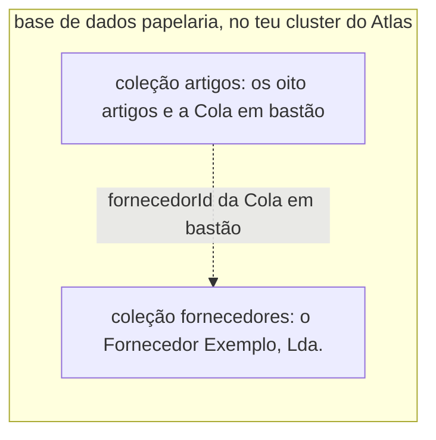

# Laboratório: modelo documental e primeiras consultas no Atlas

## O que vais construir

Vais criar no MongoDB Atlas a base de dados de uma papelaria, com nove artigos na coleção `artigos` e um fornecedor na coleção `fornecedores`. Um dos artigos aponta para esse fornecedor. Pelo caminho, fazes sete consultas aos artigos e respondes, com a tabela dos artigos, a uma pergunta que a barra de consulta não faz. No fim, procuras os artigos de um fornecedor.



1. [Fase 1: No Atlas, cada aluno tem o seu cluster](#fase-1-no-atlas-cada-aluno-tem-o-seu-cluster)
2. [Fase 2: O MongoDB guarda a informação em documentos](#fase-2-o-mongodb-guarda-a-informação-em-documentos)
3. [Fase 3: Um filtro escolhe os documentos](#fase-3-um-filtro-escolhe-os-documentos)
4. [Fase 4: A projeção escolhe os campos](#fase-4-a-projeção-escolhe-os-campos)
5. [Fase 5: Ordenar e depois limitar](#fase-5-ordenar-e-depois-limitar)
6. [Fase 6: A pergunta que a barra de consulta não faz](#fase-6-a-pergunta-que-a-barra-de-consulta-não-faz)
7. [Fase 7: A informação relacionada embute-se ou referencia-se](#fase-7-a-informação-relacionada-embute-se-ou-referencia-se)

## O que precisas

- Um browser e internet, para usares o Atlas. Confirma que chegas a ele: abre `https://www.mongodb.com/cloud/atlas/register`, e deve aparecer a página de registo do Atlas.
- O teu email, para confirmares a conta do Atlas.

Se já fizeste parte deste laboratório numa aula anterior, retoma na fase em que paraste. A paragem de cada fase diz o que tem de estar a funcionar.

## Fase 1: No Atlas, cada aluno tem o seu cluster

Crias a tua conta no Atlas e, nela, o teu cluster, onde vão viver as tuas bases de dados. Depois proteges a entrada com um utilizador da base de dados e com a lista dos endereços de onde é permitido ligar. Rever: [No Atlas, cada aluno tem o seu cluster](../02-modelo-documental-e-consultas-no-atlas.md#no-atlas-cada-aluno-tem-o-seu-cluster).

1. Cria a conta, porque é nela que vão ficar o teu projeto e o teu cluster. Abre `https://www.mongodb.com/cloud/atlas/register`, cria a conta e confirma o endereço de email na mensagem que vais receber. Se o Atlas fizer perguntas de boas-vindas sobre o que vais construir, responde como quiseres, porque não mudam nada do que se segue.

   O que deves ver: a página inicial do Atlas, já com a tua conta. Se o email de confirmação não chegar, vê [Se alguma coisa falhar](#o-email-de-confirmação-da-conta-não-chega).

2. Se o Atlas te pedir para criar uma organização e um projeto, dá-lhes um nome que te identifique, por exemplo o teu primeiro nome seguido de `lp12`. Se o Atlas já os tiver criado por ti, usa esses.

3. Cria o cluster gratuito, onde vão viver as tuas bases de dados:

   1. No menu lateral, abre a visão geral do projeto, "Project Overview".
   2. Carrega em "Create" (criar), para criar um cluster.
   3. Escolhe o plano gratuito, identificado como "M0" ou "Free".
   4. Escolhe o fornecedor de nuvem, a empresa dona dos servidores (qualquer um serve), e uma região na Europa, para os servidores ficarem perto.
   5. Escreve o nome do cluster no campo "Name", só com letras, algarismos e hífenes, por exemplo `cluster-lp12`. O nome não se pode mudar depois.
   6. Carrega em "Create".

   O que deves ver: o assistente de segurança do Atlas, o "Security Quickstart", com os dois passos que fazes a seguir. O cluster fica pronto em poucos segundos.

4. Cria o utilizador da base de dados, o primeiro passo do assistente. É o nome e a palavra-passe com que um programa entra na base de dados, e não é a tua conta do Atlas. Neste laboratório chegas aos dados pela página do Atlas, sem ele, mas um programa que se ligue ao teu cluster vai precisar dele. Escreve um nome de utilizador em "Username". Em "Password", aceita a palavra-passe que o Atlas sugere ou escreve uma longa, só com letras e algarismos. Sinais como `@`, `:` ou `/` dão problemas quando um programa a usa. Depois carrega em "Create Database User" (criar utilizador da base de dados).

   Guarda a palavra-passe num sítio seguro, que só tu vês, como um gestor de palavras-passe, o programa que as guarda por ti. Nunca a escrevas no código, no caderno, num ficheiro partilhado ou publicado na internet, nem numa mensagem. Se a perderes, crias outra quando precisares dela, como em [A palavra-passe da base de dados ficou no sítio errado](#a-palavra-passe-da-base-de-dados-ficou-no-sítio-errado).

5. Diz ao Atlas de onde é permitido ligar, o segundo passo do assistente. Por omissão, o Atlas recusa ligações de qualquer lado. Carrega em "Add My Current IP Address" (acrescentar o meu endereço IP atual), para autorizar o endereço de onde estás agora, o da rede da escola. O endereço IP é o número que identifica, na internet, a rede de onde te ligas. Depois carrega em "Finish and Close" (acabar e fechar) e em "Go to Overview" (ir para a visão geral).

   O que deves ver: o teu cluster na visão geral do projeto. A lista dos endereços autorizados fica na página "Database & Network Access", que abres na secção "Security" do menu lateral, em "IP Access List". Só os programas que se ligam ao cluster precisam dela: a página do Atlas, que usas neste laboratório, abre-se de qualquer rede, também em casa.

   Não autorizes o acesso de qualquer endereço (`0.0.0.0/0`), que deixa qualquer computador da internet tentar entrar.

6. Dá acesso ao professor, para ele poder ver os teus documentos e acompanhar o teu trabalho:

   1. No menu lateral, na secção "Security", abre "Project Identity & Access" (identidade e acesso ao projeto).
   2. No separador "Users" (utilizadores), carrega em "Invite to Project" (convidar para o projeto).
   3. Escreve o email que o professor indicar na aula e carrega em Enter.
   4. No menu dos papéis, escolhe "Project Data Access Read Only". Com o papel que o Atlas escolhe por omissão, o "Project Read Only", o professor via o projeto, mas não os teus documentos.
   5. Carrega em "Grant Access" (dar acesso).

   O que deves ver: o convite no separador "Users", como "Pending User", até o professor o aceitar.

### Paragem 1

Tens uma conta, um projeto e um cluster gratuito, com um utilizador da base de dados e a palavra-passe guardada num sítio seguro. O endereço da escola está autorizado, e o convite ao professor está enviado.

Pensa antes de continuares: porque é que o Atlas pede duas proteções, o utilizador com palavra-passe e a lista de endereços, se uma já devia chegar? A resposta: cada uma trava um perigo diferente. A palavra-passe trava quem não a sabe. A lista de endereços trava quem a sabe mas está noutro sítio, por exemplo alguém que a viu num ficheiro publicado por engano. Para entrar na tua base de dados, é preciso ter as duas coisas. Autorizar `0.0.0.0/0` é como deixar o portão da escola aberto e confiar só na chave da sala.

## Fase 2: O MongoDB guarda a informação em documentos

Crias a base de dados `papelaria`, com a coleção `artigos`, e inseres nela oito documentos, um por artigo. Cada documento escreve-se como um objeto de JavaScript, com campos em vez de propriedades. Rever: [O MongoDB guarda a informação em documentos](../02-modelo-documental-e-consultas-no-atlas.md#o-mongodb-guarda-a-informação-em-documentos) e [Uma coleção junta os documentos do mesmo tipo](../02-modelo-documental-e-consultas-no-atlas.md#uma-coleção-junta-os-documentos-do-mesmo-tipo).

1. Cria a base de dados e a primeira coleção, que o Atlas cria ao mesmo tempo. No menu lateral, na secção "Database", abre o "Data Explorer" (explorador de dados). Passa o rato por cima do nome do teu cluster e carrega no ícone que abre a janela "Create Database" (criar base de dados). Preenche os dois campos com os nomes escritos assim, em minúsculas, sem espaços nem acentos:

   - Database Name: `papelaria`
   - Collection Name: `artigos`

   Carrega em "Create Database". O que deves ver: a base de dados `papelaria` e, dentro dela, a coleção `artigos`, na lista do lado esquerdo.

2. Insere os oito artigos. Na lista do lado esquerdo, abre a coleção `artigos`, carrega em "Add Data" (acrescentar dados) e escolhe "Insert Document" (inserir documento). A janela abre num modo que aceita a escrita do JavaScript: os nomes dos campos sem aspas e vários documentos de uma vez, dentro de um array. Apaga o que lá estiver e copia este array:

   ```js
   [
     { nome: "Caderno A4 quadriculado", categoria: "Papel", stock: 12, stockMinimo: 5, precoCentimos: 250, localizacao: { corredor: "A", prateleira: 1 } },
     { nome: "Esferográfica azul", categoria: "Escrita", stock: 3, stockMinimo: 10, precoCentimos: 60, localizacao: { corredor: "B", prateleira: 1 } },
     { nome: "Bloco de notas A5", categoria: "Papel", stock: 0, stockMinimo: 4, precoCentimos: 180, localizacao: { corredor: "A", prateleira: 2 } },
     { nome: "Lápis HB", categoria: "Escrita", stock: 25, stockMinimo: 10, precoCentimos: 35, localizacao: { corredor: "B", prateleira: 1 } },
     { nome: "Resma de papel A4", categoria: "Papel", stock: 4, stockMinimo: 3, precoCentimos: 520, localizacao: { corredor: "A", prateleira: 3 } },
     { nome: "Marcador fluorescente", categoria: "Escrita", stock: 8, stockMinimo: 10, precoCentimos: 95, localizacao: { corredor: "B", prateleira: 2 } },
     { nome: "Régua de 30 cm", categoria: "Desenho", stock: 6, stockMinimo: 3, precoCentimos: 120, localizacao: { corredor: "C", prateleira: 1 } },
     { nome: "Compasso escolar", categoria: "Desenho", stock: 1, stockMinimo: 2, precoCentimos: 450, localizacao: { corredor: "C", prateleira: 1 } }
   ]
   ```

   O array tem oito documentos, um por artigo, todos com os mesmos seis campos. O preço está em cêntimos, e `250` quer dizer 2,50 €. O `stockMinimo` é o número de unidades abaixo do qual a papelaria tem de encomendar mais. A `localizacao` é um documento dentro do artigo, com o corredor e a prateleira. Nenhum documento tem `_id`.

   Antes de carregares em "Insert" (inserir), prevê: que campos vai ter cada artigo depois de inserido? Depois carrega em "Insert", uma só vez.

   O que deves ver: os oito artigos na lista da coleção. Se a janela não inserir nada, confirma que copiaste o array todo, do `[` ao `]`.

3. Confirma o que o MongoDB fez: olha para um dos documentos da lista. O que deves ver: os seis campos que escreveste e mais um, o `_id`, com um valor como `ObjectId('...')`, com 24 carateres entre as aspas. Isto quer dizer que o MongoDB deu a cada documento um identificador do tipo ObjectId, porque cada documento de uma coleção tem de ter um `_id` diferente. Rever: [O campo `_id` e o ObjectId](../02-modelo-documental-e-consultas-no-atlas.md#o-campo-_id-e-o-objectid).

   Confirma também que a lista tem exatamente oito documentos, porque as consultas seguintes contam com oito. Se tiver dezasseis, vê [Se alguma coisa falhar](#a-coleção-tem-dezasseis-documentos) antes de continuares.

### Paragem 2

A coleção `artigos` da base `papelaria` tem oito documentos, e cada um tem um `_id` do tipo ObjectId, que não escreveste.

Pensa antes de continuares: dois artigos com o mesmo nome podiam viver na mesma coleção? A resposta: sim. O que distingue dois documentos é o `_id`, e não o nome. Cada documento tem um `_id` diferente, mesmo que todos os outros campos sejam iguais. É por isso que carregar duas vezes em "Insert" dá dezasseis documentos, e não oito.

## Fase 3: Um filtro escolhe os documentos

Fazes as consultas 1 a 5, cada uma com um filtro, o documento que diz que artigos queres. A base de dados devolve só os documentos que cumprem o filtro, como o `filter` de um array. Rever: [Um filtro escolhe os documentos](../02-modelo-documental-e-consultas-no-atlas.md#um-filtro-escolhe-os-documentos).

1. Encontra a barra de consulta. Com a coleção `artigos` aberta no Data Explorer, a barra fica por cima da lista dos documentos. Escreves o filtro no campo "Filter" (filtro) e carregas em "Find" (procurar) para executar. "Reset" (repor) limpa a consulta e volta a mostrar todos os documentos.

   Antes de executares cada consulta, prevês de cabeça que artigos ela devolve, e só depois comparas com o que o passo diz. Para preveres, usa esta tabela dos oito artigos:

   | Artigo | Categoria | Stock | Stock mínimo | Preço (cêntimos) | Corredor |
   | --- | --- | ---: | ---: | ---: | --- |
   | Caderno A4 quadriculado | Papel | 12 | 5 | 250 | A |
   | Esferográfica azul | Escrita | 3 | 10 | 60 | B |
   | Bloco de notas A5 | Papel | 0 | 4 | 180 | A |
   | Lápis HB | Escrita | 25 | 10 | 35 | B |
   | Resma de papel A4 | Papel | 4 | 3 | 520 | A |
   | Marcador fluorescente | Escrita | 8 | 10 | 95 | B |
   | Régua de 30 cm | Desenho | 6 | 3 | 120 | C |
   | Compasso escolar | Desenho | 1 | 2 | 450 | C |

   Quando o resultado for diferente do que previste, procura a causa antes de avançares, com [Se alguma coisa falhar](#se-alguma-coisa-falhar).

2. Consulta 1, uma igualdade: os artigos de uma categoria. Escreve este filtro no campo "Filter" e carrega em "Find":

   ```js
   { categoria: "Papel" }
   ```

   O que deves ver: três documentos, o Caderno A4 quadriculado, o Bloco de notas A5 e a Resma de papel A4. O filtro pede os documentos cujo campo `categoria` é igual a `Papel`, escrito exatamente assim.

3. Provoca um engano de propósito: escreve `papel` com minúscula, e executa outra vez.

   ```js
   { categoria: "papel" }
   ```

   O que deves ver: nenhum documento, e nenhuma mensagem de erro. O texto `papel`, com minúscula, é outro texto, e nenhum artigo o tem. Não encontrar nada não é um erro: é uma resposta vazia. Quando uma consulta voltar vazia, vê [Se alguma coisa falhar](#uma-consulta-não-devolve-nada-e-não-dá-erro).

4. Consulta 2, um operador: os artigos com menos de 5 unidades. "Menor do que" pede um operador, uma palavra começada por `$`, escrita como um documento dentro do filtro. O `$lt` vem do inglês *less than*, menor do que. Executa:

   ```js
   { stock: { $lt: 5 } }
   ```

   O que deves ver: quatro documentos, a Esferográfica azul (3), o Bloco de notas A5 (0), a Resma de papel A4 (4) e o Compasso escolar (1). Rever: [Um operador compara um campo com um valor](../02-modelo-documental-e-consultas-no-atlas.md#um-operador-compara-um-campo-com-um-valor).

5. Consulta 3, duas condições: os artigos de escrita com menos de 10 unidades. Quando o filtro tem dois campos, um documento só aparece se cumprir os dois. Executa:

   ```js
   { categoria: "Escrita", stock: { $lt: 10 } }
   ```

   O que deves ver: dois documentos, a Esferográfica azul (3) e o Marcador fluorescente (8). O Lápis HB é de escrita, mas tem 25 unidades, e por isso fica de fora. Se previste sete artigos, leste o filtro como "ou": todos os de escrita e mais todos os que têm menos de 10. Rever: [Todas as condições de um filtro têm de se cumprir](../02-modelo-documental-e-consultas-no-atlas.md#todas-as-condições-de-um-filtro-têm-de-se-cumprir).

6. Consulta 4, um intervalo: os artigos que custam entre 1,00 € e 3,00 €, com as duas fronteiras incluídas. Em cêntimos, são 100 e 300. O `$gte` quer dizer maior ou igual, e o `$lte` menor ou igual, e os dois operadores no mesmo campo têm de se cumprir ao mesmo tempo. Executa:

   ```js
   { precoCentimos: { $gte: 100, $lte: 300 } }
   ```

   O que deves ver: três documentos, o Caderno A4 quadriculado (250), o Bloco de notas A5 (180) e a Régua de 30 cm (120). Ficam de fora o Lápis (35), a Esferográfica (60) e o Marcador (95), abaixo de 100, e a Resma (520) e o Compasso (450), acima de 300. Com `$gt` e `$lt`, sem o igual, o resultado era o mesmo, porque nenhum artigo custa exatamente 100 nem 300 cêntimos. Mas um artigo de 3,00 € exatos ficava de fora, e a pergunta inclui-o.

7. Consulta 5, um campo de um documento embutido: os artigos do corredor C. O corredor está dentro da `localizacao`, o documento embutido de cada artigo. Para lá chegar, juntas o nome dos dois campos com um ponto, e o nome fica entre aspas. Executa:

   ```js
   { "localizacao.corredor": "C" }
   ```

   O que deves ver: dois documentos, a Régua de 30 cm e o Compasso escolar. Rever: [Um campo embutido escreve-se com um ponto](../02-modelo-documental-e-consultas-no-atlas.md#um-campo-embutido-escreve-se-com-um-ponto).

8. Provoca um engano de propósito, para o reconheceres quando te acontecer: tira as aspas e escreve `{ localizacao.corredor: "C" }`. O que deves ver: a barra de consulta não aceita o filtro. O filtro escreve-se como um objeto de JavaScript, e aí um nome com um ponto no meio só é válido entre aspas.

9. Provoca outro engano: tira o nome do documento embutido e escreve `{ corredor: "C" }`. O que deves ver: a lista vazia, sem erro. Os artigos só têm o corredor dentro da `localizacao`, e nenhum tem um campo `corredor` cá fora.

### Paragem 3

As consultas 1 a 5 devolveram, no teu cluster, os artigos que cada passo diz.

Pensa antes de continuares: que filtro dava os artigos do corredor A que custam até 2,00 €? A resposta: `{ "localizacao.corredor": "A", precoCentimos: { $lte: 200 } }`, que devolve só o Bloco de notas A5 (180). O corredor está dentro da `localizacao`, por isso leva o ponto e as aspas, e "até 2,00 €" inclui a fronteira, por isso é `$lte` com 200 cêntimos.

## Fase 4: A projeção escolhe os campos

Fazes a consulta 6, com o filtro da consulta 2 e uma projeção, que diz que campos aparecem em cada documento do resultado. Na projeção, `1` mostra um campo e `0` esconde-o. Rever: [A projeção escolhe os campos](../02-modelo-documental-e-consultas-no-atlas.md#a-projeção-escolhe-os-campos).

1. Mostra os outros campos da barra de consulta: carrega em "Options" (opções). O que deves ver: mais campos, entre eles "Project", para a projeção, "Sort", para a ordenação, e "Limit", para o limite. No Atlas, "Project" quer dizer duas coisas: no menu lateral é o projeto, e aqui é a projeção.

2. Consulta 6: escreve no filtro a condição da consulta 2, `{ stock: { $lt: 5 } }`. No campo "Project", escreve esta projeção, que mostra o nome e o stock e esconde o `_id`, que de outro modo aparecia:

   ```js
   { nome: 1, stock: 1, _id: 0 }
   ```

   Antes de executares, prevê: aparecem os mesmos documentos da consulta 2, ou outros?

   O que deves ver: os mesmos quatro documentos da consulta 2, cada um só com o nome e o stock, como `{ nome: "Esferográfica azul", stock: 3 }`. A projeção mudou o que se vê de cada documento, e não que documentos aparecem, que é o trabalho do filtro.

3. Provoca um erro de propósito: muda a projeção para `{ nome: 1, stock: 0 }` e executa.

   O que deves ver: uma mensagem de erro, como `Cannot do exclusion on field stock in inclusion projection`. Quer dizer "não se pode esconder o campo stock numa projeção de campos a mostrar". Numa projeção, os campos levam todos `1` ou todos `0`, e só o `_id: 0` pode ir com os `1`. Volta a pôr `{ nome: 1, stock: 1, _id: 0 }`.

### Paragem 4

A consulta 6 mostra os quatro artigos com menos de 5 unidades, cada um só com o nome e o stock.

Pensa antes de continuares: se quisesses ver todos os campos menos a localização, que projeção escrevias? A resposta: `{ localizacao: 0 }`. Com `0`, a projeção diz "mostra tudo menos estes", e todos os outros campos aparecem, incluindo o `_id`.

## Fase 5: Ordenar e depois limitar

Fazes a consulta 7, que põe os artigos por ordem de preço e fica só com os três mais caros. A ordenação diz por que ordem aparecem os documentos, e o limite diz quantos aparecem, no máximo. Rever: [Ordenar e depois limitar](../02-modelo-documental-e-consultas-no-atlas.md#ordenar-e-depois-limitar).

1. Consulta 7: limpa a consulta com "Reset" e deixa o filtro em branco, que é o mesmo que `{}` e aceita todos os artigos ([o filtro vazio](../02-modelo-documental-e-consultas-no-atlas.md#um-filtro-escolhe-os-documentos)). No campo "Sort", escreve esta ordenação, em que `-1` quer dizer do maior para o menor:

   ```js
   { precoCentimos: -1 }
   ```

   No campo "Limit", escreve `3`. Prevê que artigos aparecem, e por que ordem. Depois executa.

   O que deves ver: a Resma de papel A4 (520), o Compasso escolar (450) e o Caderno A4 quadriculado (250), por esta ordem. A ordenação pôs os oito do mais caro para o mais barato, e o limite ficou com os três primeiros.

2. Provoca um engano de propósito: muda a ordenação para `{ precoCentimos: 1 }` e executa. O que deves ver: o Lápis HB (35), a Esferográfica azul (60) e o Marcador fluorescente (95), os três mais baratos. Com `1`, a ordem é crescente, do mais barato para o mais caro.

3. Apaga a ordenação e deixa só o limite de 3. O que deves ver: três artigos que não foram escolhidos pelo preço, provavelmente os três primeiros que inseriste. Sem ordenação, o MongoDB não garante nenhuma ordem, e o limite fica com três quaisquer.

### Paragem 5

A consulta 7 mostra os três artigos mais caros, do mais caro para o mais barato.

Pensa antes de continuares: com o filtro `{ categoria: "Papel" }`, a ordenação `{ precoCentimos: -1 }` e o limite 2, o que aparece? A resposta: a Resma de papel A4 (520) e o Caderno A4 quadriculado (250). O filtro deixa os três artigos de papel, a ordenação põe-nos do mais caro para o mais barato, e o limite fica com os dois primeiros.

## Fase 6: A pergunta que a barra de consulta não faz

Respondes com a tabela dos artigos à pergunta "que artigos estão abaixo do stock mínimo?", que compara o `stock` de cada artigo com o seu `stockMinimo`. A barra de consulta do Atlas não compara dois campos do mesmo documento. Rever: [A pergunta que a barra de consulta não faz](../02-modelo-documental-e-consultas-no-atlas.md#a-pergunta-que-a-barra-de-consulta-não-faz).

1. Na tabela dos oito artigos, no passo 1 da [fase 3](#fase-3-um-filtro-escolhe-os-documentos), encontra os artigos em que o stock é menor do que o stock mínimo.

   A resposta: quatro artigos estão abaixo do mínimo. Compara, linha a linha, com esta tabela:

   | Artigo | Stock | Stock mínimo | Abaixo do mínimo? |
   | --- | ---: | ---: | --- |
   | Caderno A4 quadriculado | 12 | 5 | Não |
   | Esferográfica azul | 3 | 10 | Sim |
   | Bloco de notas A5 | 0 | 4 | Sim |
   | Lápis HB | 25 | 10 | Não |
   | Resma de papel A4 | 4 | 3 | Não |
   | Marcador fluorescente | 8 | 10 | Sim |
   | Régua de 30 cm | 6 | 3 | Não |
   | Compasso escolar | 1 | 2 | Sim |

2. Compara a tua lista com o resultado da consulta 2, nome a nome. As duas têm quatro artigos. São os mesmos?

   A resposta: não. Em comum têm a Esferográfica, o Bloco e o Compasso. A Resma de papel A4 está na consulta 2, porque tem 4 unidades, menos de 5, mas não está abaixo do mínimo, que é 3. O Marcador fluorescente não está na consulta 2, porque tem 8 unidades, mas está abaixo do mínimo, que é 10.

3. Provoca um engano de propósito: escreve no filtro `{ stock: { $lt: "stockMinimo" } }` e executa.

   O que deves ver: a consulta volta vazia, e não aparece erro nenhum. Este filtro não compara o stock com o stock mínimo de cada artigo. Compara-o com o texto `"stockMinimo"`, e o MongoDB não compara números com texto.

### Paragem 6

Tens a lista dos quatro artigos abaixo do stock mínimo, e sabes porque é que não é a da consulta 2.

Pensa antes de continuares: porque é que o stock mínimo tem de estar guardado em cada artigo? A resposta: "pouco stock" usa um limite fixo, igual para todos os artigos, como os 5 da consulta 2. "Abaixo do mínimo" usa o limite de cada artigo. Com cinco unidades, as esferográficas já precisam de ser encomendadas, porque o mínimo delas é 10, e os compassos não, porque o deles é 2. Sem o mínimo guardado em cada artigo, não havia com que comparar. Rever: [Passo 2: a informação de que cada pergunta precisa](../02-modelo-documental-e-consultas-no-atlas.md#passo-2-a-informação-de-que-cada-pergunta-precisa).

## Fase 7: A informação relacionada embute-se ou referencia-se

Guardas o fornecedor num documento à parte, noutra coleção, e dás a um artigo novo uma referência para ele, um campo com o `_id` do fornecedor. Depois segues a referência e vês que o MongoDB não confirma se ela leva a algum lado. Rever: [A informação relacionada embute-se ou referencia-se](../02-modelo-documental-e-consultas-no-atlas.md#a-informação-relacionada-embute-se-ou-referencia-se).

1. Cria a segunda coleção, `fornecedores`, na base `papelaria`. No Data Explorer, passa o rato sobre o nome da base de dados e carrega no ícone que abre a janela "Create Collection" (criar coleção). Escreve `fornecedores` e carrega em "Create Collection". O que deves ver: as duas coleções, `artigos` e `fornecedores`, dentro da base `papelaria`.

2. Na coleção `fornecedores`, insere este documento, sem `_id`, com "Add Data" e "Insert Document", como na fase 2:

   ```js
   { nome: "Fornecedor Exemplo, Lda.", telefone: "210000000", email: "encomendas@fornecedor.example" }
   ```

   O que deves ver: o fornecedor na lista da coleção, com o `_id` que o MongoDB lhe deu.

3. Copia o valor do `_id` do fornecedor: só os 24 carateres entre as aspas, sem a palavra `ObjectId` e sem os parênteses. É este valor que o artigo vai guardar.

4. Volta à coleção `artigos` e carrega em "Reset", para a lista mostrar todos os documentos. Depois insere mais um artigo, já com a referência ao fornecedor. Substitui `COLA_AQUI_O_ID` pelos 24 carateres que copiaste, mantendo as aspas:

   ```js
   { nome: "Cola em bastão", categoria: "Escrita", stock: 15, stockMinimo: 5, precoCentimos: 140, localizacao: { corredor: "B", prateleira: 3 }, fornecedorId: ObjectId('COLA_AQUI_O_ID') }
   ```

   O valor do `fornecedorId` escreve-se com `ObjectId(...)`, para ficar guardado com o mesmo tipo do `_id` do fornecedor. Só entre aspas, ficava guardado como texto, e nunca seria igual ao `_id` do fornecedor. Rever: [Seguir uma referência pede uma segunda consulta](../02-modelo-documental-e-consultas-no-atlas.md#seguir-uma-referência-pede-uma-segunda-consulta).

   O que deves ver: o documento aceite, e a coleção com nove artigos. Se o Atlas não aceitar o documento, vê [Se alguma coisa falhar](#o-atlas-não-aceita-o-artigo-com-o-fornecedorid).

5. Encontra os artigos deste fornecedor, a partir do `_id` dele. Na coleção `artigos`, executa este filtro, com os mesmos 24 carateres no lugar de `COLA_AQUI_O_ID`:

   ```js
   { fornecedorId: ObjectId('COLA_AQUI_O_ID') }
   ```

   O que deves ver: só a Cola em bastão. Os outros oito artigos não têm o campo `fornecedorId`, e um documento sem o campo não cumpre uma condição sobre ele. Se a lista vier vazia, vê [Se alguma coisa falhar](#a-consulta-pelo-fornecedorid-não-devolve-nada).

6. Vê que o MongoDB não verifica as referências. Antes de inserires, prevê: o MongoDB aceita um artigo com uma referência a um fornecedor que não existe? Carrega em "Reset", para a lista mostrar o que vais inserir, e insere este artigo na coleção `artigos`:

   ```js
   { nome: "Artigo de teste", categoria: "Escrita", stock: 1, stockMinimo: 1, precoCentimos: 100, localizacao: { corredor: "B", prateleira: 3 }, fornecedorId: ObjectId('000000000000000000000000') }
   ```

   O que deves ver: o documento aceite, sem nenhum aviso, embora nenhum fornecedor tenha aquele `_id`. A base de dados guarda a referência, mas não confirma que ela leva a algum lado: numa aplicação, quem o confirma é o código. Rever: [O MongoDB não verifica as referências](../02-modelo-documental-e-consultas-no-atlas.md#o-mongodb-não-verifica-as-referências).

7. Apaga o "Artigo de teste", que não é um artigo da papelaria: passa o rato sobre o documento, carrega no ícone de apagar e confirma. O que deves ver: a coleção `artigos` com nove documentos, os oito do início e a Cola em bastão.

### Paragem 7

A base `papelaria` tem nove artigos e um fornecedor, e a Cola em bastão aponta para o fornecedor pelo `fornecedorId`.

Pensa antes de continuares: porque é que a localização ficou embutida no artigo e o fornecedor ficou numa coleção à parte? A resposta: a localização lê-se sempre com o artigo, é só uma e não cresce, e assim uma leitura dá ao ecrã tudo o que ele mostra. O fornecedor serve muitos artigos, e o contacto dele muda sem que eles mudem: guardado num só documento, altera-se uma vez, e não em cada artigo. O preço de referenciar é a segunda consulta, para mostrar o fornecedor com o artigo. Rever: [Duas perguntas decidem entre embutir e referenciar](../02-modelo-documental-e-consultas-no-atlas.md#duas-perguntas-decidem-entre-embutir-e-referenciar).

## Se alguma coisa falhar

1. Estás na coleção certa? No Data Explorer, a lista do lado esquerdo mostra a base `papelaria` e, dentro dela, as coleções. A consulta corre sobre a coleção que tens aberta.
2. A coleção tem o número certo de documentos? São oito no fim da fase 2 e nove no fim da fase 7. Se tiver mais, inseriste duas vezes: vê [A coleção tem dezasseis documentos](#a-coleção-tem-dezasseis-documentos).
3. Escreveste a consulta no campo certo e carregaste em "Find"? O filtro vai em "Filter", e a projeção, a ordenação e o limite vão nos campos de "Options". A lista mostra só os documentos que cumprem a consulta que está na barra, e "Reset" limpa tudo e volta a mostrar todos.
4. O resultado não é o que previste? Antes de mudares a consulta, abre um documento que devia aparecer e compara, campo a campo, o nome do campo, a escrita do valor e o tipo.
5. Um botão não tem o nome que o passo diz? O Atlas muda o aspeto das páginas de vez em quando. Procura o que tem a mesma função, porque os passos são os mesmos.

### A coleção tem dezasseis documentos

Carregaste duas vezes em "Insert", e cada artigo ficou duas vezes. Apaga as cópias antes de fazeres as consultas, porque os resultados deste laboratório contam com oito artigos. Passa o rato sobre uma das cópias, carrega no ícone de apagar e confirma. Repete até ficar um documento de cada artigo, oito no total, e confere-os com a tabela da [fase 3](#fase-3-um-filtro-escolhe-os-documentos).

### Uma consulta não devolve nada, e não dá erro

Quase sempre é uma destas causas:

- um nome de campo mal escrito, como `categria`;
- uma maiúscula diferente no valor, como `"papel"`;
- um campo embutido sem o caminho, como `{ corredor: "C" }`;
- um número entre aspas no filtro, como `{ stock: { $lt: "5" } }`;
- um operador sem o `$`, como `{ stock: { lt: 5 } }`, que procura um stock que seja o próprio documento `{ lt: 5 }`.

Abre um documento que devia aparecer e compara-o com o filtro: o nome de cada campo, a escrita de cada valor e o seu tipo. Rever: [Uma consulta volta vazia, e não dá erro](../02-modelo-documental-e-consultas-no-atlas.md#uma-consulta-volta-vazia-e-não-dá-erro).

### O email de confirmação da conta não chega

Procura na pasta de spam. Enquanto esperas, acompanha as fases 3 a 6 no ecrã de um colega e faz as tuas previsões. Faz as consultas no teu cluster quando a conta estiver confirmada.

### O professor vê o teu projeto, mas não os teus documentos

O convite foi feito com o papel por omissão, "Project Read Only", que não deixa abrir o Data Explorer. Em "Project Identity & Access", no separador "Users", muda o papel do professor para "Project Data Access Read Only".

### O Atlas não aceita o artigo com o fornecedorId

O valor dentro de `ObjectId('...')` tem de ter exatamente 24 carateres, só com algarismos e as letras de `a` a `f`. O engano mais comum é deixar `COLA_AQUI_O_ID` no lugar do valor. Os outros são colar o valor com a palavra `ObjectId` e os parênteses, e ficar com `ObjectId('ObjectId(...)')`, ou copiar menos de 24 carateres. Compara, caráter a caráter, com o `_id` do fornecedor.

### A consulta pelo fornecedorId não devolve nada

Abre a Cola em bastão: o `fornecedorId` tem de aparecer como `ObjectId('...')`, com os mesmos 24 carateres do `_id` do fornecedor. No filtro, o valor também leva `ObjectId(...)`. Escrito só entre aspas, como em `{ fornecedorId: "66fb..." }`, o filtro procura um texto, e valores de tipos diferentes nunca são iguais.

### A lista de endereços autorizados aceita qualquer endereço

Se na lista aparece `0.0.0.0/0`, qualquer computador na internet pode tentar entrar, e só a palavra-passe o trava. Abre a página "Database & Network Access", na secção "Security" do menu lateral, e vai a "IP Access List". Carrega em "Delete" nessa entrada e outra vez em "Delete", para confirmar. Deixa só os endereços das redes de onde trabalhas, como o da escola.

### A palavra-passe da base de dados ficou no sítio errado

Quem tiver essa palavra-passe e um endereço autorizado entra na tua base de dados. Nunca a escrevas no código, num ficheiro do projeto, no caderno ou numa mensagem. Se isso aconteceu, muda-a. Na página "Database & Network Access", no separador "Database Users", carrega em "Edit" no teu utilizador, escreve uma palavra-passe nova e carrega em "Update User".

## Desafios

Estes desafios usam os nove artigos do fim da fase 7. Em cada um, prevê o resultado antes de executares a consulta.

1. Os artigos de escrita ou de desenho com menos de 10 unidades. Pista: o operador `$in` recebe uma lista de valores, escrita entre parênteses retos, e o documento fica no resultado se o campo for igual a qualquer um deles.
2. Só o nome e o preço dos artigos de papel, do mais barato para o mais caro.
3. A Cola em bastão com o telefone do fornecedor. Escreve as duas consultas que a aplicação faria, uma em cada coleção. Pista: a primeira lê o artigo; a segunda usa o que encontraste nele.

## Antes de terminares

- [ ] A tua base `papelaria` tem nove artigos na coleção `artigos` e um fornecedor na coleção `fornecedores`.
- [ ] O convite ao professor está enviado, com o papel "Project Data Access Read Only".
- [ ] A palavra-passe do utilizador da base de dados está guardada num sítio seguro, fora do código e do caderno.
- [ ] Cada uma das sete consultas devolveu, no teu cluster, os artigos que o passo diz, e sabes que quatro artigos estão abaixo do stock mínimo.
- [ ] Para cada resultado diferente do previsto, encontraste a causa, como um campo mal escrito, uma maiúscula, um operador trocado ou a falta do `$`.
- [ ] Consegues explicar, por palavras tuas, porque é que a localização ficou embutida no artigo e o fornecedor ficou numa coleção à parte.


